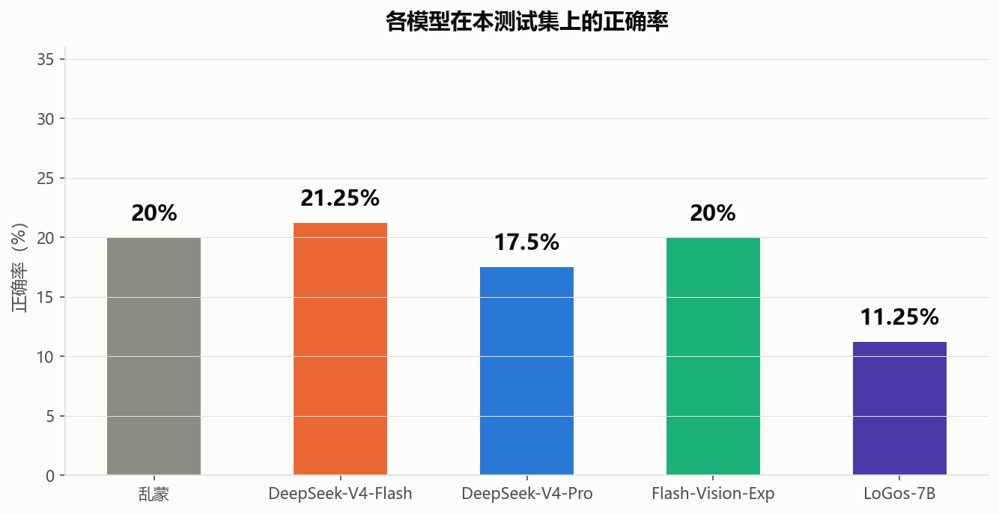
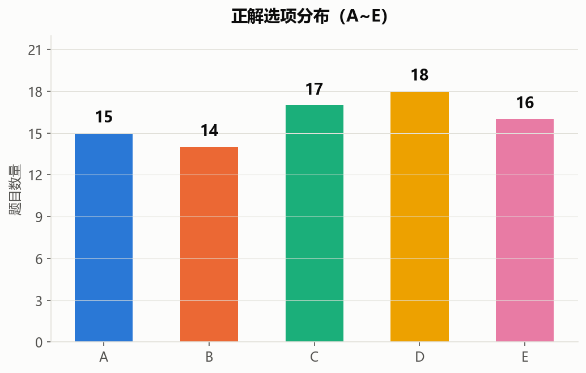
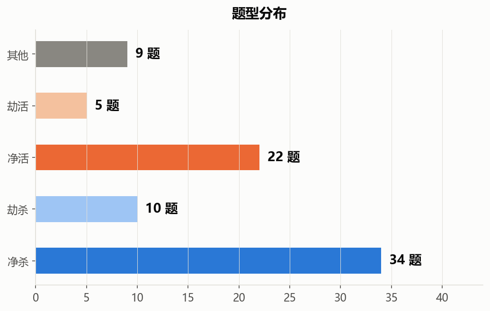
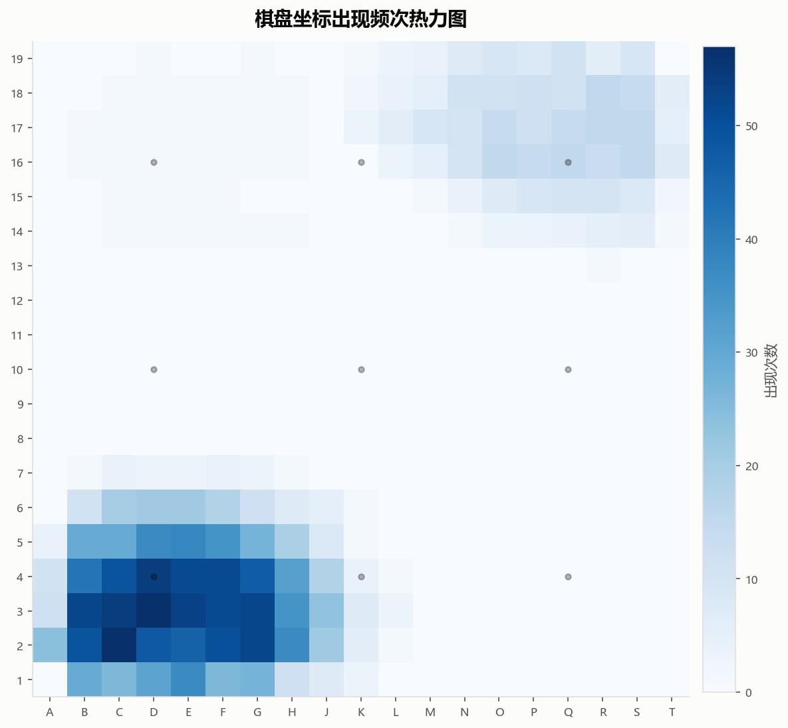
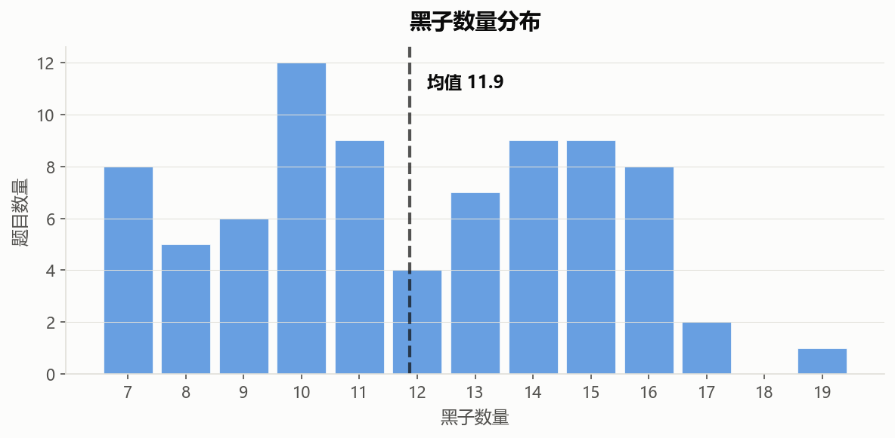
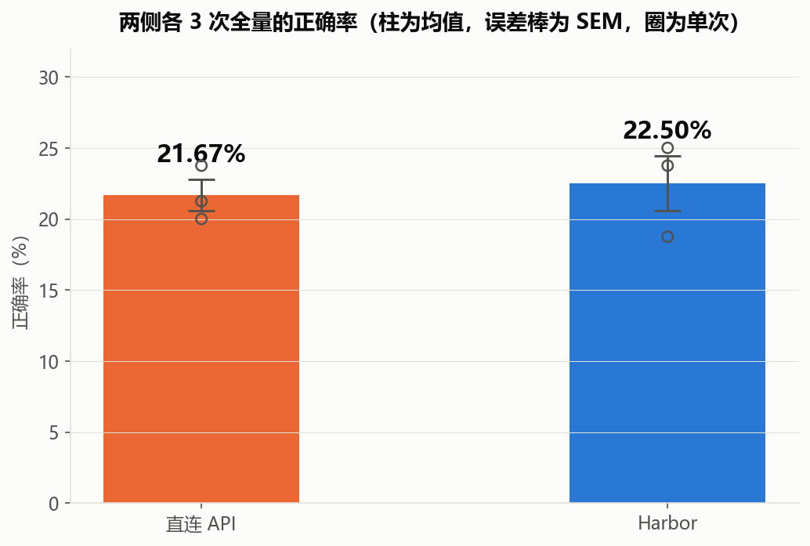
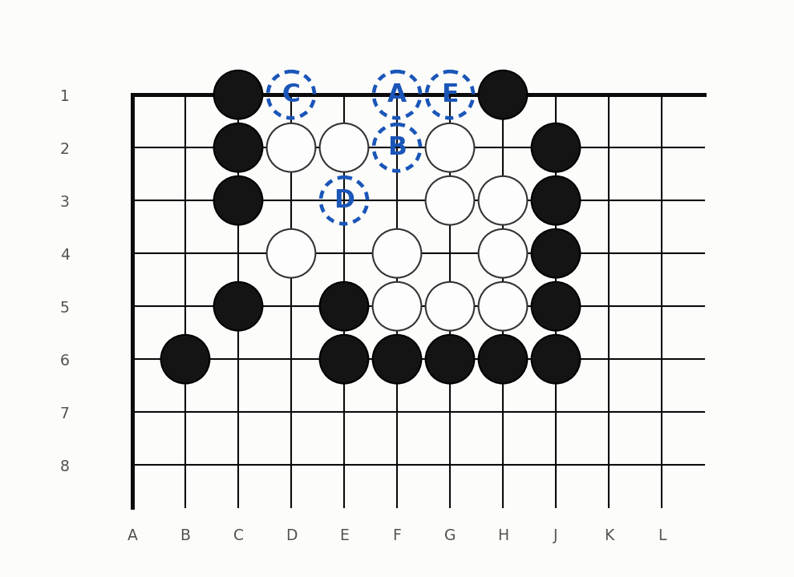
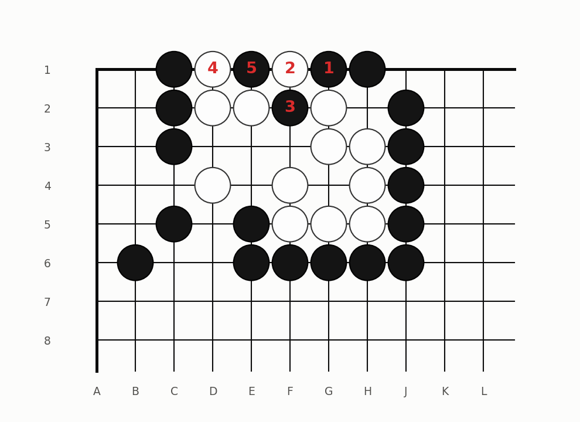

**更新时间：2026-11-05**

本死活题集为前田陈尔（Maeda Nobuaki，1907年—1975年）所著的死活题书《痛快》中的部分，以单选题方式表述，有包含图片和不包含图片的两种版本，方便衡量多模态与纯文本两类大模型的空间推理能力。因为前田陈尔已经去世超过50年，目前已经不存在著作权问题。该集共选入了80道题目，每道题目均包含题目介绍（其中有来源说明、题目要求、棋盘坐标、问题）、黑子坐标、白子坐标（所有坐标均以字母-数字表示）、ABCDE五个选项（其中第五个保证为"以上选项均不对"）、正确答案的序号。原书有误之处已经纠正，且保证每一道题目的正解第一手都不是脱先，保证ABCD中的坐标均为当前局面下的黑方合法落子着法的坐标，保证除了ABCD外黑棋还有其他的合法坐标以确保E选项有意义。部分题目有多解，选项只会用其中的一种。感谢B站up主 @明玥谈棋 在讲解《痛快》中对本测试集选项设置的启发。由于是人工输入，难免会有错误，尚祈批评指正。

## 测试结果（DeepSeek 系列 / LoGos-7B）

2026年9月3日，对本测试集全部 80 题评测了 DeepSeek-V4-Flash、DeepSeek-V4-Pro、DeepSeek-V4-Flash-Vision-Exp 与 LoGos-7B（InternThinker-Go 开源版，本地 vLLM 推理）四个模型。文字题面（单项选择题描述、黑子/白子坐标、问句、A~E 选项、答案格式指令）见下文「Prompt 构造说明」；DeepSeek 三个模型均以思考模式（reasoning_effort=high）作答，回复要求以 `<box>X</box>` 结尾；Vision 版在文字之后附加棋盘图片（不附带任何说明文字），以考察图片输入的作用；LoGos-7B 为纯文本输入（temperature=0，生成长度上限 2048）。



| 模型 | 答对 | 无答案 | 正确率 | 与乱蒙基线（20%）比较 |
| --- | --- | --- | --- | --- |
| 乱蒙基线 | 16 | - | 20% | - |
| DeepSeek-V4-Flash | 17 | 1 | 21.25% | 无显著差异（单侧二项 p=0.434） |
| DeepSeek-V4-Pro | 14 | 0 | 17.5% | 无显著差异（单侧二项 p=0.346） |
| DeepSeek-V4-Flash-Vision-Exp | 16 | 1 | 20.0% | 无显著差异（单侧二项 p=0.545） |
| LoGos-7B（InternThinker-Go 开源版） | 9 | 27 | 11.25% | 显著低于乱蒙（单侧二项 p=0.029） |

注：无答案不计为正确（Flash：id=1；Vision：id=58；LoGos-7B：27 题）。

笑点解析：三个模型在启用思考模式全力推理的情况下，正确率与乱蒙基线（五选一的 20%）均无统计显著差异，Pro 甚至略低于乱蒙；两两配对检验（McNemar）也均不显著（Flash vs Pro p=0.664，Flash vs Vision p=1.000，Pro vs Vision p=0.839）。三个模型各自答对的题目彼此高度不重叠，正确率上的细微高低是采样随机性主导。Vision 模型即使直接输入棋盘图片（含 ▲/● 标记），也没有带来任何提升，其正确率与文本版相当。

而自称"首个具备围棋专业水平、展示透明思维链"的 InternThinker，其开源 7B 版 LoGos-7B 在本测试集上正确率仅 11.25%（9/80），**显著低于乱蒙基线**（P(X≤9)=0.029），且 80 题中 27 题（34%）陷入机械复读、连答案都未给出，证明其宣称的围棋专业水平是虚假的。不知道王星昊是如何做出"能解说思考过程的AI还是第一次见，感觉它分析得非常好；从布局看棋力可能在职业3-5段之间"的评论（[来源](https://www.shlab.org.cn/news/5444083)）。

本测试集的结果表明：当前大模型无法解出这类题目。

### Prompt 构造说明

以第 1 题为例：

```
这是前田陈尔九段的《痛快》一书中的题目，单项选择。黑先做活，要求净活，不允许劫活。十九路棋盘，从左到右A~T（不含I），从上到下1~19。
黑子：B3 D2 D3 E3 F3 G1 G2 G3
白子：B4 C2 C3 D4 E2 E4 F1 F4 G4 H2 H4 J3

以下选项中，能成为正解的黑方第一手的坐标的是？

选项：
  A：F2
  B：D1
  C：C1
  D：E1
  E：以上选项都不对

回复末尾请以 <box>X</box> 结尾，X 为你的选项字母（A~E）。
```

- 题目要求与棋盘坐标方向说明随题而异（杀/活、净/劫、以及方向变体，如"从左到右T\~A、从上到下19\~1"），直接取自数据集中每题的 header，方向表述原样保留。
- Vision 版在文字之后附加该题棋盘图片（`boards/board_XXX.png`，含 ▲/● 标记），不附带任何说明文字。
- 正确判定：提取回复末尾 `<box>` 内的字母与正解比对。

### 测试脚本

- `tests/scripts/test_deepseek_unified.py`：评测脚本（`--model flash|pro|vision`，默认思考模式）。参数：`--ids` 只测指定题号（逗号分隔）；`--batches` 并发数；`--no-think` 关闭思考模式（直接回答）；`--dry-run` 仅打印题面与选项，不发起请求。

### 测试结果文件

各模型 80 题逐题完整记录（每条含 prompt、思考过程、回复、`<box>` 答案、token 用量、耗时，Vision 另含棋盘图文件名）见 `tests/results/` 目录下对应模型的子目录。

## 统计图

### 正解选项分布（A~E）



### 题型分布（净杀 / 劫杀 / 净活 / 劫活 / 其他）



### 棋盘坐标出现频次热力图



### 黑子数量分布



### 白子数量分布


## 各模型答题明细

<table style="border-collapse:collapse">
<thead>
<tr><td style="border:1px solid #d0d7de; padding:3px 8px; text-align:center">题目描述</td><td style="border:1px solid #d0d7de; padding:3px 8px; text-align:center">图片</td><td style="border:1px solid #d0d7de; padding:3px 8px; text-align:center">正解</td><td style="border:1px solid #d0d7de; padding:3px 8px; text-align:center">Flash</td><td style="border:1px solid #d0d7de; padding:3px 8px; text-align:center">Pro</td><td style="border:1px solid #d0d7de; padding:3px 8px; text-align:center">Vision</td><td style="border:1px solid #d0d7de; padding:3px 8px; text-align:center">LoGos-7B</td></tr>
</thead>
<tbody>
<tr><td style="border:1px solid #d0d7de; padding:3px 8px; text-align:left"><b>1</b> 这是前田陈尔九段的《痛快》一书中的题目，黑先做活，要求净活，不允许劫活。十九路棋盘，从左到右A~T（不含I），从上到下1~19。</td><td style="border:1px solid #d0d7de; padding:3px 8px; text-align:center"></td><td style="border:1px solid #d0d7de; padding:3px 8px; text-align:center">C（C1）</td><td style="background-color:#f6f8fa; border:1px solid #d0d7de; padding:3px 8px; text-align:center">空</td><td style="background-color:#ffebe9; border:1px solid #d0d7de; padding:3px 8px; text-align:center">E ✗</td><td style="background-color:#ffebe9; border:1px solid #d0d7de; padding:3px 8px; text-align:center">B ✗</td><td style="background-color:#ffebe9; border:1px solid #d0d7de; padding:3px 8px; text-align:center">A ✗</td></tr>
<tr><td style="border:1px solid #d0d7de; padding:3px 8px; text-align:left"><b>2</b> 黑先杀白，要求净杀，不允许劫杀。十九路棋盘，从左到右T~A（不含I），从上到下19~1。</td><td style="border:1px solid #d0d7de; padding:3px 8px; text-align:center"></td><td style="border:1px solid #d0d7de; padding:3px 8px; text-align:center">E（都不对）</td><td style="background-color:#ffebe9; border:1px solid #d0d7de; padding:3px 8px; text-align:center">D ✗</td><td style="background-color:#ffebe9; border:1px solid #d0d7de; padding:3px 8px; text-align:center">D ✗</td><td style="background-color:#ffebe9; border:1px solid #d0d7de; padding:3px 8px; text-align:center">D ✗</td><td style="background-color:#ffebe9; border:1px solid #d0d7de; padding:3px 8px; text-align:center">A ✗</td></tr>
<tr><td style="border:1px solid #d0d7de; padding:3px 8px; text-align:left"><b>3</b> 黑先杀白，要求净杀，不允许劫杀。十九路棋盘，从左到右T~A（不含I），从上到下19~1。</td><td style="border:1px solid #d0d7de; padding:3px 8px; text-align:center"></td><td style="border:1px solid #d0d7de; padding:3px 8px; text-align:center">E（都不对）</td><td style="background-color:#ffebe9; border:1px solid #d0d7de; padding:3px 8px; text-align:center">D ✗</td><td style="background-color:#ffebe9; border:1px solid #d0d7de; padding:3px 8px; text-align:center">C ✗</td><td style="background-color:#ffebe9; border:1px solid #d0d7de; padding:3px 8px; text-align:center">A ✗</td><td style="background-color:#f6f8fa; border:1px solid #d0d7de; padding:3px 8px; text-align:center">空</td></tr>
<tr><td style="border:1px solid #d0d7de; padding:3px 8px; text-align:left"><b>4</b> 黑先做活，要求净活，不允许劫活。十九路棋盘，从左到右A~T（不含I），从上到下1~19。</td><td style="border:1px solid #d0d7de; padding:3px 8px; text-align:center"></td><td style="border:1px solid #d0d7de; padding:3px 8px; text-align:center">A（D1）</td><td style="background-color:#ffebe9; border:1px solid #d0d7de; padding:3px 8px; text-align:center">E ✗</td><td style="background-color:#e6ffec; border:1px solid #d0d7de; padding:3px 8px; text-align:center">A ✓</td><td style="background-color:#ffebe9; border:1px solid #d0d7de; padding:3px 8px; text-align:center">E ✗</td><td style="background-color:#e6ffec; border:1px solid #d0d7de; padding:3px 8px; text-align:center">A ✓</td></tr>
<tr><td style="border:1px solid #d0d7de; padding:3px 8px; text-align:left"><b>5</b> 黑先做活，要求净活，不允许劫活。十九路棋盘，从左到右T~A（不含I），从上到下19~1。</td><td style="border:1px solid #d0d7de; padding:3px 8px; text-align:center"></td><td style="border:1px solid #d0d7de; padding:3px 8px; text-align:center">C（Q19）</td><td style="background-color:#ffebe9; border:1px solid #d0d7de; padding:3px 8px; text-align:center">B ✗</td><td style="background-color:#ffebe9; border:1px solid #d0d7de; padding:3px 8px; text-align:center">B ✗</td><td style="background-color:#ffebe9; border:1px solid #d0d7de; padding:3px 8px; text-align:center">D ✗</td><td style="background-color:#ffebe9; border:1px solid #d0d7de; padding:3px 8px; text-align:center">A ✗</td></tr>
<tr><td style="border:1px solid #d0d7de; padding:3px 8px; text-align:left"><b>6</b> 黑先做活，要求净活，不允许劫活。十九路棋盘，从左到右A~T（不含I），从上到下1~19。</td><td style="border:1px solid #d0d7de; padding:3px 8px; text-align:center"></td><td style="border:1px solid #d0d7de; padding:3px 8px; text-align:center">D（E1）</td><td style="background-color:#e6ffec; border:1px solid #d0d7de; padding:3px 8px; text-align:center">D ✓</td><td style="background-color:#ffebe9; border:1px solid #d0d7de; padding:3px 8px; text-align:center">B ✗</td><td style="background-color:#ffebe9; border:1px solid #d0d7de; padding:3px 8px; text-align:center">B ✗</td><td style="background-color:#f6f8fa; border:1px solid #d0d7de; padding:3px 8px; text-align:center">空</td></tr>
<tr><td style="border:1px solid #d0d7de; padding:3px 8px; text-align:left"><b>7</b> 黑先做活，要求净活，不允许劫活。十九路棋盘，从左到右A~T（不含I），从上到下1~19。</td><td style="border:1px solid #d0d7de; padding:3px 8px; text-align:center"></td><td style="border:1px solid #d0d7de; padding:3px 8px; text-align:center">D（E1）</td><td style="background-color:#ffebe9; border:1px solid #d0d7de; padding:3px 8px; text-align:center">A ✗</td><td style="background-color:#ffebe9; border:1px solid #d0d7de; padding:3px 8px; text-align:center">B ✗</td><td style="background-color:#ffebe9; border:1px solid #d0d7de; padding:3px 8px; text-align:center">B ✗</td><td style="background-color:#ffebe9; border:1px solid #d0d7de; padding:3px 8px; text-align:center">A ✗</td></tr>
<tr><td style="border:1px solid #d0d7de; padding:3px 8px; text-align:left"><b>8</b> 黑先杀白，要求净杀，不允许劫杀。十九路棋盘，从左到右T~A（不含I），从上到下19~1。</td><td style="border:1px solid #d0d7de; padding:3px 8px; text-align:center"></td><td style="border:1px solid #d0d7de; padding:3px 8px; text-align:center">C（Q19）</td><td style="background-color:#ffebe9; border:1px solid #d0d7de; padding:3px 8px; text-align:center">D ✗</td><td style="background-color:#ffebe9; border:1px solid #d0d7de; padding:3px 8px; text-align:center">A ✗</td><td style="background-color:#ffebe9; border:1px solid #d0d7de; padding:3px 8px; text-align:center">D ✗</td><td style="background-color:#ffebe9; border:1px solid #d0d7de; padding:3px 8px; text-align:center">A ✗</td></tr>
<tr><td style="border:1px solid #d0d7de; padding:3px 8px; text-align:left"><b>9</b> 黑先，要求救回▲黑子。从左到右A~T（不含I），从上到下1~19。</td><td style="border:1px solid #d0d7de; padding:3px 8px; text-align:center"></td><td style="border:1px solid #d0d7de; padding:3px 8px; text-align:center">C（D1）</td><td style="background-color:#ffebe9; border:1px solid #d0d7de; padding:3px 8px; text-align:center">A ✗</td><td style="background-color:#ffebe9; border:1px solid #d0d7de; padding:3px 8px; text-align:center">B ✗</td><td style="background-color:#ffebe9; border:1px solid #d0d7de; padding:3px 8px; text-align:center">B ✗</td><td style="background-color:#f6f8fa; border:1px solid #d0d7de; padding:3px 8px; text-align:center">空</td></tr>
<tr><td style="border:1px solid #d0d7de; padding:3px 8px; text-align:left"><b>10</b> 黑先杀白，要求净杀，不允许劫杀。十九路棋盘，从左到右A~T（不含I），从上到下1~19。</td><td style="border:1px solid #d0d7de; padding:3px 8px; text-align:center"></td><td style="border:1px solid #d0d7de; padding:3px 8px; text-align:center">D（E3）</td><td style="background-color:#e6ffec; border:1px solid #d0d7de; padding:3px 8px; text-align:center">D ✓</td><td style="background-color:#ffebe9; border:1px solid #d0d7de; padding:3px 8px; text-align:center">C ✗</td><td style="background-color:#ffebe9; border:1px solid #d0d7de; padding:3px 8px; text-align:center">C ✗</td><td style="background-color:#f6f8fa; border:1px solid #d0d7de; padding:3px 8px; text-align:center">空</td></tr>
<tr><td style="border:1px solid #d0d7de; padding:3px 8px; text-align:left"><b>11</b> 黑先杀白，劫杀即可。十九路棋盘，从左到右A~T（不含I），从上到下1~19。</td><td style="border:1px solid #d0d7de; padding:3px 8px; text-align:center"></td><td style="border:1px solid #d0d7de; padding:3px 8px; text-align:center">D（E1）</td><td style="background-color:#ffebe9; border:1px solid #d0d7de; padding:3px 8px; text-align:center">A ✗</td><td style="background-color:#ffebe9; border:1px solid #d0d7de; padding:3px 8px; text-align:center">C ✗</td><td style="background-color:#e6ffec; border:1px solid #d0d7de; padding:3px 8px; text-align:center">D ✓</td><td style="background-color:#ffebe9; border:1px solid #d0d7de; padding:3px 8px; text-align:center">A ✗</td></tr>
<tr><td style="border:1px solid #d0d7de; padding:3px 8px; text-align:left"><b>12</b> 黑先，要求杀白▲子。十九路棋盘，从左到右A~T（不含I），从上到下1~19。</td><td style="border:1px solid #d0d7de; padding:3px 8px; text-align:center"></td><td style="border:1px solid #d0d7de; padding:3px 8px; text-align:center">E（都不对）</td><td style="background-color:#ffebe9; border:1px solid #d0d7de; padding:3px 8px; text-align:center">C ✗</td><td style="background-color:#ffebe9; border:1px solid #d0d7de; padding:3px 8px; text-align:center">D ✗</td><td style="background-color:#ffebe9; border:1px solid #d0d7de; padding:3px 8px; text-align:center">C ✗</td><td style="background-color:#ffebe9; border:1px solid #d0d7de; padding:3px 8px; text-align:center">A ✗</td></tr>
<tr><td style="border:1px solid #d0d7de; padding:3px 8px; text-align:left"><b>13</b> 黑先杀白，要求净杀，不允许劫杀。十九路棋盘，从左到右A~T（不含I），从上到下1~19。</td><td style="border:1px solid #d0d7de; padding:3px 8px; text-align:center"></td><td style="border:1px solid #d0d7de; padding:3px 8px; text-align:center">A（D2）</td><td style="background-color:#e6ffec; border:1px solid #d0d7de; padding:3px 8px; text-align:center">A ✓</td><td style="background-color:#ffebe9; border:1px solid #d0d7de; padding:3px 8px; text-align:center">E ✗</td><td style="background-color:#e6ffec; border:1px solid #d0d7de; padding:3px 8px; text-align:center">A ✓</td><td style="background-color:#e6ffec; border:1px solid #d0d7de; padding:3px 8px; text-align:center">A ✓</td></tr>
<tr><td style="border:1px solid #d0d7de; padding:3px 8px; text-align:left"><b>14</b> 黑先杀白，要求净杀，不允许劫杀。十九路棋盘，从左到右A~T（不含I），从上到下1~19。</td><td style="border:1px solid #d0d7de; padding:3px 8px; text-align:center"></td><td style="border:1px solid #d0d7de; padding:3px 8px; text-align:center">C（G2）</td><td style="background-color:#e6ffec; border:1px solid #d0d7de; padding:3px 8px; text-align:center">C ✓</td><td style="background-color:#ffebe9; border:1px solid #d0d7de; padding:3px 8px; text-align:center">D ✗</td><td style="background-color:#e6ffec; border:1px solid #d0d7de; padding:3px 8px; text-align:center">C ✓</td><td style="background-color:#ffebe9; border:1px solid #d0d7de; padding:3px 8px; text-align:center">A ✗</td></tr>
<tr><td style="border:1px solid #d0d7de; padding:3px 8px; text-align:left"><b>15</b> 黑先杀白，要求净杀，不允许劫杀。十九路棋盘，从左到右A~T（不含I），从上到下1~19。</td><td style="border:1px solid #d0d7de; padding:3px 8px; text-align:center"></td><td style="border:1px solid #d0d7de; padding:3px 8px; text-align:center">E（都不对）</td><td style="background-color:#ffebe9; border:1px solid #d0d7de; padding:3px 8px; text-align:center">B ✗</td><td style="background-color:#ffebe9; border:1px solid #d0d7de; padding:3px 8px; text-align:center">C ✗</td><td style="background-color:#ffebe9; border:1px solid #d0d7de; padding:3px 8px; text-align:center">A ✗</td><td style="background-color:#ffebe9; border:1px solid #d0d7de; padding:3px 8px; text-align:center">A ✗</td></tr>
<tr><td style="border:1px solid #d0d7de; padding:3px 8px; text-align:left"><b>16</b> 黑先做活，要求净活，不允许劫活。十九路棋盘，从左到右A~T（不含I），从上到下1~19。</td><td style="border:1px solid #d0d7de; padding:3px 8px; text-align:center"></td><td style="border:1px solid #d0d7de; padding:3px 8px; text-align:center">A（C2）</td><td style="background-color:#ffebe9; border:1px solid #d0d7de; padding:3px 8px; text-align:center">D ✗</td><td style="background-color:#ffebe9; border:1px solid #d0d7de; padding:3px 8px; text-align:center">D ✗</td><td style="background-color:#e6ffec; border:1px solid #d0d7de; padding:3px 8px; text-align:center">A ✓</td><td style="background-color:#f6f8fa; border:1px solid #d0d7de; padding:3px 8px; text-align:center">空</td></tr>
<tr><td style="border:1px solid #d0d7de; padding:3px 8px; text-align:left"><b>17</b> 黑先，要求救回▲黑子。十九路棋盘，从左到右A~T（不含I），从上到下1~19。</td><td style="border:1px solid #d0d7de; padding:3px 8px; text-align:center"></td><td style="border:1px solid #d0d7de; padding:3px 8px; text-align:center">E（都不对）</td><td style="background-color:#ffebe9; border:1px solid #d0d7de; padding:3px 8px; text-align:center">B ✗</td><td style="background-color:#ffebe9; border:1px solid #d0d7de; padding:3px 8px; text-align:center">A ✗</td><td style="background-color:#e6ffec; border:1px solid #d0d7de; padding:3px 8px; text-align:center">E ✓</td><td style="background-color:#ffebe9; border:1px solid #d0d7de; padding:3px 8px; text-align:center">A ✗</td></tr>
<tr><td style="border:1px solid #d0d7de; padding:3px 8px; text-align:left"><b>18</b> 黑先，要求救回▲黑子，以此吃住●白子，要求净吃，不能成劫。十九路棋盘，从左到右T~A（不含I），从上到下19~1。</td><td style="border:1px solid #d0d7de; padding:3px 8px; text-align:center"></td><td style="border:1px solid #d0d7de; padding:3px 8px; text-align:center">B（P18）</td><td style="background-color:#ffebe9; border:1px solid #d0d7de; padding:3px 8px; text-align:center">D ✗</td><td style="background-color:#e6ffec; border:1px solid #d0d7de; padding:3px 8px; text-align:center">B ✓</td><td style="background-color:#e6ffec; border:1px solid #d0d7de; padding:3px 8px; text-align:center">B ✓</td><td style="background-color:#ffebe9; border:1px solid #d0d7de; padding:3px 8px; text-align:center">A ✗</td></tr>
<tr><td style="border:1px solid #d0d7de; padding:3px 8px; text-align:left"><b>19</b> 黑先杀白，劫杀即可。十九路棋盘，从左到右A~T（不含I），从上到下19~1。</td><td style="border:1px solid #d0d7de; padding:3px 8px; text-align:center"></td><td style="border:1px solid #d0d7de; padding:3px 8px; text-align:center">C（D17）</td><td style="background-color:#e6ffec; border:1px solid #d0d7de; padding:3px 8px; text-align:center">C ✓</td><td style="background-color:#ffebe9; border:1px solid #d0d7de; padding:3px 8px; text-align:center">E ✗</td><td style="background-color:#e6ffec; border:1px solid #d0d7de; padding:3px 8px; text-align:center">C ✓</td><td style="background-color:#ffebe9; border:1px solid #d0d7de; padding:3px 8px; text-align:center">A ✗</td></tr>
<tr><td style="border:1px solid #d0d7de; padding:3px 8px; text-align:left"><b>20</b> 黑棋在白棋空中有两颗▲残子还可以出棋，如何利用它们来获取最大利益？十九路棋盘，从左到右T~A（不含I），从上到下19~1。</td><td style="border:1px solid #d0d7de; padding:3px 8px; text-align:center"></td><td style="border:1px solid #d0d7de; padding:3px 8px; text-align:center">B（R19）</td><td style="background-color:#ffebe9; border:1px solid #d0d7de; padding:3px 8px; text-align:center">D ✗</td><td style="background-color:#ffebe9; border:1px solid #d0d7de; padding:3px 8px; text-align:center">E ✗</td><td style="background-color:#ffebe9; border:1px solid #d0d7de; padding:3px 8px; text-align:center">D ✗</td><td style="background-color:#ffebe9; border:1px solid #d0d7de; padding:3px 8px; text-align:center">A ✗</td></tr>
<tr><td style="border:1px solid #d0d7de; padding:3px 8px; text-align:left"><b>21</b> 黑先做活，要求净活，不允许劫活。十九路棋盘，从左到右A~T（不含I），从上到下1~19。</td><td style="border:1px solid #d0d7de; padding:3px 8px; text-align:center"></td><td style="border:1px solid #d0d7de; padding:3px 8px; text-align:center">D（D2）</td><td style="background-color:#e6ffec; border:1px solid #d0d7de; padding:3px 8px; text-align:center">D ✓</td><td style="background-color:#ffebe9; border:1px solid #d0d7de; padding:3px 8px; text-align:center">A ✗</td><td style="background-color:#ffebe9; border:1px solid #d0d7de; padding:3px 8px; text-align:center">E ✗</td><td style="background-color:#ffebe9; border:1px solid #d0d7de; padding:3px 8px; text-align:center">A ✗</td></tr>
<tr><td style="border:1px solid #d0d7de; padding:3px 8px; text-align:left"><b>22</b> 黑先做活，要求净活，不允许劫活。十九路棋盘，从左到右A~T（不含I），从上到下1~19。</td><td style="border:1px solid #d0d7de; padding:3px 8px; text-align:center"></td><td style="border:1px solid #d0d7de; padding:3px 8px; text-align:center">B（D1）</td><td style="background-color:#e6ffec; border:1px solid #d0d7de; padding:3px 8px; text-align:center">B ✓</td><td style="background-color:#e6ffec; border:1px solid #d0d7de; padding:3px 8px; text-align:center">B ✓</td><td style="background-color:#ffebe9; border:1px solid #d0d7de; padding:3px 8px; text-align:center">D ✗</td><td style="background-color:#ffebe9; border:1px solid #d0d7de; padding:3px 8px; text-align:center">D ✗</td></tr>
<tr><td style="border:1px solid #d0d7de; padding:3px 8px; text-align:left"><b>23</b> 黑先杀白，要求净杀，不允许劫杀。十九路棋盘，从左到右A~T（不含I），从上到下1~19。</td><td style="border:1px solid #d0d7de; padding:3px 8px; text-align:center"></td><td style="border:1px solid #d0d7de; padding:3px 8px; text-align:center">A（E2）</td><td style="background-color:#ffebe9; border:1px solid #d0d7de; padding:3px 8px; text-align:center">C ✗</td><td style="background-color:#ffebe9; border:1px solid #d0d7de; padding:3px 8px; text-align:center">E ✗</td><td style="background-color:#ffebe9; border:1px solid #d0d7de; padding:3px 8px; text-align:center">E ✗</td><td style="background-color:#f6f8fa; border:1px solid #d0d7de; padding:3px 8px; text-align:center">空</td></tr>
<tr><td style="border:1px solid #d0d7de; padding:3px 8px; text-align:left"><b>24</b> 黑先杀白，要求杀掉▲白子，要求净杀，不允许劫杀。十九路棋盘，从左到右A~T（不含I），从上到下1~19。</td><td style="border:1px solid #d0d7de; padding:3px 8px; text-align:center"></td><td style="border:1px solid #d0d7de; padding:3px 8px; text-align:center">A（F1）</td><td style="background-color:#ffebe9; border:1px solid #d0d7de; padding:3px 8px; text-align:center">C ✗</td><td style="background-color:#ffebe9; border:1px solid #d0d7de; padding:3px 8px; text-align:center">D ✗</td><td style="background-color:#ffebe9; border:1px solid #d0d7de; padding:3px 8px; text-align:center">B ✗</td><td style="background-color:#e6ffec; border:1px solid #d0d7de; padding:3px 8px; text-align:center">A ✓</td></tr>
<tr><td style="border:1px solid #d0d7de; padding:3px 8px; text-align:left"><b>25</b> 黑先杀白，劫杀即可。十九路棋盘，从左到右A~T（不含I），从上到下1~19。</td><td style="border:1px solid #d0d7de; padding:3px 8px; text-align:center"></td><td style="border:1px solid #d0d7de; padding:3px 8px; text-align:center">C（G1）</td><td style="background-color:#ffebe9; border:1px solid #d0d7de; padding:3px 8px; text-align:center">E ✗</td><td style="background-color:#ffebe9; border:1px solid #d0d7de; padding:3px 8px; text-align:center">D ✗</td><td style="background-color:#ffebe9; border:1px solid #d0d7de; padding:3px 8px; text-align:center">A ✗</td><td style="background-color:#f6f8fa; border:1px solid #d0d7de; padding:3px 8px; text-align:center">空</td></tr>
<tr><td style="border:1px solid #d0d7de; padding:3px 8px; text-align:left"><b>26</b> 黑先杀白，要求净杀，不允许劫杀。十九路棋盘，从左到右A~T（不含I），从上到下1~19。</td><td style="border:1px solid #d0d7de; padding:3px 8px; text-align:center"></td><td style="border:1px solid #d0d7de; padding:3px 8px; text-align:center">D（A2）</td><td style="background-color:#ffebe9; border:1px solid #d0d7de; padding:3px 8px; text-align:center">B ✗</td><td style="background-color:#ffebe9; border:1px solid #d0d7de; padding:3px 8px; text-align:center">B ✗</td><td style="background-color:#ffebe9; border:1px solid #d0d7de; padding:3px 8px; text-align:center">B ✗</td><td style="background-color:#f6f8fa; border:1px solid #d0d7de; padding:3px 8px; text-align:center">空</td></tr>
<tr><td style="border:1px solid #d0d7de; padding:3px 8px; text-align:left"><b>27</b> 黑先做活，要求净活，不允许劫活。十九路棋盘，从左到右A~T（不含I），从上到下1~19。</td><td style="border:1px solid #d0d7de; padding:3px 8px; text-align:center"></td><td style="border:1px solid #d0d7de; padding:3px 8px; text-align:center">E（都不对）</td><td style="background-color:#ffebe9; border:1px solid #d0d7de; padding:3px 8px; text-align:center">B ✗</td><td style="background-color:#ffebe9; border:1px solid #d0d7de; padding:3px 8px; text-align:center">B ✗</td><td style="background-color:#ffebe9; border:1px solid #d0d7de; padding:3px 8px; text-align:center">C ✗</td><td style="background-color:#ffebe9; border:1px solid #d0d7de; padding:3px 8px; text-align:center">A ✗</td></tr>
<tr><td style="border:1px solid #d0d7de; padding:3px 8px; text-align:left"><b>28</b> 黑先杀白，劫杀即可。十九路棋盘，从左到右A~T（不含I），从上到下1~19。</td><td style="border:1px solid #d0d7de; padding:3px 8px; text-align:center"></td><td style="border:1px solid #d0d7de; padding:3px 8px; text-align:center">D（G1）</td><td style="background-color:#ffebe9; border:1px solid #d0d7de; padding:3px 8px; text-align:center">A ✗</td><td style="background-color:#ffebe9; border:1px solid #d0d7de; padding:3px 8px; text-align:center">C ✗</td><td style="background-color:#e6ffec; border:1px solid #d0d7de; padding:3px 8px; text-align:center">D ✓</td><td style="background-color:#f6f8fa; border:1px solid #d0d7de; padding:3px 8px; text-align:center">空</td></tr>
<tr><td style="border:1px solid #d0d7de; padding:3px 8px; text-align:left"><b>29</b> 黑先做活，要求净活，不允许劫活。十九路棋盘，从左到右A~T（不含I），从上到下1~19。</td><td style="border:1px solid #d0d7de; padding:3px 8px; text-align:center"></td><td style="border:1px solid #d0d7de; padding:3px 8px; text-align:center">E（都不对）</td><td style="background-color:#ffebe9; border:1px solid #d0d7de; padding:3px 8px; text-align:center">D ✗</td><td style="background-color:#ffebe9; border:1px solid #d0d7de; padding:3px 8px; text-align:center">A ✗</td><td style="background-color:#ffebe9; border:1px solid #d0d7de; padding:3px 8px; text-align:center">B ✗</td><td style="background-color:#f6f8fa; border:1px solid #d0d7de; padding:3px 8px; text-align:center">空</td></tr>
<tr><td style="border:1px solid #d0d7de; padding:3px 8px; text-align:left"><b>30</b> 黑先杀白，要求净杀，不允许劫杀。十九路棋盘，从左到右A~T（不含I），从上到下1~19。</td><td style="border:1px solid #d0d7de; padding:3px 8px; text-align:center"></td><td style="border:1px solid #d0d7de; padding:3px 8px; text-align:center">B（E2）</td><td style="background-color:#e6ffec; border:1px solid #d0d7de; padding:3px 8px; text-align:center">B ✓</td><td style="background-color:#e6ffec; border:1px solid #d0d7de; padding:3px 8px; text-align:center">B ✓</td><td style="background-color:#ffebe9; border:1px solid #d0d7de; padding:3px 8px; text-align:center">A ✗</td><td style="background-color:#ffebe9; border:1px solid #d0d7de; padding:3px 8px; text-align:center">A ✗</td></tr>
<tr><td style="border:1px solid #d0d7de; padding:3px 8px; text-align:left"><b>31</b> 黑先杀白，要求净杀，不允许劫杀。十九路棋盘，从左到右A~T（不含I），从上到下1~19。</td><td style="border:1px solid #d0d7de; padding:3px 8px; text-align:center"></td><td style="border:1px solid #d0d7de; padding:3px 8px; text-align:center">B（G4）</td><td style="background-color:#ffebe9; border:1px solid #d0d7de; padding:3px 8px; text-align:center">C ✗</td><td style="background-color:#ffebe9; border:1px solid #d0d7de; padding:3px 8px; text-align:center">D ✗</td><td style="background-color:#ffebe9; border:1px solid #d0d7de; padding:3px 8px; text-align:center">D ✗</td><td style="background-color:#ffebe9; border:1px solid #d0d7de; padding:3px 8px; text-align:center">A ✗</td></tr>
<tr><td style="border:1px solid #d0d7de; padding:3px 8px; text-align:left"><b>32</b> 黑先杀白，劫杀即可。十九路棋盘，从左到右A~T（不含I），从上到下1~19。</td><td style="border:1px solid #d0d7de; padding:3px 8px; text-align:center"></td><td style="border:1px solid #d0d7de; padding:3px 8px; text-align:center">D（C1）</td><td style="background-color:#e6ffec; border:1px solid #d0d7de; padding:3px 8px; text-align:center">D ✓</td><td style="background-color:#ffebe9; border:1px solid #d0d7de; padding:3px 8px; text-align:center">E ✗</td><td style="background-color:#ffebe9; border:1px solid #d0d7de; padding:3px 8px; text-align:center">B ✗</td><td style="background-color:#f6f8fa; border:1px solid #d0d7de; padding:3px 8px; text-align:center">空</td></tr>
<tr><td style="border:1px solid #d0d7de; padding:3px 8px; text-align:left"><b>33</b> 黑先杀白，劫杀即可。十九路棋盘，从左到右A~T（不含I），从上到下1~19。</td><td style="border:1px solid #d0d7de; padding:3px 8px; text-align:center"></td><td style="border:1px solid #d0d7de; padding:3px 8px; text-align:center">A（E2）</td><td style="background-color:#e6ffec; border:1px solid #d0d7de; padding:3px 8px; text-align:center">A ✓</td><td style="background-color:#e6ffec; border:1px solid #d0d7de; padding:3px 8px; text-align:center">A ✓</td><td style="background-color:#e6ffec; border:1px solid #d0d7de; padding:3px 8px; text-align:center">A ✓</td><td style="background-color:#e6ffec; border:1px solid #d0d7de; padding:3px 8px; text-align:center">A ✓</td></tr>
<tr><td style="border:1px solid #d0d7de; padding:3px 8px; text-align:left"><b>34</b> 黑先做活，要求净活，不允许劫活。十九路棋盘，从左到右A~T（不含I），从上到下1~19。</td><td style="border:1px solid #d0d7de; padding:3px 8px; text-align:center"></td><td style="border:1px solid #d0d7de; padding:3px 8px; text-align:center">A（F1）</td><td style="background-color:#ffebe9; border:1px solid #d0d7de; padding:3px 8px; text-align:center">B ✗</td><td style="background-color:#ffebe9; border:1px solid #d0d7de; padding:3px 8px; text-align:center">C ✗</td><td style="background-color:#ffebe9; border:1px solid #d0d7de; padding:3px 8px; text-align:center">B ✗</td><td style="background-color:#e6ffec; border:1px solid #d0d7de; padding:3px 8px; text-align:center">A ✓</td></tr>
<tr><td style="border:1px solid #d0d7de; padding:3px 8px; text-align:left"><b>35</b> 黑先做活，要求净活，不允许劫活。十九路棋盘，从左到右A~T（不含I），从上到下1~19。</td><td style="border:1px solid #d0d7de; padding:3px 8px; text-align:center"></td><td style="border:1px solid #d0d7de; padding:3px 8px; text-align:center">A（B2）</td><td style="background-color:#ffebe9; border:1px solid #d0d7de; padding:3px 8px; text-align:center">D ✗</td><td style="background-color:#ffebe9; border:1px solid #d0d7de; padding:3px 8px; text-align:center">C ✗</td><td style="background-color:#ffebe9; border:1px solid #d0d7de; padding:3px 8px; text-align:center">C ✗</td><td style="background-color:#e6ffec; border:1px solid #d0d7de; padding:3px 8px; text-align:center">A ✓</td></tr>
<tr><td style="border:1px solid #d0d7de; padding:3px 8px; text-align:left"><b>36</b> 黑先杀白，劫杀即可。十九路棋盘，从左到右A~T（不含I），从上到下1~19。</td><td style="border:1px solid #d0d7de; padding:3px 8px; text-align:center"></td><td style="border:1px solid #d0d7de; padding:3px 8px; text-align:center">C（D1）</td><td style="background-color:#ffebe9; border:1px solid #d0d7de; padding:3px 8px; text-align:center">D ✗</td><td style="background-color:#e6ffec; border:1px solid #d0d7de; padding:3px 8px; text-align:center">C ✓</td><td style="background-color:#ffebe9; border:1px solid #d0d7de; padding:3px 8px; text-align:center">B ✗</td><td style="background-color:#f6f8fa; border:1px solid #d0d7de; padding:3px 8px; text-align:center">空</td></tr>
<tr><td style="border:1px solid #d0d7de; padding:3px 8px; text-align:left"><b>37</b> 黑先杀白，要求净杀，不允许劫杀。十九路棋盘，从左到右A~T（不含I），从上到下1~19。</td><td style="border:1px solid #d0d7de; padding:3px 8px; text-align:center"></td><td style="border:1px solid #d0d7de; padding:3px 8px; text-align:center">B（D2）</td><td style="background-color:#ffebe9; border:1px solid #d0d7de; padding:3px 8px; text-align:center">A ✗</td><td style="background-color:#ffebe9; border:1px solid #d0d7de; padding:3px 8px; text-align:center">A ✗</td><td style="background-color:#ffebe9; border:1px solid #d0d7de; padding:3px 8px; text-align:center">A ✗</td><td style="background-color:#ffebe9; border:1px solid #d0d7de; padding:3px 8px; text-align:center">A ✗</td></tr>
<tr><td style="border:1px solid #d0d7de; padding:3px 8px; text-align:left"><b>38</b> 黑先杀白，劫杀即可。十九路棋盘，从左到右A~T（不含I），从上到下1~19。</td><td style="border:1px solid #d0d7de; padding:3px 8px; text-align:center"></td><td style="border:1px solid #d0d7de; padding:3px 8px; text-align:center">C（D3）</td><td style="background-color:#ffebe9; border:1px solid #d0d7de; padding:3px 8px; text-align:center">A ✗</td><td style="background-color:#ffebe9; border:1px solid #d0d7de; padding:3px 8px; text-align:center">A ✗</td><td style="background-color:#ffebe9; border:1px solid #d0d7de; padding:3px 8px; text-align:center">A ✗</td><td style="background-color:#ffebe9; border:1px solid #d0d7de; padding:3px 8px; text-align:center">A ✗</td></tr>
<tr><td style="border:1px solid #d0d7de; padding:3px 8px; text-align:left"><b>39</b> 黑先杀白，要求净杀，不允许劫杀。十九路棋盘，从左到右A~T（不含I），从上到下1~19。</td><td style="border:1px solid #d0d7de; padding:3px 8px; text-align:center"></td><td style="border:1px solid #d0d7de; padding:3px 8px; text-align:center">D（D1）</td><td style="background-color:#ffebe9; border:1px solid #d0d7de; padding:3px 8px; text-align:center">A ✗</td><td style="background-color:#ffebe9; border:1px solid #d0d7de; padding:3px 8px; text-align:center">A ✗</td><td style="background-color:#ffebe9; border:1px solid #d0d7de; padding:3px 8px; text-align:center">A ✗</td><td style="background-color:#f6f8fa; border:1px solid #d0d7de; padding:3px 8px; text-align:center">空</td></tr>
<tr><td style="border:1px solid #d0d7de; padding:3px 8px; text-align:left"><b>40</b> 黑先杀白，要求净杀，不允许劫杀。十九路棋盘，从左到右A~T（不含I），从上到下1~19。</td><td style="border:1px solid #d0d7de; padding:3px 8px; text-align:center"></td><td style="border:1px solid #d0d7de; padding:3px 8px; text-align:center">A（G4）</td><td style="background-color:#e6ffec; border:1px solid #d0d7de; padding:3px 8px; text-align:center">A ✓</td><td style="background-color:#e6ffec; border:1px solid #d0d7de; padding:3px 8px; text-align:center">A ✓</td><td style="background-color:#e6ffec; border:1px solid #d0d7de; padding:3px 8px; text-align:center">A ✓</td><td style="background-color:#e6ffec; border:1px solid #d0d7de; padding:3px 8px; text-align:center">A ✓</td></tr>
<tr><td style="border:1px solid #d0d7de; padding:3px 8px; text-align:left"><b>41</b> 黑先做活，要求净活，不允许劫活。十九路棋盘，从左到右A~T（不含I），从上到下1~19。</td><td style="border:1px solid #d0d7de; padding:3px 8px; text-align:center"></td><td style="border:1px solid #d0d7de; padding:3px 8px; text-align:center">C（D1）</td><td style="background-color:#e6ffec; border:1px solid #d0d7de; padding:3px 8px; text-align:center">C ✓</td><td style="background-color:#ffebe9; border:1px solid #d0d7de; padding:3px 8px; text-align:center">D ✗</td><td style="background-color:#ffebe9; border:1px solid #d0d7de; padding:3px 8px; text-align:center">D ✗</td><td style="background-color:#ffebe9; border:1px solid #d0d7de; padding:3px 8px; text-align:center">A ✗</td></tr>
<tr><td style="border:1px solid #d0d7de; padding:3px 8px; text-align:left"><b>42</b> 黑先杀白，要求净杀，不允许劫杀。十九路棋盘，从左到右A~T（不含I），从上到下1~19。</td><td style="border:1px solid #d0d7de; padding:3px 8px; text-align:center"></td><td style="border:1px solid #d0d7de; padding:3px 8px; text-align:center">D（B2）</td><td style="background-color:#e6ffec; border:1px solid #d0d7de; padding:3px 8px; text-align:center">D ✓</td><td style="background-color:#ffebe9; border:1px solid #d0d7de; padding:3px 8px; text-align:center">A ✗</td><td style="background-color:#ffebe9; border:1px solid #d0d7de; padding:3px 8px; text-align:center">A ✗</td><td style="background-color:#ffebe9; border:1px solid #d0d7de; padding:3px 8px; text-align:center">A ✗</td></tr>
<tr><td style="border:1px solid #d0d7de; padding:3px 8px; text-align:left"><b>43</b> 黑先杀白，要求净杀，不允许劫杀。十九路棋盘，从左到右A~T（不含I），从上到下1~19。</td><td style="border:1px solid #d0d7de; padding:3px 8px; text-align:center"></td><td style="border:1px solid #d0d7de; padding:3px 8px; text-align:center">E（都不对）</td><td style="background-color:#ffebe9; border:1px solid #d0d7de; padding:3px 8px; text-align:center">D ✗</td><td style="background-color:#e6ffec; border:1px solid #d0d7de; padding:3px 8px; text-align:center">E ✓</td><td style="background-color:#ffebe9; border:1px solid #d0d7de; padding:3px 8px; text-align:center">D ✗</td><td style="background-color:#ffebe9; border:1px solid #d0d7de; padding:3px 8px; text-align:center">A ✗</td></tr>
<tr><td style="border:1px solid #d0d7de; padding:3px 8px; text-align:left"><b>44</b> 黑先做活，要求净活，不允许劫活。十九路棋盘，从左到右A~T（不含I），从上到下1~19。</td><td style="border:1px solid #d0d7de; padding:3px 8px; text-align:center"></td><td style="border:1px solid #d0d7de; padding:3px 8px; text-align:center">B（A2）</td><td style="background-color:#ffebe9; border:1px solid #d0d7de; padding:3px 8px; text-align:center">A ✗</td><td style="background-color:#ffebe9; border:1px solid #d0d7de; padding:3px 8px; text-align:center">D ✗</td><td style="background-color:#ffebe9; border:1px solid #d0d7de; padding:3px 8px; text-align:center">A ✗</td><td style="background-color:#ffebe9; border:1px solid #d0d7de; padding:3px 8px; text-align:center">A ✗</td></tr>
<tr><td style="border:1px solid #d0d7de; padding:3px 8px; text-align:left"><b>45</b> 黑先做活，要求净活，不允许劫活。十九路棋盘，从左到右A~T（不含I），从上到下1~19。</td><td style="border:1px solid #d0d7de; padding:3px 8px; text-align:center"></td><td style="border:1px solid #d0d7de; padding:3px 8px; text-align:center">D（H2）</td><td style="background-color:#ffebe9; border:1px solid #d0d7de; padding:3px 8px; text-align:center">A ✗</td><td style="background-color:#e6ffec; border:1px solid #d0d7de; padding:3px 8px; text-align:center">D ✓</td><td style="background-color:#ffebe9; border:1px solid #d0d7de; padding:3px 8px; text-align:center">A ✗</td><td style="background-color:#ffebe9; border:1px solid #d0d7de; padding:3px 8px; text-align:center">A ✗</td></tr>
<tr><td style="border:1px solid #d0d7de; padding:3px 8px; text-align:left"><b>46</b> 黑先杀白，要求净杀，不允许劫杀。十九路棋盘，从左到右A~T（不含I），从上到下1~19。</td><td style="border:1px solid #d0d7de; padding:3px 8px; text-align:center"></td><td style="border:1px solid #d0d7de; padding:3px 8px; text-align:center">C（E1）</td><td style="background-color:#ffebe9; border:1px solid #d0d7de; padding:3px 8px; text-align:center">A ✗</td><td style="background-color:#ffebe9; border:1px solid #d0d7de; padding:3px 8px; text-align:center">A ✗</td><td style="background-color:#ffebe9; border:1px solid #d0d7de; padding:3px 8px; text-align:center">A ✗</td><td style="background-color:#ffebe9; border:1px solid #d0d7de; padding:3px 8px; text-align:center">A ✗</td></tr>
<tr><td style="border:1px solid #d0d7de; padding:3px 8px; text-align:left"><b>47</b> 黑先，要求杀掉白▲子。要求净杀，不允许劫杀。十九路棋盘，从左到右A~T（不含I），从上到下1~19。</td><td style="border:1px solid #d0d7de; padding:3px 8px; text-align:center"></td><td style="border:1px solid #d0d7de; padding:3px 8px; text-align:center">D（E1）</td><td style="background-color:#ffebe9; border:1px solid #d0d7de; padding:3px 8px; text-align:center">A ✗</td><td style="background-color:#ffebe9; border:1px solid #d0d7de; padding:3px 8px; text-align:center">B ✗</td><td style="background-color:#ffebe9; border:1px solid #d0d7de; padding:3px 8px; text-align:center">E ✗</td><td style="background-color:#ffebe9; border:1px solid #d0d7de; padding:3px 8px; text-align:center">A ✗</td></tr>
<tr><td style="border:1px solid #d0d7de; padding:3px 8px; text-align:left"><b>48</b> 黑先杀白，要求净杀，不允许劫杀。十九路棋盘，从左到右A~T（不含I），从上到下1~19。</td><td style="border:1px solid #d0d7de; padding:3px 8px; text-align:center"></td><td style="border:1px solid #d0d7de; padding:3px 8px; text-align:center">A（D1）</td><td style="background-color:#ffebe9; border:1px solid #d0d7de; padding:3px 8px; text-align:center">B ✗</td><td style="background-color:#ffebe9; border:1px solid #d0d7de; padding:3px 8px; text-align:center">C ✗</td><td style="background-color:#e6ffec; border:1px solid #d0d7de; padding:3px 8px; text-align:center">A ✓</td><td style="background-color:#e6ffec; border:1px solid #d0d7de; padding:3px 8px; text-align:center">A ✓</td></tr>
<tr><td style="border:1px solid #d0d7de; padding:3px 8px; text-align:left"><b>49</b> 黑先做活，劫活即可。尽管劫活很容易，但此题要求黑棋的最优处理，做到先手缓气劫。十九路棋盘，从左到右A~T（不含I），从上到下1~19。</td><td style="border:1px solid #d0d7de; padding:3px 8px; text-align:center"></td><td style="border:1px solid #d0d7de; padding:3px 8px; text-align:center">C（B1）</td><td style="background-color:#ffebe9; border:1px solid #d0d7de; padding:3px 8px; text-align:center">A ✗</td><td style="background-color:#ffebe9; border:1px solid #d0d7de; padding:3px 8px; text-align:center">B ✗</td><td style="background-color:#ffebe9; border:1px solid #d0d7de; padding:3px 8px; text-align:center">B ✗</td><td style="background-color:#ffebe9; border:1px solid #d0d7de; padding:3px 8px; text-align:center">A ✗</td></tr>
<tr><td style="border:1px solid #d0d7de; padding:3px 8px; text-align:left"><b>50</b> 黑先做活，要求净活，不允许劫活。十九路棋盘，从左到右A~T（不含I），从上到下1~19。</td><td style="border:1px solid #d0d7de; padding:3px 8px; text-align:center"></td><td style="border:1px solid #d0d7de; padding:3px 8px; text-align:center">B（B2）</td><td style="background-color:#ffebe9; border:1px solid #d0d7de; padding:3px 8px; text-align:center">A ✗</td><td style="background-color:#ffebe9; border:1px solid #d0d7de; padding:3px 8px; text-align:center">A ✗</td><td style="background-color:#ffebe9; border:1px solid #d0d7de; padding:3px 8px; text-align:center">A ✗</td><td style="background-color:#f6f8fa; border:1px solid #d0d7de; padding:3px 8px; text-align:center">空</td></tr>
<tr><td style="border:1px solid #d0d7de; padding:3px 8px; text-align:left"><b>51</b> 黑先杀白，要求净杀，不允许劫杀。十九路棋盘，从左到右A~T（不含I），从上到下1~19。</td><td style="border:1px solid #d0d7de; padding:3px 8px; text-align:center"></td><td style="border:1px solid #d0d7de; padding:3px 8px; text-align:center">B（B1）</td><td style="background-color:#ffebe9; border:1px solid #d0d7de; padding:3px 8px; text-align:center">A ✗</td><td style="background-color:#ffebe9; border:1px solid #d0d7de; padding:3px 8px; text-align:center">A ✗</td><td style="background-color:#ffebe9; border:1px solid #d0d7de; padding:3px 8px; text-align:center">A ✗</td><td style="background-color:#f6f8fa; border:1px solid #d0d7de; padding:3px 8px; text-align:center">空</td></tr>
<tr><td style="border:1px solid #d0d7de; padding:3px 8px; text-align:left"><b>52</b> 黑先杀白，劫杀即可。十九路棋盘，从左到右A~T（不含I），从上到下1~19。</td><td style="border:1px solid #d0d7de; padding:3px 8px; text-align:center"></td><td style="border:1px solid #d0d7de; padding:3px 8px; text-align:center">B（F1）</td><td style="background-color:#ffebe9; border:1px solid #d0d7de; padding:3px 8px; text-align:center">E ✗</td><td style="background-color:#ffebe9; border:1px solid #d0d7de; padding:3px 8px; text-align:center">E ✗</td><td style="background-color:#ffebe9; border:1px solid #d0d7de; padding:3px 8px; text-align:center">A ✗</td><td style="background-color:#ffebe9; border:1px solid #d0d7de; padding:3px 8px; text-align:center">A ✗</td></tr>
<tr><td style="border:1px solid #d0d7de; padding:3px 8px; text-align:left"><b>53</b> 黑先做活，要求净活，不允许劫活。十九路棋盘，从左到右A~T（不含I），从上到下1~19。</td><td style="border:1px solid #d0d7de; padding:3px 8px; text-align:center"></td><td style="border:1px solid #d0d7de; padding:3px 8px; text-align:center">E（都不对）</td><td style="background-color:#ffebe9; border:1px solid #d0d7de; padding:3px 8px; text-align:center">A ✗</td><td style="background-color:#e6ffec; border:1px solid #d0d7de; padding:3px 8px; text-align:center">E ✓</td><td style="background-color:#ffebe9; border:1px solid #d0d7de; padding:3px 8px; text-align:center">C ✗</td><td style="background-color:#ffebe9; border:1px solid #d0d7de; padding:3px 8px; text-align:center">A ✗</td></tr>
<tr><td style="border:1px solid #d0d7de; padding:3px 8px; text-align:left"><b>54</b> 黑先做活，要求净活，不允许劫活。十九路棋盘，从左到右A~T（不含I），从上到下1~19。</td><td style="border:1px solid #d0d7de; padding:3px 8px; text-align:center"></td><td style="border:1px solid #d0d7de; padding:3px 8px; text-align:center">A（E1）</td><td style="background-color:#e6ffec; border:1px solid #d0d7de; padding:3px 8px; text-align:center">A ✓</td><td style="background-color:#e6ffec; border:1px solid #d0d7de; padding:3px 8px; text-align:center">A ✓</td><td style="background-color:#ffebe9; border:1px solid #d0d7de; padding:3px 8px; text-align:center">D ✗</td><td style="background-color:#f6f8fa; border:1px solid #d0d7de; padding:3px 8px; text-align:center">空</td></tr>
<tr><td style="border:1px solid #d0d7de; padding:3px 8px; text-align:left"><b>55</b> 黑先杀白，要求净杀，不允许劫杀。注意白棋外围有J3接应。十九路棋盘，从左到右A~T（不含I），从上到下1~19。</td><td style="border:1px solid #d0d7de; padding:3px 8px; text-align:center"></td><td style="border:1px solid #d0d7de; padding:3px 8px; text-align:center">D（F1）</td><td style="background-color:#ffebe9; border:1px solid #d0d7de; padding:3px 8px; text-align:center">B ✗</td><td style="background-color:#ffebe9; border:1px solid #d0d7de; padding:3px 8px; text-align:center">A ✗</td><td style="background-color:#ffebe9; border:1px solid #d0d7de; padding:3px 8px; text-align:center">A ✗</td><td style="background-color:#f6f8fa; border:1px solid #d0d7de; padding:3px 8px; text-align:center">空</td></tr>
<tr><td style="border:1px solid #d0d7de; padding:3px 8px; text-align:left"><b>56</b> 黑先，要求杀掉白棋▲子，救回黑棋●子。十九路棋盘，从左到右A~T（不含I），从上到下1~19。</td><td style="border:1px solid #d0d7de; padding:3px 8px; text-align:center"></td><td style="border:1px solid #d0d7de; padding:3px 8px; text-align:center">C（G1）</td><td style="background-color:#ffebe9; border:1px solid #d0d7de; padding:3px 8px; text-align:center">A ✗</td><td style="background-color:#ffebe9; border:1px solid #d0d7de; padding:3px 8px; text-align:center">E ✗</td><td style="background-color:#e6ffec; border:1px solid #d0d7de; padding:3px 8px; text-align:center">C ✓</td><td style="background-color:#f6f8fa; border:1px solid #d0d7de; padding:3px 8px; text-align:center">空</td></tr>
<tr><td style="border:1px solid #d0d7de; padding:3px 8px; text-align:left"><b>57</b> 黑先杀白，要求净杀，不允许劫杀。十九路棋盘，从左到右A~T（不含I），从上到下1~19。</td><td style="border:1px solid #d0d7de; padding:3px 8px; text-align:center"></td><td style="border:1px solid #d0d7de; padding:3px 8px; text-align:center">E（都不对）</td><td style="background-color:#ffebe9; border:1px solid #d0d7de; padding:3px 8px; text-align:center">A ✗</td><td style="background-color:#ffebe9; border:1px solid #d0d7de; padding:3px 8px; text-align:center">A ✗</td><td style="background-color:#e6ffec; border:1px solid #d0d7de; padding:3px 8px; text-align:center">E ✓</td><td style="background-color:#ffebe9; border:1px solid #d0d7de; padding:3px 8px; text-align:center">A ✗</td></tr>
<tr><td style="border:1px solid #d0d7de; padding:3px 8px; text-align:left"><b>58</b> 黑先，如何救回被困的▲黑子，杀掉白棋●子？十九路棋盘，从左到右A~T（不含I），从上到下1~19。</td><td style="border:1px solid #d0d7de; padding:3px 8px; text-align:center"></td><td style="border:1px solid #d0d7de; padding:3px 8px; text-align:center">A（G1）</td><td style="background-color:#ffebe9; border:1px solid #d0d7de; padding:3px 8px; text-align:center">B ✗</td><td style="background-color:#e6ffec; border:1px solid #d0d7de; padding:3px 8px; text-align:center">A ✓</td><td style="background-color:#f6f8fa; border:1px solid #d0d7de; padding:3px 8px; text-align:center">空</td><td style="background-color:#e6ffec; border:1px solid #d0d7de; padding:3px 8px; text-align:center">A ✓</td></tr>
<tr><td style="border:1px solid #d0d7de; padding:3px 8px; text-align:left"><b>59</b> 黑先杀白，要求净杀，不允许劫杀。注意外围白棋有C6子接应。十九路棋盘，从左到右A~T（不含I），从上到下1~19。</td><td style="border:1px solid #d0d7de; padding:3px 8px; text-align:center"></td><td style="border:1px solid #d0d7de; padding:3px 8px; text-align:center">B（C1）</td><td style="background-color:#e6ffec; border:1px solid #d0d7de; padding:3px 8px; text-align:center">B ✓</td><td style="background-color:#ffebe9; border:1px solid #d0d7de; padding:3px 8px; text-align:center">D ✗</td><td style="background-color:#ffebe9; border:1px solid #d0d7de; padding:3px 8px; text-align:center">C ✗</td><td style="background-color:#ffebe9; border:1px solid #d0d7de; padding:3px 8px; text-align:center">A ✗</td></tr>
<tr><td style="border:1px solid #d0d7de; padding:3px 8px; text-align:left"><b>60</b> 黑先杀白，要求净杀，不允许劫杀。十九路棋盘，从左到右A~T（不含I），从上到下1~19。</td><td style="border:1px solid #d0d7de; padding:3px 8px; text-align:center"></td><td style="border:1px solid #d0d7de; padding:3px 8px; text-align:center">B（E1）</td><td style="background-color:#e6ffec; border:1px solid #d0d7de; padding:3px 8px; text-align:center">B ✓</td><td style="background-color:#ffebe9; border:1px solid #d0d7de; padding:3px 8px; text-align:center">A ✗</td><td style="background-color:#e6ffec; border:1px solid #d0d7de; padding:3px 8px; text-align:center">B ✓</td><td style="background-color:#f6f8fa; border:1px solid #d0d7de; padding:3px 8px; text-align:center">空</td></tr>
<tr><td style="border:1px solid #d0d7de; padding:3px 8px; text-align:left"><b>61</b> 黑先杀白，要求净杀，不允许劫杀。十九路棋盘，从左到右T~A（不含I），从上到下19~1。</td><td style="border:1px solid #d0d7de; padding:3px 8px; text-align:center"></td><td style="border:1px solid #d0d7de; padding:3px 8px; text-align:center">D（Q19）</td><td style="background-color:#ffebe9; border:1px solid #d0d7de; padding:3px 8px; text-align:center">A ✗</td><td style="background-color:#e6ffec; border:1px solid #d0d7de; padding:3px 8px; text-align:center">D ✓</td><td style="background-color:#ffebe9; border:1px solid #d0d7de; padding:3px 8px; text-align:center">A ✗</td><td style="background-color:#ffebe9; border:1px solid #d0d7de; padding:3px 8px; text-align:center">A ✗</td></tr>
<tr><td style="border:1px solid #d0d7de; padding:3px 8px; text-align:left"><b>62</b> 原题为黑先杀白，然而此题前田陈尔出题有误，实际上无法杀白，白棋可以净活。本题因此改为黑棋收官，在此处谋取最大利益。十九路棋盘，从左到右A~T（不含I），从上到下1~19。</td><td style="border:1px solid #d0d7de; padding:3px 8px; text-align:center"></td><td style="border:1px solid #d0d7de; padding:3px 8px; text-align:center">D（E1）</td><td style="background-color:#ffebe9; border:1px solid #d0d7de; padding:3px 8px; text-align:center">A ✗</td><td style="background-color:#ffebe9; border:1px solid #d0d7de; padding:3px 8px; text-align:center">C ✗</td><td style="background-color:#ffebe9; border:1px solid #d0d7de; padding:3px 8px; text-align:center">B ✗</td><td style="background-color:#f6f8fa; border:1px solid #d0d7de; padding:3px 8px; text-align:center">空</td></tr>
<tr><td style="border:1px solid #d0d7de; padding:3px 8px; text-align:left"><b>63</b> 黑先杀白，要求净杀，不允许劫杀。十九路棋盘，从左到右T~A（不含I），从上到下19~1。</td><td style="border:1px solid #d0d7de; padding:3px 8px; text-align:center"></td><td style="border:1px solid #d0d7de; padding:3px 8px; text-align:center">E（都不对）</td><td style="background-color:#ffebe9; border:1px solid #d0d7de; padding:3px 8px; text-align:center">D ✗</td><td style="background-color:#ffebe9; border:1px solid #d0d7de; padding:3px 8px; text-align:center">D ✗</td><td style="background-color:#ffebe9; border:1px solid #d0d7de; padding:3px 8px; text-align:center">A ✗</td><td style="background-color:#ffebe9; border:1px solid #d0d7de; padding:3px 8px; text-align:center">A ✗</td></tr>
<tr><td style="border:1px solid #d0d7de; padding:3px 8px; text-align:left"><b>64</b> 黑先做活，劫活即可。十九路棋盘，从左到右A~T（不含I），从上到下1~19。</td><td style="border:1px solid #d0d7de; padding:3px 8px; text-align:center"></td><td style="border:1px solid #d0d7de; padding:3px 8px; text-align:center">E（都不对）</td><td style="background-color:#ffebe9; border:1px solid #d0d7de; padding:3px 8px; text-align:center">A ✗</td><td style="background-color:#ffebe9; border:1px solid #d0d7de; padding:3px 8px; text-align:center">A ✗</td><td style="background-color:#ffebe9; border:1px solid #d0d7de; padding:3px 8px; text-align:center">A ✗</td><td style="background-color:#ffebe9; border:1px solid #d0d7de; padding:3px 8px; text-align:center">A ✗</td></tr>
<tr><td style="border:1px solid #d0d7de; padding:3px 8px; text-align:left"><b>65</b> 黑先做活，要求净活，不允许劫活。十九路棋盘，从左到右T~A（不含I），从上到下19~1。</td><td style="border:1px solid #d0d7de; padding:3px 8px; text-align:center"></td><td style="border:1px solid #d0d7de; padding:3px 8px; text-align:center">E（都不对）</td><td style="background-color:#ffebe9; border:1px solid #d0d7de; padding:3px 8px; text-align:center">C ✗</td><td style="background-color:#ffebe9; border:1px solid #d0d7de; padding:3px 8px; text-align:center">B ✗</td><td style="background-color:#ffebe9; border:1px solid #d0d7de; padding:3px 8px; text-align:center">B ✗</td><td style="background-color:#f6f8fa; border:1px solid #d0d7de; padding:3px 8px; text-align:center">空</td></tr>
<tr><td style="border:1px solid #d0d7de; padding:3px 8px; text-align:left"><b>66</b> 黑先做活，要求净活，不允许劫活。十九路棋盘，从左到右A~T（不含I），从上到下1~19。</td><td style="border:1px solid #d0d7de; padding:3px 8px; text-align:center"></td><td style="border:1px solid #d0d7de; padding:3px 8px; text-align:center">C（A2）</td><td style="background-color:#ffebe9; border:1px solid #d0d7de; padding:3px 8px; text-align:center">B ✗</td><td style="background-color:#ffebe9; border:1px solid #d0d7de; padding:3px 8px; text-align:center">A ✗</td><td style="background-color:#ffebe9; border:1px solid #d0d7de; padding:3px 8px; text-align:center">B ✗</td><td style="background-color:#ffebe9; border:1px solid #d0d7de; padding:3px 8px; text-align:center">A ✗</td></tr>
<tr><td style="border:1px solid #d0d7de; padding:3px 8px; text-align:left"><b>67</b> 黑先杀白，要求净杀，不允许劫杀。十九路棋盘，从左到右T~A（不含I），从上到下19~1。</td><td style="border:1px solid #d0d7de; padding:3px 8px; text-align:center"></td><td style="border:1px solid #d0d7de; padding:3px 8px; text-align:center">A（T18）</td><td style="background-color:#ffebe9; border:1px solid #d0d7de; padding:3px 8px; text-align:center">B ✗</td><td style="background-color:#ffebe9; border:1px solid #d0d7de; padding:3px 8px; text-align:center">D ✗</td><td style="background-color:#ffebe9; border:1px solid #d0d7de; padding:3px 8px; text-align:center">D ✗</td><td style="background-color:#f6f8fa; border:1px solid #d0d7de; padding:3px 8px; text-align:center">空</td></tr>
<tr><td style="border:1px solid #d0d7de; padding:3px 8px; text-align:left"><b>68</b> 黑先做活，劫活即可。十九路棋盘，从左到右T~A（不含I），从上到下19~1。</td><td style="border:1px solid #d0d7de; padding:3px 8px; text-align:center"></td><td style="border:1px solid #d0d7de; padding:3px 8px; text-align:center">B（R18）</td><td style="background-color:#ffebe9; border:1px solid #d0d7de; padding:3px 8px; text-align:center">C ✗</td><td style="background-color:#ffebe9; border:1px solid #d0d7de; padding:3px 8px; text-align:center">C ✗</td><td style="background-color:#e6ffec; border:1px solid #d0d7de; padding:3px 8px; text-align:center">B ✓</td><td style="background-color:#ffebe9; border:1px solid #d0d7de; padding:3px 8px; text-align:center">A ✗</td></tr>
<tr><td style="border:1px solid #d0d7de; padding:3px 8px; text-align:left"><b>69</b> 黑先杀白，要求净杀，不允许劫杀。十九路棋盘，从左到右T~A（不含I），从上到下19~1。</td><td style="border:1px solid #d0d7de; padding:3px 8px; text-align:center"></td><td style="border:1px solid #d0d7de; padding:3px 8px; text-align:center">A（P19）</td><td style="background-color:#ffebe9; border:1px solid #d0d7de; padding:3px 8px; text-align:center">B ✗</td><td style="background-color:#ffebe9; border:1px solid #d0d7de; padding:3px 8px; text-align:center">C ✗</td><td style="background-color:#ffebe9; border:1px solid #d0d7de; padding:3px 8px; text-align:center">B ✗</td><td style="background-color:#f6f8fa; border:1px solid #d0d7de; padding:3px 8px; text-align:center">空</td></tr>
<tr><td style="border:1px solid #d0d7de; padding:3px 8px; text-align:left"><b>70</b> 黑先杀白，要求净杀，不允许劫杀。十九路棋盘，从左到右T~A（不含I），从上到下19~1。</td><td style="border:1px solid #d0d7de; padding:3px 8px; text-align:center"></td><td style="border:1px solid #d0d7de; padding:3px 8px; text-align:center">E（都不对）</td><td style="background-color:#ffebe9; border:1px solid #d0d7de; padding:3px 8px; text-align:center">A ✗</td><td style="background-color:#ffebe9; border:1px solid #d0d7de; padding:3px 8px; text-align:center">C ✗</td><td style="background-color:#ffebe9; border:1px solid #d0d7de; padding:3px 8px; text-align:center">A ✗</td><td style="background-color:#f6f8fa; border:1px solid #d0d7de; padding:3px 8px; text-align:center">空</td></tr>
<tr><td style="border:1px solid #d0d7de; padding:3px 8px; text-align:left"><b>71</b> 黑先做活，劫活即可。十九路棋盘，从左到右A~T（不含I），从上到下1~19。</td><td style="border:1px solid #d0d7de; padding:3px 8px; text-align:center"></td><td style="border:1px solid #d0d7de; padding:3px 8px; text-align:center">C（G1）</td><td style="background-color:#ffebe9; border:1px solid #d0d7de; padding:3px 8px; text-align:center">B ✗</td><td style="background-color:#ffebe9; border:1px solid #d0d7de; padding:3px 8px; text-align:center">B ✗</td><td style="background-color:#ffebe9; border:1px solid #d0d7de; padding:3px 8px; text-align:center">B ✗</td><td style="background-color:#ffebe9; border:1px solid #d0d7de; padding:3px 8px; text-align:center">A ✗</td></tr>
<tr><td style="border:1px solid #d0d7de; padding:3px 8px; text-align:left"><b>72</b> 黑先杀白，要求净杀，不允许劫杀。注意外围有白▲子接应。十九路棋盘，从左到右A~T（不含I），从上到下1~19。</td><td style="border:1px solid #d0d7de; padding:3px 8px; text-align:center"></td><td style="border:1px solid #d0d7de; padding:3px 8px; text-align:center">D（F2）</td><td style="background-color:#ffebe9; border:1px solid #d0d7de; padding:3px 8px; text-align:center">C ✗</td><td style="background-color:#ffebe9; border:1px solid #d0d7de; padding:3px 8px; text-align:center">A ✗</td><td style="background-color:#ffebe9; border:1px solid #d0d7de; padding:3px 8px; text-align:center">B ✗</td><td style="background-color:#ffebe9; border:1px solid #d0d7de; padding:3px 8px; text-align:center">A ✗</td></tr>
<tr><td style="border:1px solid #d0d7de; padding:3px 8px; text-align:left"><b>73</b> 黑先杀白，要求净杀，不允许劫杀。十九路棋盘，从左到右A~T（不含I），从上到下1~19。</td><td style="border:1px solid #d0d7de; padding:3px 8px; text-align:center"></td><td style="border:1px solid #d0d7de; padding:3px 8px; text-align:center">E（都不对）</td><td style="background-color:#ffebe9; border:1px solid #d0d7de; padding:3px 8px; text-align:center">D ✗</td><td style="background-color:#ffebe9; border:1px solid #d0d7de; padding:3px 8px; text-align:center">A ✗</td><td style="background-color:#ffebe9; border:1px solid #d0d7de; padding:3px 8px; text-align:center">C ✗</td><td style="background-color:#f6f8fa; border:1px solid #d0d7de; padding:3px 8px; text-align:center">空</td></tr>
<tr><td style="border:1px solid #d0d7de; padding:3px 8px; text-align:left"><b>74</b> 黑先做活，要求净活，不允许劫活。十九路棋盘，从左到右A~T（不含I），从上到下1~19。</td><td style="border:1px solid #d0d7de; padding:3px 8px; text-align:center"></td><td style="border:1px solid #d0d7de; padding:3px 8px; text-align:center">C（A2）</td><td style="background-color:#ffebe9; border:1px solid #d0d7de; padding:3px 8px; text-align:center">A ✗</td><td style="background-color:#e6ffec; border:1px solid #d0d7de; padding:3px 8px; text-align:center">C ✓</td><td style="background-color:#ffebe9; border:1px solid #d0d7de; padding:3px 8px; text-align:center">A ✗</td><td style="background-color:#f6f8fa; border:1px solid #d0d7de; padding:3px 8px; text-align:center">空</td></tr>
<tr><td style="border:1px solid #d0d7de; padding:3px 8px; text-align:left"><b>75</b> 黑先做活，要求净活，不允许劫活。十九路棋盘，从左到右T~A（不含I），从上到下19~1。</td><td style="border:1px solid #d0d7de; padding:3px 8px; text-align:center"></td><td style="border:1px solid #d0d7de; padding:3px 8px; text-align:center">A（O19）</td><td style="background-color:#ffebe9; border:1px solid #d0d7de; padding:3px 8px; text-align:center">D ✗</td><td style="background-color:#ffebe9; border:1px solid #d0d7de; padding:3px 8px; text-align:center">D ✗</td><td style="background-color:#ffebe9; border:1px solid #d0d7de; padding:3px 8px; text-align:center">D ✗</td><td style="background-color:#ffebe9; border:1px solid #d0d7de; padding:3px 8px; text-align:center">D ✗</td></tr>
<tr><td style="border:1px solid #d0d7de; padding:3px 8px; text-align:left"><b>76</b> 黑先杀白，要求净杀，不允许劫杀。十九路棋盘，从左到右T~A（不含I），从上到下19~1。</td><td style="border:1px solid #d0d7de; padding:3px 8px; text-align:center"></td><td style="border:1px solid #d0d7de; padding:3px 8px; text-align:center">B（P19）</td><td style="background-color:#e6ffec; border:1px solid #d0d7de; padding:3px 8px; text-align:center">B ✓</td><td style="background-color:#ffebe9; border:1px solid #d0d7de; padding:3px 8px; text-align:center">C ✗</td><td style="background-color:#ffebe9; border:1px solid #d0d7de; padding:3px 8px; text-align:center">D ✗</td><td style="background-color:#f6f8fa; border:1px solid #d0d7de; padding:3px 8px; text-align:center">空</td></tr>
<tr><td style="border:1px solid #d0d7de; padding:3px 8px; text-align:left"><b>77</b> 黑先做活，劫活即可。十九路棋盘，从左到右A~T（不含I），从上到下1~19。</td><td style="border:1px solid #d0d7de; padding:3px 8px; text-align:center"></td><td style="border:1px solid #d0d7de; padding:3px 8px; text-align:center">D（B2）</td><td style="background-color:#ffebe9; border:1px solid #d0d7de; padding:3px 8px; text-align:center">A ✗</td><td style="background-color:#ffebe9; border:1px solid #d0d7de; padding:3px 8px; text-align:center">A ✗</td><td style="background-color:#e6ffec; border:1px solid #d0d7de; padding:3px 8px; text-align:center">D ✓</td><td style="background-color:#ffebe9; border:1px solid #d0d7de; padding:3px 8px; text-align:center">A ✗</td></tr>
<tr><td style="border:1px solid #d0d7de; padding:3px 8px; text-align:left"><b>78</b> 黑先杀白，要求净杀，不允许劫杀。十九路棋盘，从左到右T~A（不含I），从上到下19~1。</td><td style="border:1px solid #d0d7de; padding:3px 8px; text-align:center"></td><td style="border:1px solid #d0d7de; padding:3px 8px; text-align:center">C（R19）</td><td style="background-color:#ffebe9; border:1px solid #d0d7de; padding:3px 8px; text-align:center">A ✗</td><td style="background-color:#ffebe9; border:1px solid #d0d7de; padding:3px 8px; text-align:center">A ✗</td><td style="background-color:#ffebe9; border:1px solid #d0d7de; padding:3px 8px; text-align:center">B ✗</td><td style="background-color:#ffebe9; border:1px solid #d0d7de; padding:3px 8px; text-align:center">A ✗</td></tr>
<tr><td style="border:1px solid #d0d7de; padding:3px 8px; text-align:left"><b>79</b> 黑先杀白，要求净杀，不允许劫杀。注意外围白棋有▲子接应。十九路棋盘，从左到右1~19，从上到下A~T（不含I）。</td><td style="border:1px solid #d0d7de; padding:3px 8px; text-align:center"></td><td style="border:1px solid #d0d7de; padding:3px 8px; text-align:center">D（A2）</td><td style="background-color:#ffebe9; border:1px solid #d0d7de; padding:3px 8px; text-align:center">B ✗</td><td style="background-color:#ffebe9; border:1px solid #d0d7de; padding:3px 8px; text-align:center">A ✗</td><td style="background-color:#ffebe9; border:1px solid #d0d7de; padding:3px 8px; text-align:center">C ✗</td><td style="background-color:#ffebe9; border:1px solid #d0d7de; padding:3px 8px; text-align:center">A ✗</td></tr>
<tr><td style="border:1px solid #d0d7de; padding:3px 8px; text-align:left"><b>80</b> 黑先杀白，劫杀即可。十九路棋盘，从左到右A~T（不含I），从上到下1~19。</td><td style="border:1px solid #d0d7de; padding:3px 8px; text-align:center"></td><td style="border:1px solid #d0d7de; padding:3px 8px; text-align:center">E（都不对）</td><td style="background-color:#ffebe9; border:1px solid #d0d7de; padding:3px 8px; text-align:center">B ✗</td><td style="background-color:#ffebe9; border:1px solid #d0d7de; padding:3px 8px; text-align:center">A ✗</td><td style="background-color:#ffebe9; border:1px solid #d0d7de; padding:3px 8px; text-align:center">A ✗</td><td style="background-color:#ffebe9; border:1px solid #d0d7de; padding:3px 8px; text-align:center">A ✗</td></tr>
</tbody>
</table>

表格说明：每行含题目描述（第 1 行为完整题面；自第 2 行起「这是前田陈尔九段的《痛快》一书中的题目，」一句省略，完整题面见 `死活题.json`）、棋盘图片（`boards/` 目录，▲/● 标记已在图中标出）、正解（含坐标），以及 Flash / Pro / Vision / LoGos-7B 四个模型的回答选项与是否正确（格底色：<span style="background-color:#e6ffec; padding:2px 8px; border:1px solid #d0d7de">对</span> <span style="background-color:#ffebe9; padding:2px 8px; border:1px solid #d0d7de">错</span> <span style="background-color:#f6f8fa; padding:2px 8px; border:1px solid #d0d7de">空 = 无答案</span>。LoGos 非常喜欢蒙 A，令人忍俊不禁）。

## Harbor 评测（2026-11-05）

2026年11月5日，用 Harbor 0.25.0 对本测试集 80 题做了评测，模型 DeepSeek-V4.1-Flash，两侧各跑 3 次。

| 评测方式 | 第 1 次 | 第 2 次 | 第 3 次 | 均值 |
| --- | --- | --- | --- | --- |
| 直连 API | 17/80（21.25%） | 16/80（20.00%） | 19/80（23.75%） | 21.67% ± SEM 1.10 |
| Harbor | 19/80（23.75%） | 15/80（18.75%） | 20/80（25.00%） | 22.50% ± SEM 1.91 |



两侧的分数区间重叠，合乎 Harbor 的 parity 判据。

两侧使用的模型、题面、参数与判定规则相同。思考模式开启，reasoning_effort 为 high，输出上限 131072 tokens，temperature 不设置，每题采样 1 次。题面由同一个函数生成，两侧逐字相同。判定只认回复中最后一个 `<box>X</box>`，与正解相同记 1。

令人忍俊不禁的是有些题目大模型在不同次的回答各不相同。第 80 题在六次运行中分别给出 D、B、C、D、B、A。该题正解是 E（以上选项都不对），四个选项与正解第一手的位置如下图：



本题为劫杀，正解思路是：黑G1冲 - 白F1挡 - 黑F2扑 - 白D1挡 - 黑E1提，劫杀。E 所指的 G1 就是正解第一手。



四个错误选项的思路：A 黑F1点，白G1挡，失败；B 黑F2挖，白G1挡，黑E1扳，白D1挡，黑E3打，白D3接，失败；C 黑D1冲，白E3做眼，失败；D 黑E3靠，白D1挡，失败。

原始记录与对照表放在 `results/parity/`。

## 也可以看看

- 三国杀数据集：https://www.modelscope.cn/datasets/suxinchun/Sanguosha
- AI大宝：https://www.modelscope.cn/studios/suxinchun/AI-Sanguosha
- AI帽子姐：https://www.modelscope.cn/models/suxinchun/AI-tokamak
