本死活题集为前田陈尔（Maeda Nobuaki，1907年—1975年）所著的死活题书《痛快》中的部分，以单选题方式表述，有包含图片和不包含图片的两种版本，方便衡量多模态与纯文本两类大模型的空间推理能力。因为前田陈尔已经去世超过50年，目前已经不存在著作权问题。该集共选入了80道题目，每道题目均包含题目介绍（其中有来源说明、题目要求、棋盘坐标、问题）、黑子坐标、白子坐标（所有坐标均以字母-数字表示）、ABCDE五个选项（其中第五个保证为"以上选项均不对"）、正确答案的序号。原书有误之处已经纠正，且保证每一道题目的正解第一手都不是脱先，保证ABCD中的坐标均为当前局面下的黑方合法落子着法的坐标，保证除了ABCD外黑棋还有其他的合法坐标以确保E选项有意义。部分题目有多解，选项只会用其中的一种。感谢B站up主 @明玥谈棋 在讲解《痛快》中对本测试集选项设置的启发。由于是人工输入，难免会有错误，尚祈批评指正。

## 测试结果（DeepSeek-V4-Pro / Flash / Flash-Vision-Exp）

2026年8月13日（DeepSeek-V4-Pro）、8月15日（DeepSeek-V4-Flash）与 8月21日（DeepSeek-V4-Flash-Vision-Exp），使用 DeepSeek 家的模型（思考模式，长度131072，reasoning_effort=high）对全部 80 道题进行完整评测（均 10 批并发；Pro 用时约 3 小时，Flash 用时约 2 小时，Vision 用时约 1.5 小时），结果令人忍俊不禁。


| 模型 | 答对 | 答错或无答案 | 正确率 |
| --- | --- | --- | --- |
| DeepSeek-V4-Flash | 20 | 60 | 25% |
| DeepSeek-V4-Pro | 18 | 62 | 22.5% |
| DeepSeek-V4-Flash-Vision-Exp | 19 | 61 | 23.8% |

注：Flash 的无答案 1 题为 id=12（无法判别出来正确选项）；Pro 的无答案 1 题为 id=7（思考未能给出结果）；Vision 的无答案 2 题为 id=32、id=43（思考超长被截断）。

笑点解析：三个模型的正确率与乱蒙基线（五选一的20%）的差异均不显著，flash的正确率甚至高于pro，令人忍俊不禁（精确单侧二项检验：Pro p=0.329，Flash p=0.163，Vision p=0.238；Pro 与 Flash 之间 Fisher 双尾检验 p=0.853，Vision 与 Pro / Flash 之间 p=1.0）。
在启用思考模式并且全力推理的情况下，几个模型都还是无法以空间思考和推理的办法得出正解，其正确率与乱蒙相当。Vision 模型即使直接输入棋盘图片，也没有带来任何提升。
这说明了本测试集还是很难的：当前大模型的空间推理能力尚不足以解决这类题目。

### 测试脚本

- `test_deepseek.py`：单线程测试脚本，支持思考模式（`--think`）、指定题号（`--id`）、分批（`--start` / `--limit`）
- `test_deepseek_parallel.py`：并发测试脚本，默认 10 批并发，带实时进度面板，支持 `--ids` 只测指定题号；每条结果含 `usage`（token 用量）
- `test_deepseek_vision.py`：视觉模型测试脚本（`deepseek-v4-flash-vision-exp`），把每题棋盘图（`boards/`）作为图片输入，10 批并发，答案要求以 `<box>X</box>` 结尾便于提取

### Prompt 构造说明

本测试集有两个版本的 prompt：纯文字版与带图片版，以第 1 题为例。

#### 纯文字版（test_deepseek.py 的 build_user_prompt）

用户 prompt 由四部分拼接而成：

1. **题面**：题目介绍中"以下选项中"之前的部分——包含来源、题目要求、棋盘坐标说明。尽管理论上棋盘坐标方向不影响解题，但大模型会大量错误走到"是否看反了坐标"，因此还是按照原题给出了坐标方向。坐标方向有多种。棋盘均为19路。
2. **棋子坐标**：黑子与白子各自的坐标
3. **问句**："以下选项中，能成为正解的黑方第一手的坐标的是？"。在本测试集中所有题目均为黑先。
4. **选项**：`选项：`之后每行一个选项

完整 prompt：

```
这是前田陈尔九段的《痛快》一书中的题目，黑先做活，要求净活，不允许劫活。十九路棋盘，从左到右A~T（不含I），从上到下1~19。黑子：B3 D2 D3 E3 F3 G1 G2 G3\n白子：B4 C2 C3 D4 E2 E4 F1 F4 G4 H2 H4 J3\n\n以下选项中，能成为正解的黑方第一手的坐标的是？\n\n选项：\n  A：F2\n  B：D1\n  C：C1\n  D：E1\n  E：以上选项都不对
```

#### 带图片版（test_deepseek_vision.py 的 build_vision_messages）

棋盘图（boards/board_001.png 等）以 base64 内联在 content 的 image_url 块中；文本部分为：题目要求（加"单项选择"）+ 问句 + 选项 + 答案格式指令：

```
如图所示，这是前田陈尔九段的《痛快》一书中的题目，单项选择。黑先做活，要求净活，不允许劫活。十九路棋盘，从左到右A~T（不含I），从上到下1~19。

以下选项中，能成为正解的黑方第一手的坐标的是？

选项：
  A：F2
  B：D1
  C：C1
  D：E1
  E：以上选项都不对

回复末尾请以 <box>X</box> 结尾，X 为你的选项字母（A~E）。
```

+ 图片块：{"type": "image_url", "image_url": {"url": "data:image/png;base64,..."}}

### 测试结果

- `results/pro_all_20260813_165328.jsonl`：DeepSeek-V4-Pro 80 题逐题完整记录（含 prompt、思考过程、最终回复、耗时）
- `results/flash_all_20260815_155525.jsonl`：DeepSeek-V4-Flash 80 题逐题完整记录（含 prompt、思考过程、最终回复、token 用量）
- `results/vision_all_20260821_190741.jsonl`：DeepSeek-V4-Flash-Vision-Exp 80 题逐题完整记录（含棋盘图片、思考过程、`<box>` 答案）

### 核对说明

- DeepSeek-V4-Pro：id=3、id=63 提取错误（模型正确答 E 被错误提取为 D），修正后正确数 16→18，见 `提取核对说明_pro.txt`
- DeepSeek-V4-Flash：id=3、id=12 提取问题，修正不影响正确数，见 `提取核对说明.txt`
- DeepSeek-V4-Flash-Vision-Exp：答案统一由 `<box>X</box>` 标记提取

## 统计图

### 正解选项分布（A~E）


### 题型分布（净杀 / 劫杀 / 净活 / 劫活 / 其他）

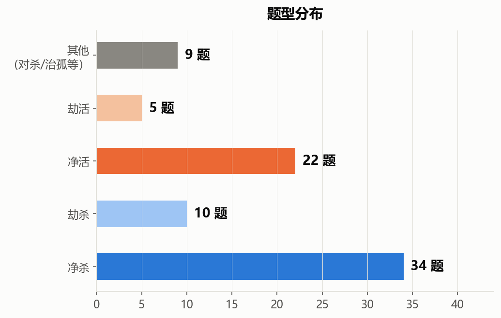

### 棋盘坐标出现频次热力图


### 黑子数量分布


### 白子数量分布

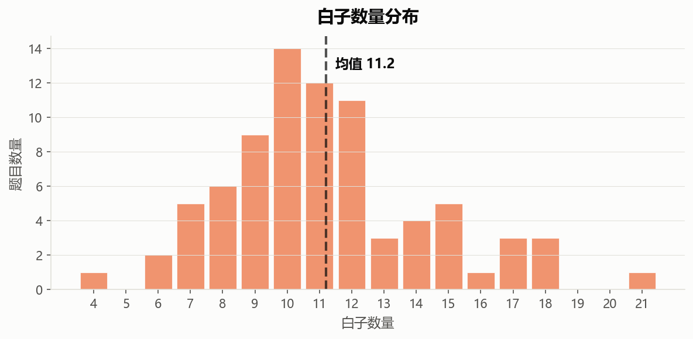

## 各模型答题明细

<table style="border-collapse:collapse">
<thead>
<tr><td style="border:1px solid #d0d7de; padding:3px 8px; text-align:center">题目描述</td><td style="border:1px solid #d0d7de; padding:3px 8px; text-align:center">图片</td><td style="border:1px solid #d0d7de; padding:3px 8px; text-align:center">正解</td><td style="border:1px solid #d0d7de; padding:3px 8px; text-align:center">Flash</td><td style="border:1px solid #d0d7de; padding:3px 8px; text-align:center">Pro</td><td style="border:1px solid #d0d7de; padding:3px 8px; text-align:center">Vision</td></tr>
</thead>
<tbody>
<tr><td style="border:1px solid #d0d7de; padding:3px 8px; text-align:left"><b>1</b> 这是前田陈尔九段的《痛快》一书中的题目，黑先做活，要求净活，不允许劫活。十九路棋盘，从左到右A~T（不含I），从上到下1~19。</td><td style="border:1px solid #d0d7de; padding:3px 8px; text-align:center">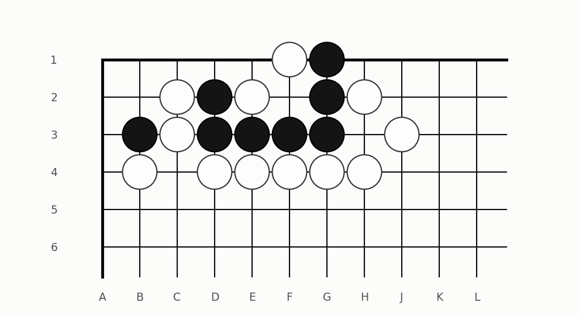</td><td style="border:1px solid #d0d7de; padding:3px 8px; text-align:center">C（C1）</td><td style="background-color:#ffebe9; border:1px solid #d0d7de; padding:3px 8px; text-align:center">B（D1）✗</td><td style="background-color:#ffebe9; border:1px solid #d0d7de; padding:3px 8px; text-align:center">E（都不对）✗</td><td style="background-color:#ffebe9; border:1px solid #d0d7de; padding:3px 8px; text-align:center">D（E1）✗</td></tr>
<tr><td style="border:1px solid #d0d7de; padding:3px 8px; text-align:left"><b>2</b> 黑先杀白，要求净杀，不允许劫杀。十九路棋盘，从左到右T~A（不含I），从上到下19~1。</td><td style="border:1px solid #d0d7de; padding:3px 8px; text-align:center">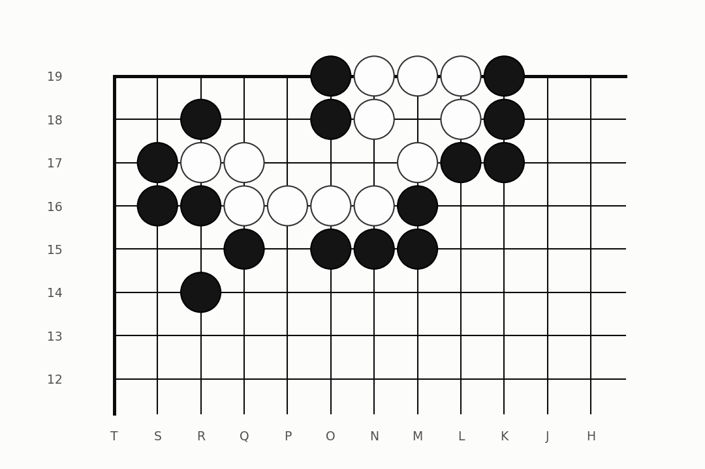</td><td style="border:1px solid #d0d7de; padding:3px 8px; text-align:center">E（都不对）</td><td style="background-color:#ffebe9; border:1px solid #d0d7de; padding:3px 8px; text-align:center">B（P19）✗</td><td style="background-color:#ffebe9; border:1px solid #d0d7de; padding:3px 8px; text-align:center">D（Q18）✗</td><td style="background-color:#ffebe9; border:1px solid #d0d7de; padding:3px 8px; text-align:center">B（P19）✗</td></tr>
<tr><td style="border:1px solid #d0d7de; padding:3px 8px; text-align:left"><b>3</b> 黑先杀白，要求净杀，不允许劫杀。十九路棋盘，从左到右T~A（不含I），从上到下19~1。</td><td style="border:1px solid #d0d7de; padding:3px 8px; text-align:center">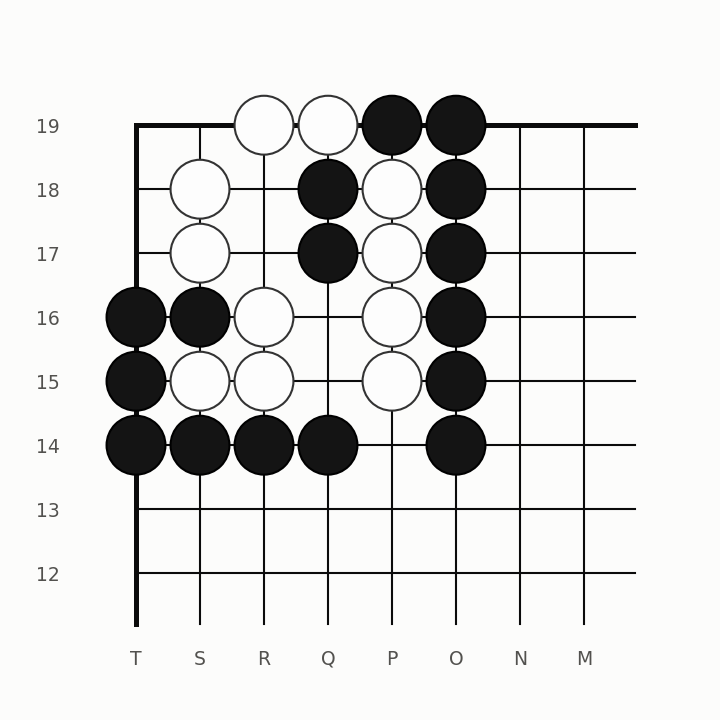</td><td style="border:1px solid #d0d7de; padding:3px 8px; text-align:center">E（都不对）</td><td style="background-color:#ffebe9; border:1px solid #d0d7de; padding:3px 8px; text-align:center">A（R18）✗</td><td style="background-color:#e6ffec; border:1px solid #d0d7de; padding:3px 8px; text-align:center">E（都不对）✓</td><td style="background-color:#e6ffec; border:1px solid #d0d7de; padding:3px 8px; text-align:center">E（都不对）✓</td></tr>
<tr><td style="border:1px solid #d0d7de; padding:3px 8px; text-align:left"><b>4</b> 黑先做活，要求净活，不允许劫活。十九路棋盘，从左到右A~T（不含I），从上到下1~19。</td><td style="border:1px solid #d0d7de; padding:3px 8px; text-align:center">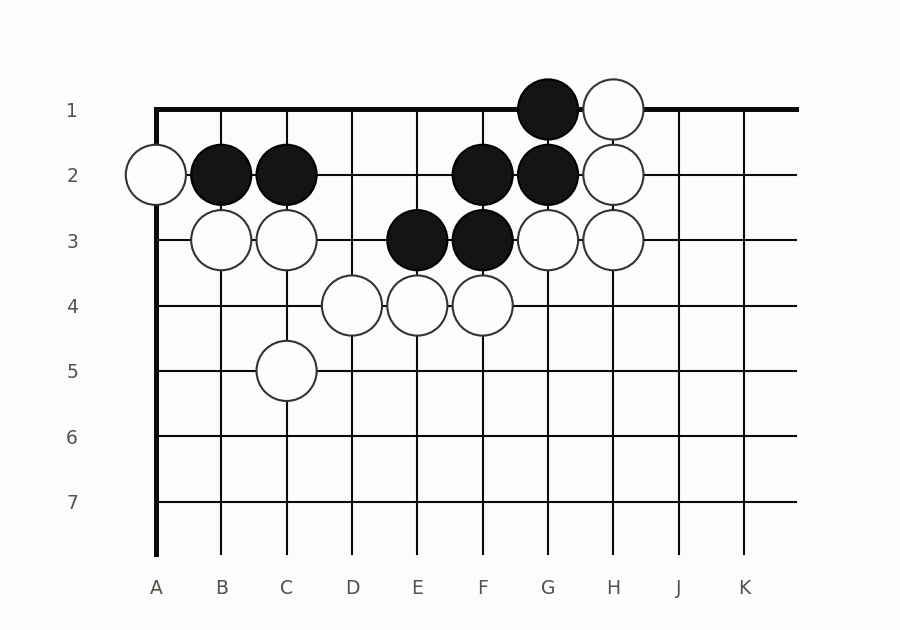</td><td style="border:1px solid #d0d7de; padding:3px 8px; text-align:center">A（D1）</td><td style="background-color:#e6ffec; border:1px solid #d0d7de; padding:3px 8px; text-align:center">A（D1）✓</td><td style="background-color:#ffebe9; border:1px solid #d0d7de; padding:3px 8px; text-align:center">D（D3）✗</td><td style="background-color:#ffebe9; border:1px solid #d0d7de; padding:3px 8px; text-align:center">E（都不对）✗</td></tr>
<tr><td style="border:1px solid #d0d7de; padding:3px 8px; text-align:left"><b>5</b> 黑先做活，要求净活，不允许劫活。十九路棋盘，从左到右T~A（不含I），从上到下19~1。</td><td style="border:1px solid #d0d7de; padding:3px 8px; text-align:center">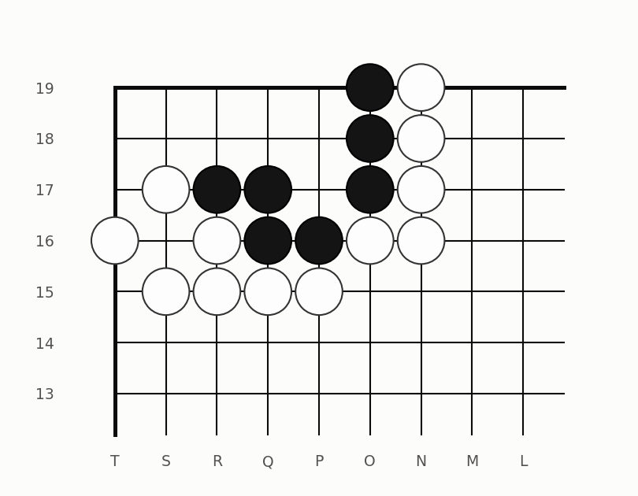</td><td style="border:1px solid #d0d7de; padding:3px 8px; text-align:center">C（Q19）</td><td style="background-color:#ffebe9; border:1px solid #d0d7de; padding:3px 8px; text-align:center">A（S18）✗</td><td style="background-color:#ffebe9; border:1px solid #d0d7de; padding:3px 8px; text-align:center">B（P18）✗</td><td style="background-color:#ffebe9; border:1px solid #d0d7de; padding:3px 8px; text-align:center">A（S18）✗</td></tr>
<tr><td style="border:1px solid #d0d7de; padding:3px 8px; text-align:left"><b>6</b> 黑先做活，要求净活，不允许劫活。十九路棋盘，从左到右A~T（不含I），从上到下1~19。</td><td style="border:1px solid #d0d7de; padding:3px 8px; text-align:center">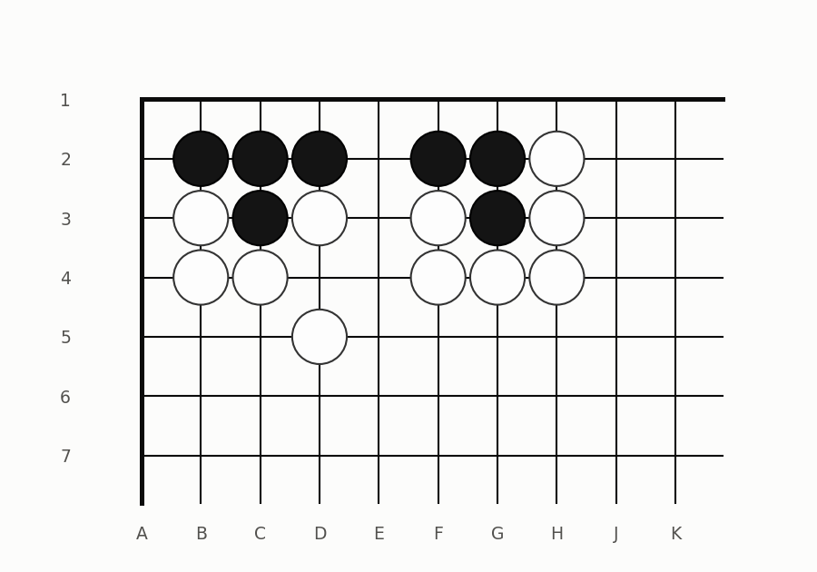</td><td style="border:1px solid #d0d7de; padding:3px 8px; text-align:center">D（E1）</td><td style="background-color:#ffebe9; border:1px solid #d0d7de; padding:3px 8px; text-align:center">B（E2）✗</td><td style="background-color:#e6ffec; border:1px solid #d0d7de; padding:3px 8px; text-align:center">D（E1）✓</td><td style="background-color:#ffebe9; border:1px solid #d0d7de; padding:3px 8px; text-align:center">B（E2）✗</td></tr>
<tr><td style="border:1px solid #d0d7de; padding:3px 8px; text-align:left"><b>7</b> 黑先做活，要求净活，不允许劫活。十九路棋盘，从左到右A~T（不含I），从上到下1~19。</td><td style="border:1px solid #d0d7de; padding:3px 8px; text-align:center">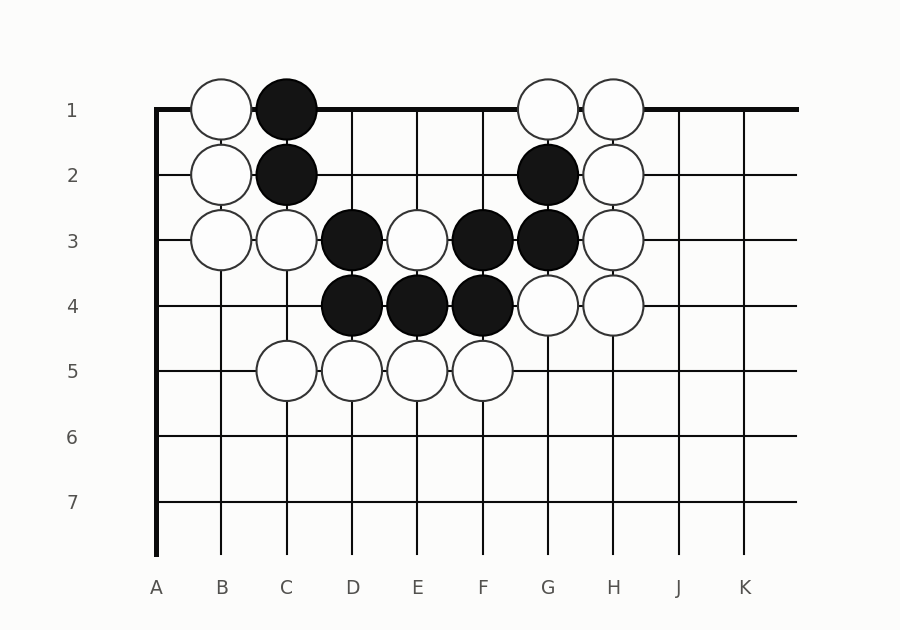</td><td style="border:1px solid #d0d7de; padding:3px 8px; text-align:center">D（E1）</td><td style="background-color:#e6ffec; border:1px solid #d0d7de; padding:3px 8px; text-align:center">D（E1）✓</td><td style="background-color:#f6f8fa; border:1px solid #d0d7de; padding:3px 8px; text-align:center">空</td><td style="background-color:#ffebe9; border:1px solid #d0d7de; padding:3px 8px; text-align:center">B（E2）✗</td></tr>
<tr><td style="border:1px solid #d0d7de; padding:3px 8px; text-align:left"><b>8</b> 黑先杀白，要求净杀，不允许劫杀。十九路棋盘，从左到右T~A（不含I），从上到下19~1。</td><td style="border:1px solid #d0d7de; padding:3px 8px; text-align:center">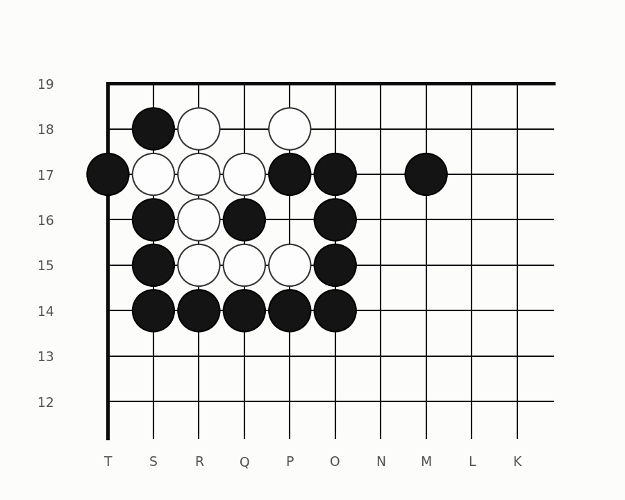</td><td style="border:1px solid #d0d7de; padding:3px 8px; text-align:center">C（Q19）</td><td style="background-color:#ffebe9; border:1px solid #d0d7de; padding:3px 8px; text-align:center">B（R19）✗</td><td style="background-color:#ffebe9; border:1px solid #d0d7de; padding:3px 8px; text-align:center">A（O18）✗</td><td style="background-color:#ffebe9; border:1px solid #d0d7de; padding:3px 8px; text-align:center">D（P16）✗</td></tr>
<tr><td style="border:1px solid #d0d7de; padding:3px 8px; text-align:left"><b>9</b> 黑先，要求救回▲黑子。从左到右A~T（不含I），从上到下1~19。</td><td style="border:1px solid #d0d7de; padding:3px 8px; text-align:center">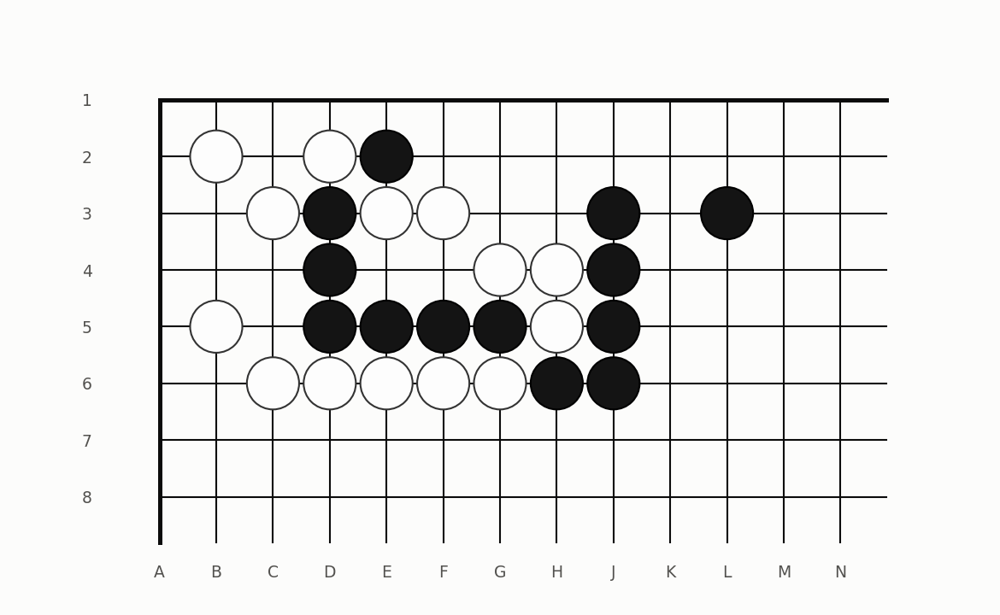</td><td style="border:1px solid #d0d7de; padding:3px 8px; text-align:center">C（D1）</td><td style="background-color:#ffebe9; border:1px solid #d0d7de; padding:3px 8px; text-align:center">B（G3）✗</td><td style="background-color:#ffebe9; border:1px solid #d0d7de; padding:3px 8px; text-align:center">B（G3）✗</td><td style="background-color:#ffebe9; border:1px solid #d0d7de; padding:3px 8px; text-align:center">B（G3）✗</td></tr>
<tr><td style="border:1px solid #d0d7de; padding:3px 8px; text-align:left"><b>10</b> 黑先杀白，要求净杀，不允许劫杀。十九路棋盘，从左到右A~T（不含I），从上到下1~19。</td><td style="border:1px solid #d0d7de; padding:3px 8px; text-align:center">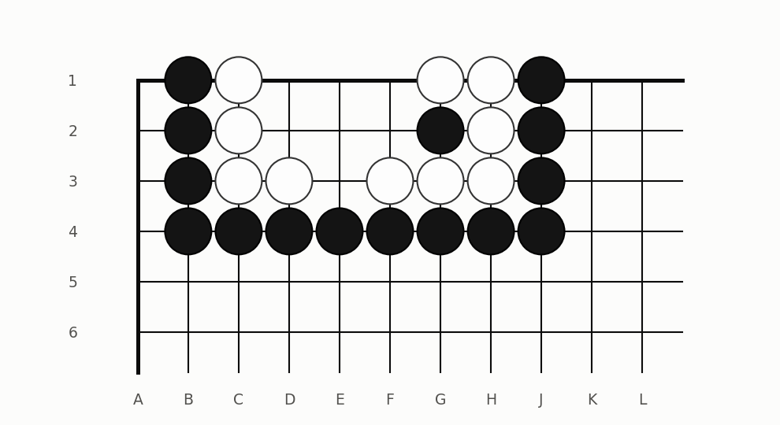</td><td style="border:1px solid #d0d7de; padding:3px 8px; text-align:center">D（E3）</td><td style="background-color:#e6ffec; border:1px solid #d0d7de; padding:3px 8px; text-align:center">D（E3）✓</td><td style="background-color:#ffebe9; border:1px solid #d0d7de; padding:3px 8px; text-align:center">C（E2）✗</td><td style="background-color:#ffebe9; border:1px solid #d0d7de; padding:3px 8px; text-align:center">C（E2）✗</td></tr>
<tr><td style="border:1px solid #d0d7de; padding:3px 8px; text-align:left"><b>11</b> 黑先杀白，劫杀即可。十九路棋盘，从左到右A~T（不含I），从上到下1~19。</td><td style="border:1px solid #d0d7de; padding:3px 8px; text-align:center">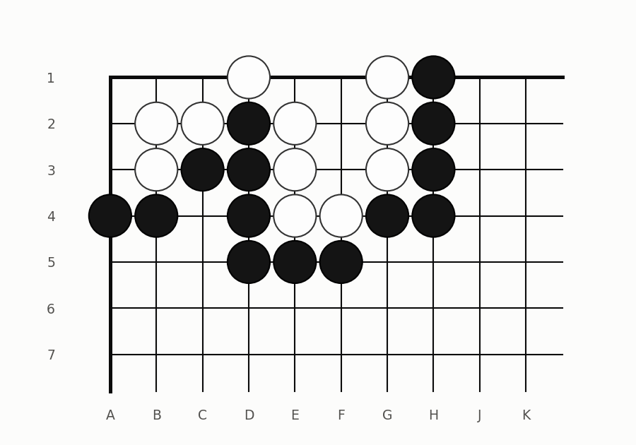</td><td style="border:1px solid #d0d7de; padding:3px 8px; text-align:center">D（E1）</td><td style="background-color:#ffebe9; border:1px solid #d0d7de; padding:3px 8px; text-align:center">B（B1）✗</td><td style="background-color:#e6ffec; border:1px solid #d0d7de; padding:3px 8px; text-align:center">D（E1）✓</td><td style="background-color:#e6ffec; border:1px solid #d0d7de; padding:3px 8px; text-align:center">D（E1）✓</td></tr>
<tr><td style="border:1px solid #d0d7de; padding:3px 8px; text-align:left"><b>12</b> 黑先，要求杀白▲子。十九路棋盘，从左到右A~T（不含I），从上到下1~19。</td><td style="border:1px solid #d0d7de; padding:3px 8px; text-align:center">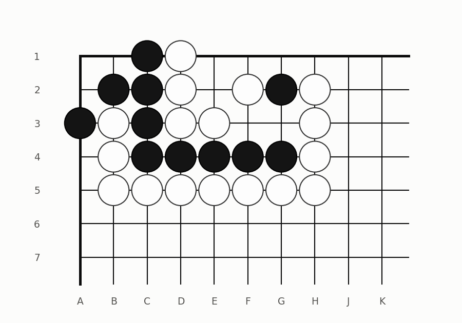</td><td style="border:1px solid #d0d7de; padding:3px 8px; text-align:center">E（都不对）</td><td style="background-color:#f6f8fa; border:1px solid #d0d7de; padding:3px 8px; text-align:center">空</td><td style="background-color:#ffebe9; border:1px solid #d0d7de; padding:3px 8px; text-align:center">A（G1）✗</td><td style="background-color:#ffebe9; border:1px solid #d0d7de; padding:3px 8px; text-align:center">D（G3）✗</td></tr>
<tr><td style="border:1px solid #d0d7de; padding:3px 8px; text-align:left"><b>13</b> 黑先杀白，要求净杀，不允许劫杀。十九路棋盘，从左到右A~T（不含I），从上到下1~19。</td><td style="border:1px solid #d0d7de; padding:3px 8px; text-align:center">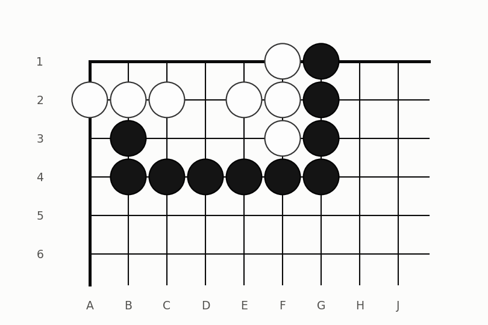</td><td style="border:1px solid #d0d7de; padding:3px 8px; text-align:center">A（D2）</td><td style="background-color:#e6ffec; border:1px solid #d0d7de; padding:3px 8px; text-align:center">A（D2）✓</td><td style="background-color:#e6ffec; border:1px solid #d0d7de; padding:3px 8px; text-align:center">A（D2）✓</td><td style="background-color:#e6ffec; border:1px solid #d0d7de; padding:3px 8px; text-align:center">A（D2）✓</td></tr>
<tr><td style="border:1px solid #d0d7de; padding:3px 8px; text-align:left"><b>14</b> 黑先杀白，要求净杀，不允许劫杀。十九路棋盘，从左到右A~T（不含I），从上到下1~19。</td><td style="border:1px solid #d0d7de; padding:3px 8px; text-align:center">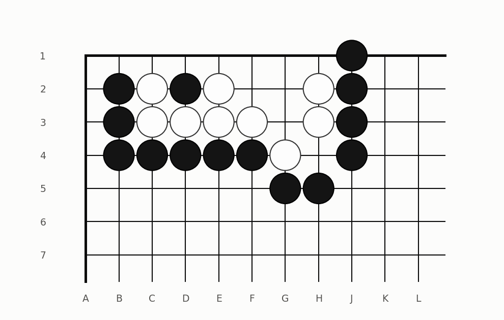</td><td style="border:1px solid #d0d7de; padding:3px 8px; text-align:center">C（G2）</td><td style="background-color:#e6ffec; border:1px solid #d0d7de; padding:3px 8px; text-align:center">C（G2）✓</td><td style="background-color:#ffebe9; border:1px solid #d0d7de; padding:3px 8px; text-align:center">E（都不对）✗</td><td style="background-color:#e6ffec; border:1px solid #d0d7de; padding:3px 8px; text-align:center">C（G2）✓</td></tr>
<tr><td style="border:1px solid #d0d7de; padding:3px 8px; text-align:left"><b>15</b> 黑先杀白，要求净杀，不允许劫杀。十九路棋盘，从左到右A~T（不含I），从上到下1~19。</td><td style="border:1px solid #d0d7de; padding:3px 8px; text-align:center">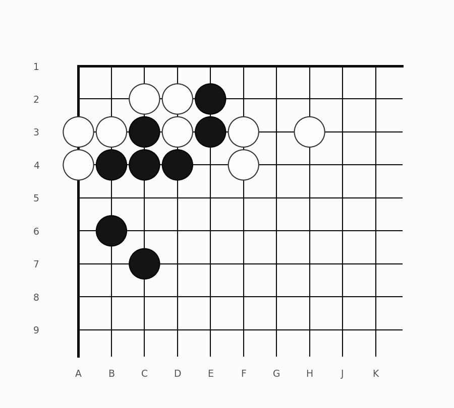</td><td style="border:1px solid #d0d7de; padding:3px 8px; text-align:center">E（都不对）</td><td style="background-color:#ffebe9; border:1px solid #d0d7de; padding:3px 8px; text-align:center">A（E4）✗</td><td style="background-color:#ffebe9; border:1px solid #d0d7de; padding:3px 8px; text-align:center">A（E4）✗</td><td style="background-color:#ffebe9; border:1px solid #d0d7de; padding:3px 8px; text-align:center">B（B1）✗</td></tr>
<tr><td style="border:1px solid #d0d7de; padding:3px 8px; text-align:left"><b>16</b> 黑先做活，要求净活，不允许劫活。十九路棋盘，从左到右A~T（不含I），从上到下1~19。</td><td style="border:1px solid #d0d7de; padding:3px 8px; text-align:center">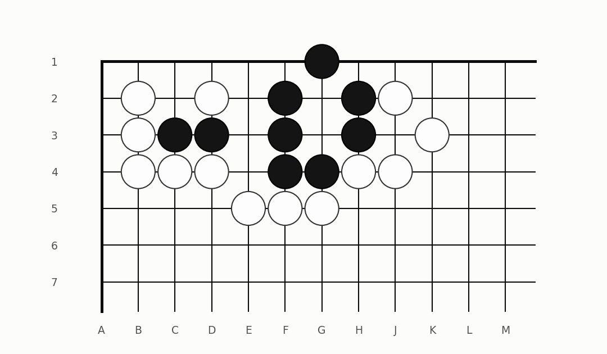</td><td style="border:1px solid #d0d7de; padding:3px 8px; text-align:center">A（C2）</td><td style="background-color:#ffebe9; border:1px solid #d0d7de; padding:3px 8px; text-align:center">D（E2）✗</td><td style="background-color:#ffebe9; border:1px solid #d0d7de; padding:3px 8px; text-align:center">B（E3）✗</td><td style="background-color:#e6ffec; border:1px solid #d0d7de; padding:3px 8px; text-align:center">A（C2）✓</td></tr>
<tr><td style="border:1px solid #d0d7de; padding:3px 8px; text-align:left"><b>17</b> 黑先，要求救回▲黑子。十九路棋盘，从左到右A~T（不含I），从上到下1~19。</td><td style="border:1px solid #d0d7de; padding:3px 8px; text-align:center">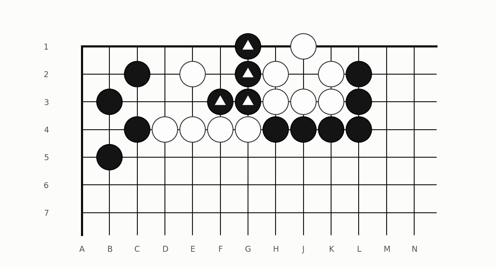</td><td style="border:1px solid #d0d7de; padding:3px 8px; text-align:center">E（都不对）</td><td style="background-color:#ffebe9; border:1px solid #d0d7de; padding:3px 8px; text-align:center">C（F1）✗</td><td style="background-color:#e6ffec; border:1px solid #d0d7de; padding:3px 8px; text-align:center">E（都不对）✓</td><td style="background-color:#ffebe9; border:1px solid #d0d7de; padding:3px 8px; text-align:center">D（D2）✗</td></tr>
<tr><td style="border:1px solid #d0d7de; padding:3px 8px; text-align:left"><b>18</b> 黑先，要求救回▲黑子，以此吃住●白子，要求净吃，不能成劫。十九路棋盘，从左到右T~A（不含I），从上到下19~1。</td><td style="border:1px solid #d0d7de; padding:3px 8px; text-align:center">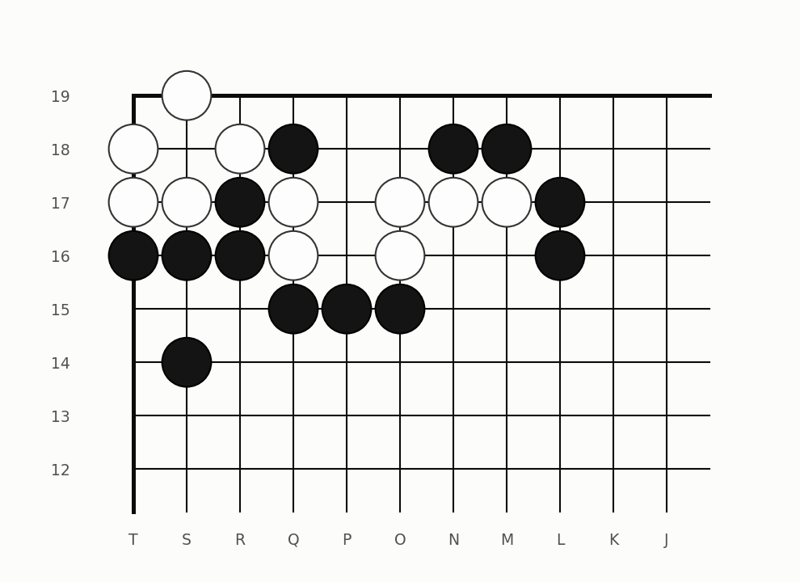</td><td style="border:1px solid #d0d7de; padding:3px 8px; text-align:center">B（P18）</td><td style="background-color:#e6ffec; border:1px solid #d0d7de; padding:3px 8px; text-align:center">B（P18）✓</td><td style="background-color:#ffebe9; border:1px solid #d0d7de; padding:3px 8px; text-align:center">E（都不对）✗</td><td style="background-color:#ffebe9; border:1px solid #d0d7de; padding:3px 8px; text-align:center">E（都不对）✗</td></tr>
<tr><td style="border:1px solid #d0d7de; padding:3px 8px; text-align:left"><b>19</b> 黑先杀白，劫杀即可。十九路棋盘，从左到右A~T（不含I），从上到下19~1。</td><td style="border:1px solid #d0d7de; padding:3px 8px; text-align:center">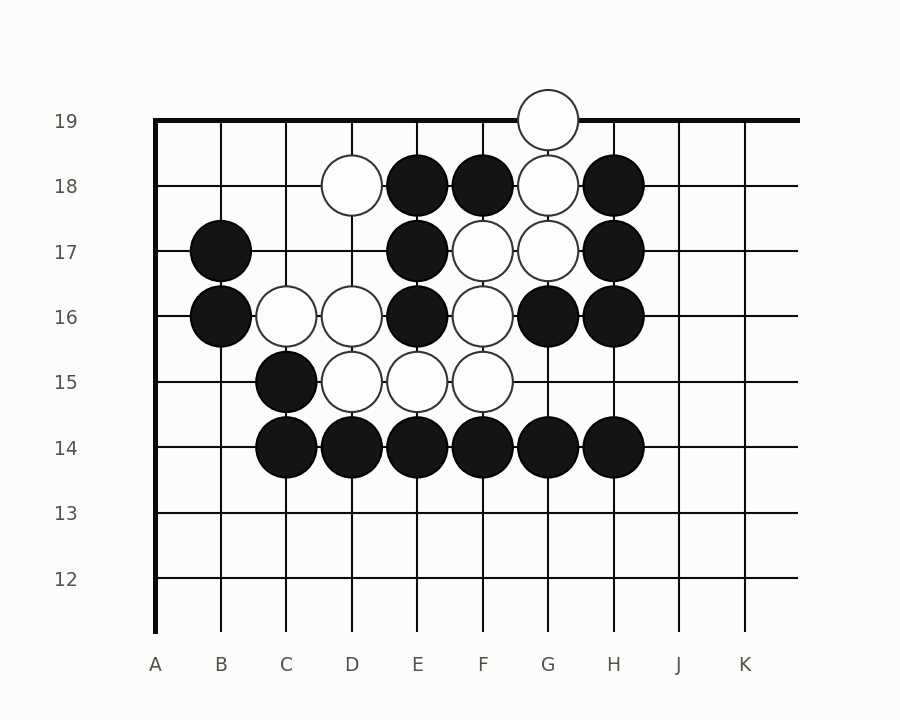</td><td style="border:1px solid #d0d7de; padding:3px 8px; text-align:center">C（D17）</td><td style="background-color:#e6ffec; border:1px solid #d0d7de; padding:3px 8px; text-align:center">C（D17）✓</td><td style="background-color:#e6ffec; border:1px solid #d0d7de; padding:3px 8px; text-align:center">C（D17）✓</td><td style="background-color:#e6ffec; border:1px solid #d0d7de; padding:3px 8px; text-align:center">C（D17）✓</td></tr>
<tr><td style="border:1px solid #d0d7de; padding:3px 8px; text-align:left"><b>20</b> 黑棋在白棋空中有两颗▲残子还可以出棋，如何利用它们来获取最大利益？十九路棋盘，从左到右T~A（不含I），从上到下19~1。</td><td style="border:1px solid #d0d7de; padding:3px 8px; text-align:center">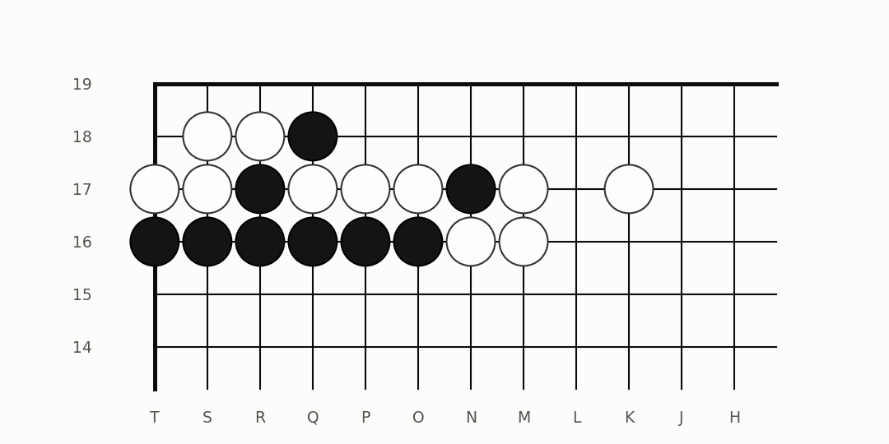</td><td style="border:1px solid #d0d7de; padding:3px 8px; text-align:center">B（R19）</td><td style="background-color:#ffebe9; border:1px solid #d0d7de; padding:3px 8px; text-align:center">A（O18）✗</td><td style="background-color:#ffebe9; border:1px solid #d0d7de; padding:3px 8px; text-align:center">A（O18）✗</td><td style="background-color:#ffebe9; border:1px solid #d0d7de; padding:3px 8px; text-align:center">A（O18）✗</td></tr>
<tr><td style="border:1px solid #d0d7de; padding:3px 8px; text-align:left"><b>21</b> 黑先做活，要求净活，不允许劫活。十九路棋盘，从左到右A~T（不含I），从上到下1~19。</td><td style="border:1px solid #d0d7de; padding:3px 8px; text-align:center">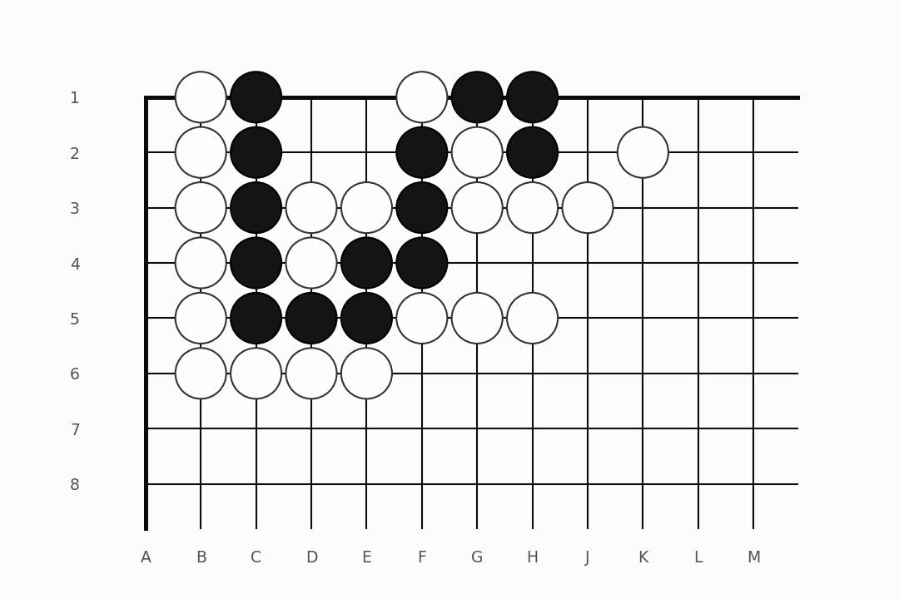</td><td style="border:1px solid #d0d7de; padding:3px 8px; text-align:center">D（D2）</td><td style="background-color:#e6ffec; border:1px solid #d0d7de; padding:3px 8px; text-align:center">D（D2）✓</td><td style="background-color:#e6ffec; border:1px solid #d0d7de; padding:3px 8px; text-align:center">D（D2）✓</td><td style="background-color:#e6ffec; border:1px solid #d0d7de; padding:3px 8px; text-align:center">D（D2）✓</td></tr>
<tr><td style="border:1px solid #d0d7de; padding:3px 8px; text-align:left"><b>22</b> 黑先做活，要求净活，不允许劫活。十九路棋盘，从左到右A~T（不含I），从上到下1~19。</td><td style="border:1px solid #d0d7de; padding:3px 8px; text-align:center">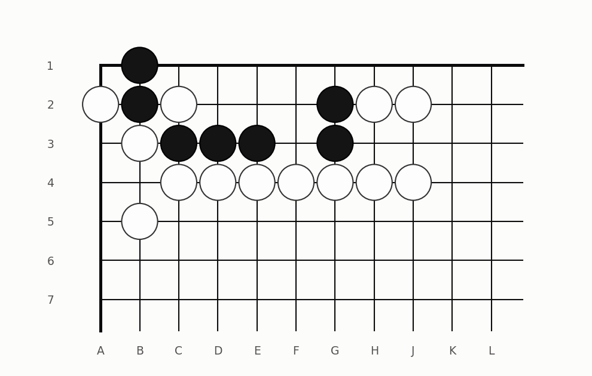</td><td style="border:1px solid #d0d7de; padding:3px 8px; text-align:center">B（D1）</td><td style="background-color:#e6ffec; border:1px solid #d0d7de; padding:3px 8px; text-align:center">B（D1）✓</td><td style="background-color:#ffebe9; border:1px solid #d0d7de; padding:3px 8px; text-align:center">D（D2）✗</td><td style="background-color:#e6ffec; border:1px solid #d0d7de; padding:3px 8px; text-align:center">B（D1）✓</td></tr>
<tr><td style="border:1px solid #d0d7de; padding:3px 8px; text-align:left"><b>23</b> 黑先杀白，要求净杀，不允许劫杀。十九路棋盘，从左到右A~T（不含I），从上到下1~19。</td><td style="border:1px solid #d0d7de; padding:3px 8px; text-align:center">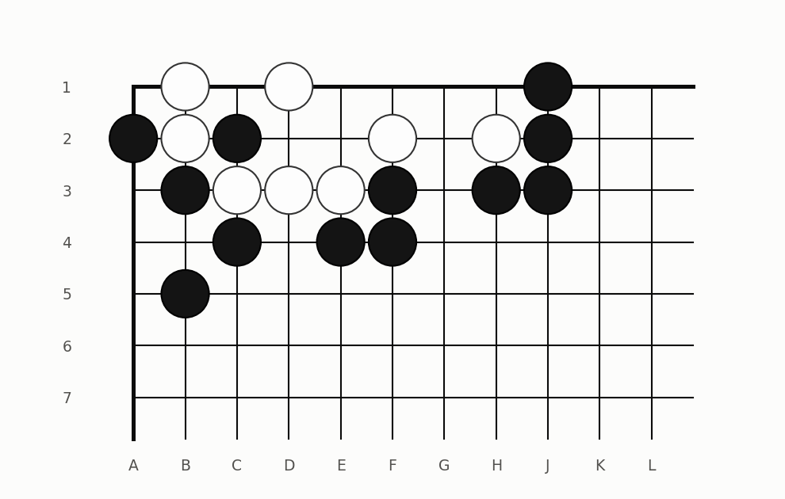</td><td style="border:1px solid #d0d7de; padding:3px 8px; text-align:center">A（E2）</td><td style="background-color:#e6ffec; border:1px solid #d0d7de; padding:3px 8px; text-align:center">A（E2）✓</td><td style="background-color:#ffebe9; border:1px solid #d0d7de; padding:3px 8px; text-align:center">D（F1）✗</td><td style="background-color:#e6ffec; border:1px solid #d0d7de; padding:3px 8px; text-align:center">A（E2）✓</td></tr>
<tr><td style="border:1px solid #d0d7de; padding:3px 8px; text-align:left"><b>24</b> 黑先杀白，要求杀掉▲白子，要求净杀，不允许劫杀。十九路棋盘，从左到右A~T（不含I），从上到下1~19。</td><td style="border:1px solid #d0d7de; padding:3px 8px; text-align:center">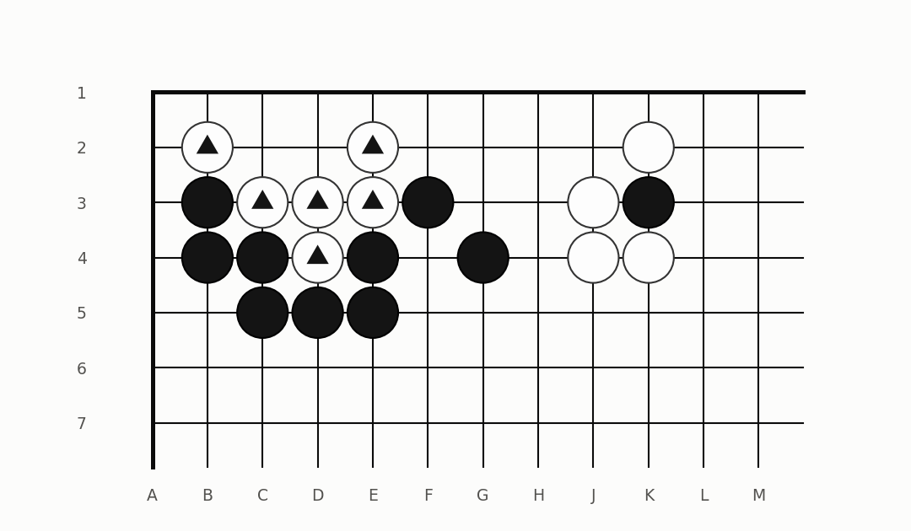</td><td style="border:1px solid #d0d7de; padding:3px 8px; text-align:center">A（F1）</td><td style="background-color:#e6ffec; border:1px solid #d0d7de; padding:3px 8px; text-align:center">A（F1）✓</td><td style="background-color:#ffebe9; border:1px solid #d0d7de; padding:3px 8px; text-align:center">D（C2）✗</td><td style="background-color:#ffebe9; border:1px solid #d0d7de; padding:3px 8px; text-align:center">D（C2）✗</td></tr>
<tr><td style="border:1px solid #d0d7de; padding:3px 8px; text-align:left"><b>25</b> 黑先杀白，劫杀即可。十九路棋盘，从左到右A~T（不含I），从上到下1~19。</td><td style="border:1px solid #d0d7de; padding:3px 8px; text-align:center">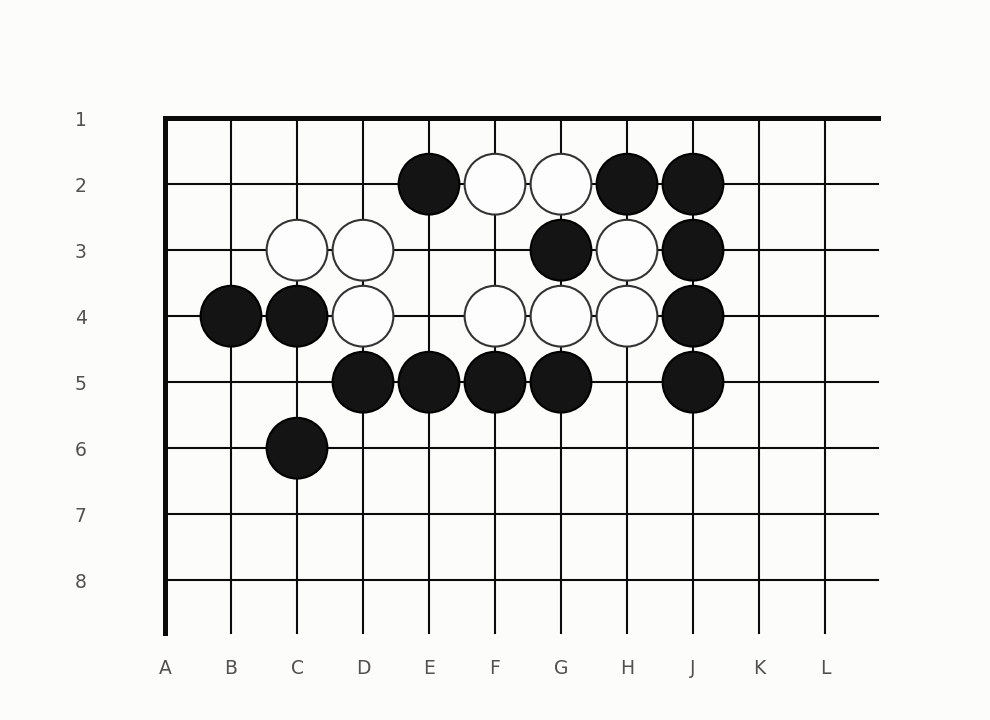</td><td style="border:1px solid #d0d7de; padding:3px 8px; text-align:center">C（G1）</td><td style="background-color:#ffebe9; border:1px solid #d0d7de; padding:3px 8px; text-align:center">A（E3）✗</td><td style="background-color:#ffebe9; border:1px solid #d0d7de; padding:3px 8px; text-align:center">E（都不对）✗</td><td style="background-color:#ffebe9; border:1px solid #d0d7de; padding:3px 8px; text-align:center">D（E4）✗</td></tr>
<tr><td style="border:1px solid #d0d7de; padding:3px 8px; text-align:left"><b>26</b> 黑先杀白，要求净杀，不允许劫杀。十九路棋盘，从左到右A~T（不含I），从上到下1~19。</td><td style="border:1px solid #d0d7de; padding:3px 8px; text-align:center">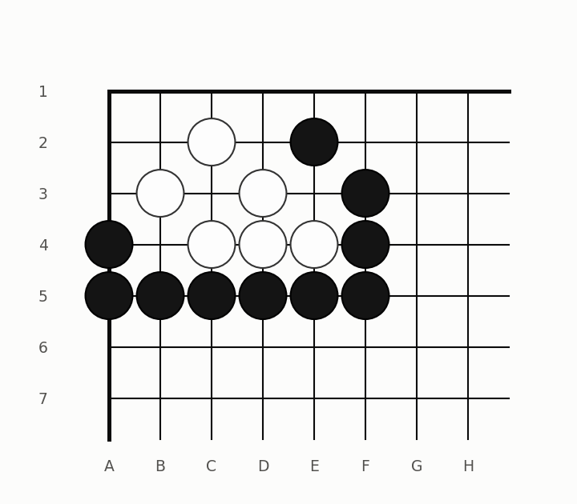</td><td style="border:1px solid #d0d7de; padding:3px 8px; text-align:center">D（A2）</td><td style="background-color:#ffebe9; border:1px solid #d0d7de; padding:3px 8px; text-align:center">B（D2）✗</td><td style="background-color:#ffebe9; border:1px solid #d0d7de; padding:3px 8px; text-align:center">C（B1）✗</td><td style="background-color:#ffebe9; border:1px solid #d0d7de; padding:3px 8px; text-align:center">A（B4）✗</td></tr>
<tr><td style="border:1px solid #d0d7de; padding:3px 8px; text-align:left"><b>27</b> 黑先做活，要求净活，不允许劫活。十九路棋盘，从左到右A~T（不含I），从上到下1~19。</td><td style="border:1px solid #d0d7de; padding:3px 8px; text-align:center">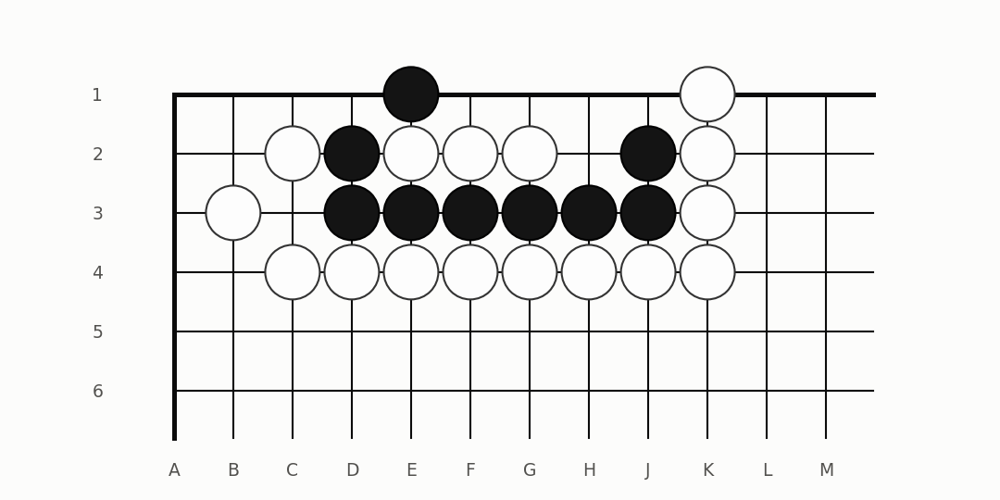</td><td style="border:1px solid #d0d7de; padding:3px 8px; text-align:center">E（都不对）</td><td style="background-color:#ffebe9; border:1px solid #d0d7de; padding:3px 8px; text-align:center">C（H1）✗</td><td style="background-color:#ffebe9; border:1px solid #d0d7de; padding:3px 8px; text-align:center">C（H1）✗</td><td style="background-color:#ffebe9; border:1px solid #d0d7de; padding:3px 8px; text-align:center">A（J1）✗</td></tr>
<tr><td style="border:1px solid #d0d7de; padding:3px 8px; text-align:left"><b>28</b> 黑先杀白，劫杀即可。十九路棋盘，从左到右A~T（不含I），从上到下1~19。</td><td style="border:1px solid #d0d7de; padding:3px 8px; text-align:center">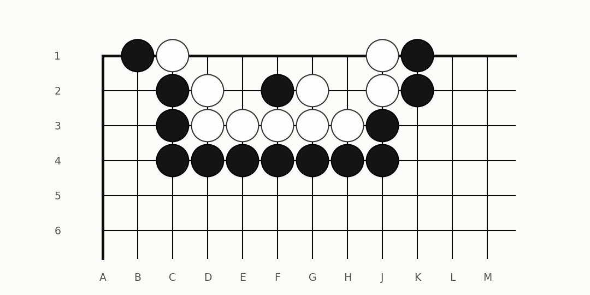</td><td style="border:1px solid #d0d7de; padding:3px 8px; text-align:center">D（G1）</td><td style="background-color:#ffebe9; border:1px solid #d0d7de; padding:3px 8px; text-align:center">C（F1）✗</td><td style="background-color:#ffebe9; border:1px solid #d0d7de; padding:3px 8px; text-align:center">B（E1）✗</td><td style="background-color:#ffebe9; border:1px solid #d0d7de; padding:3px 8px; text-align:center">A（D1）✗</td></tr>
<tr><td style="border:1px solid #d0d7de; padding:3px 8px; text-align:left"><b>29</b> 黑先做活，要求净活，不允许劫活。十九路棋盘，从左到右A~T（不含I），从上到下1~19。</td><td style="border:1px solid #d0d7de; padding:3px 8px; text-align:center">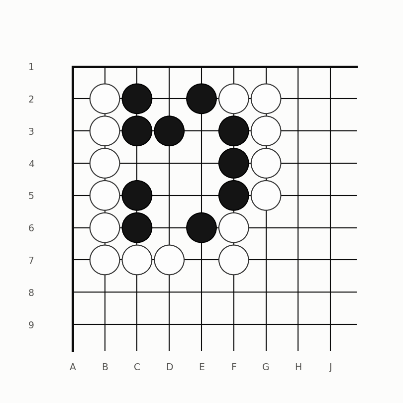</td><td style="border:1px solid #d0d7de; padding:3px 8px; text-align:center">E（都不对）</td><td style="background-color:#ffebe9; border:1px solid #d0d7de; padding:3px 8px; text-align:center">B（D6）✗</td><td style="background-color:#ffebe9; border:1px solid #d0d7de; padding:3px 8px; text-align:center">A（E4）✗</td><td style="background-color:#ffebe9; border:1px solid #d0d7de; padding:3px 8px; text-align:center">D（D1）✗</td></tr>
<tr><td style="border:1px solid #d0d7de; padding:3px 8px; text-align:left"><b>30</b> 黑先杀白，要求净杀，不允许劫杀。十九路棋盘，从左到右A~T（不含I），从上到下1~19。</td><td style="border:1px solid #d0d7de; padding:3px 8px; text-align:center">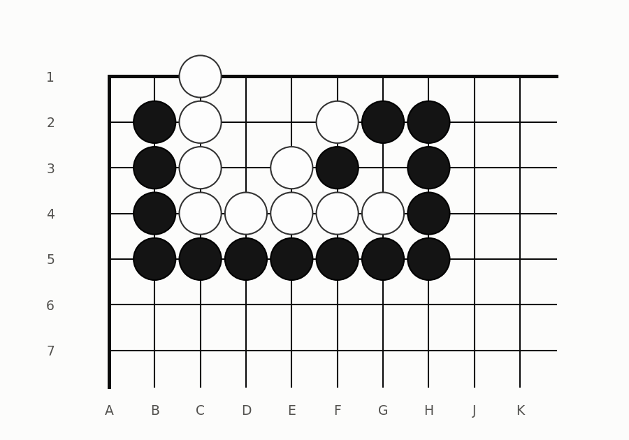</td><td style="border:1px solid #d0d7de; padding:3px 8px; text-align:center">B（E2）</td><td style="background-color:#e6ffec; border:1px solid #d0d7de; padding:3px 8px; text-align:center">B（E2）✓</td><td style="background-color:#e6ffec; border:1px solid #d0d7de; padding:3px 8px; text-align:center">B（E2）✓</td><td style="background-color:#ffebe9; border:1px solid #d0d7de; padding:3px 8px; text-align:center">C（F1）✗</td></tr>
<tr><td style="border:1px solid #d0d7de; padding:3px 8px; text-align:left"><b>31</b> 黑先杀白，要求净杀，不允许劫杀。十九路棋盘，从左到右A~T（不含I），从上到下1~19。</td><td style="border:1px solid #d0d7de; padding:3px 8px; text-align:center">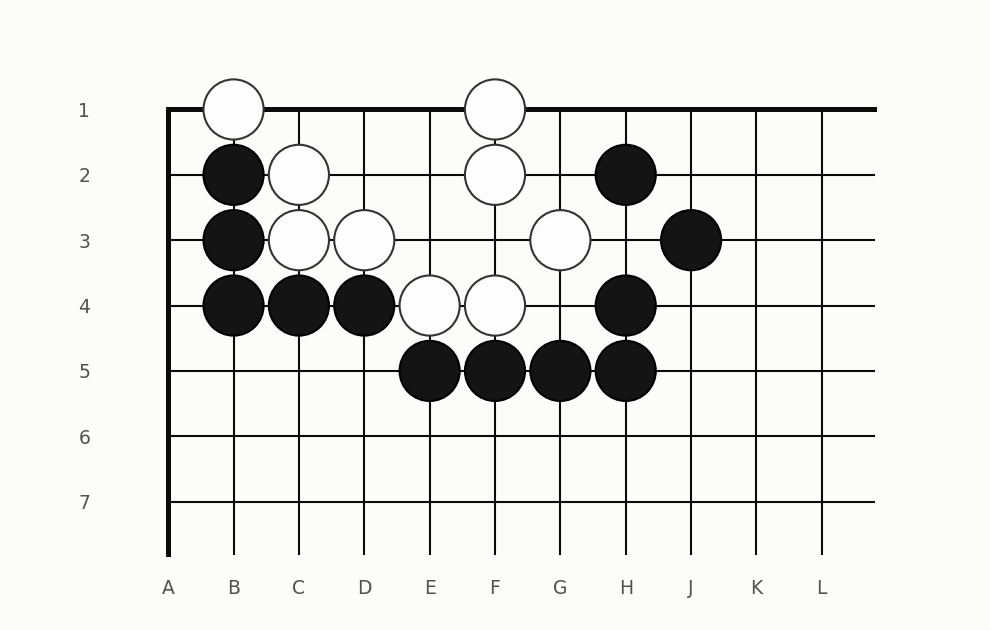</td><td style="border:1px solid #d0d7de; padding:3px 8px; text-align:center">B（G4）</td><td style="background-color:#ffebe9; border:1px solid #d0d7de; padding:3px 8px; text-align:center">D（E2）✗</td><td style="background-color:#ffebe9; border:1px solid #d0d7de; padding:3px 8px; text-align:center">D（E2）✗</td><td style="background-color:#ffebe9; border:1px solid #d0d7de; padding:3px 8px; text-align:center">E（都不对）✗</td></tr>
<tr><td style="border:1px solid #d0d7de; padding:3px 8px; text-align:left"><b>32</b> 黑先杀白，劫杀即可。十九路棋盘，从左到右A~T（不含I），从上到下1~19。</td><td style="border:1px solid #d0d7de; padding:3px 8px; text-align:center">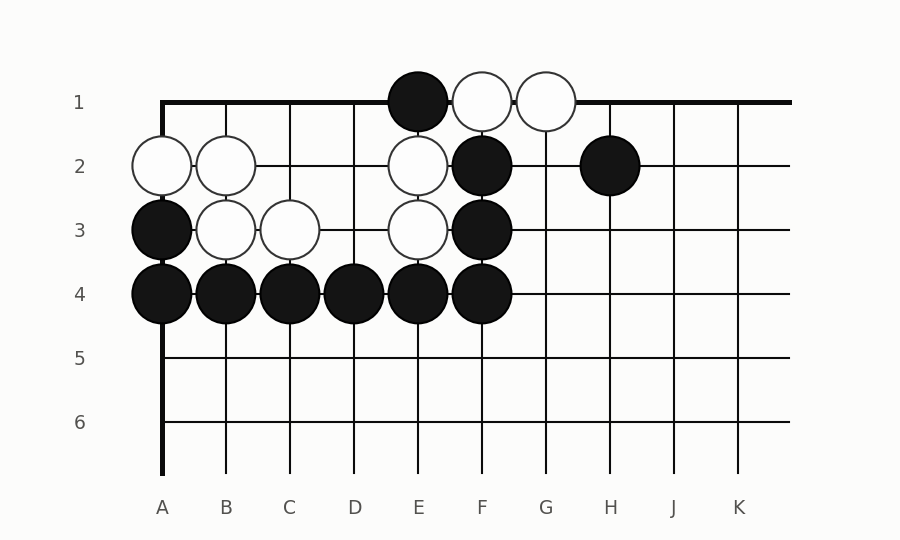</td><td style="border:1px solid #d0d7de; padding:3px 8px; text-align:center">D（C1）</td><td style="background-color:#ffebe9; border:1px solid #d0d7de; padding:3px 8px; text-align:center">C（D1）✗</td><td style="background-color:#ffebe9; border:1px solid #d0d7de; padding:3px 8px; text-align:center">E（都不对）✗</td><td style="background-color:#f6f8fa; border:1px solid #d0d7de; padding:3px 8px; text-align:center">空</td></tr>
<tr><td style="border:1px solid #d0d7de; padding:3px 8px; text-align:left"><b>33</b> 黑先杀白，劫杀即可。十九路棋盘，从左到右A~T（不含I），从上到下1~19。</td><td style="border:1px solid #d0d7de; padding:3px 8px; text-align:center">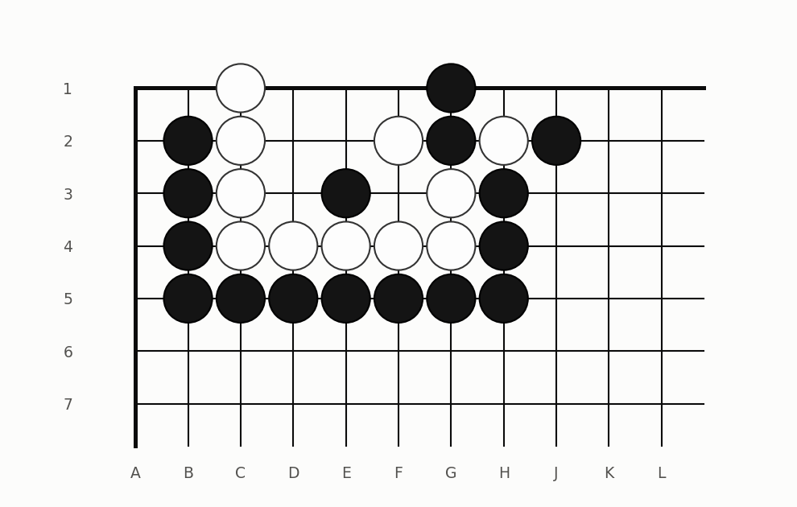</td><td style="border:1px solid #d0d7de; padding:3px 8px; text-align:center">A（E2）</td><td style="background-color:#ffebe9; border:1px solid #d0d7de; padding:3px 8px; text-align:center">C（D2）✗</td><td style="background-color:#e6ffec; border:1px solid #d0d7de; padding:3px 8px; text-align:center">A（E2）✓</td><td style="background-color:#e6ffec; border:1px solid #d0d7de; padding:3px 8px; text-align:center">A（E2）✓</td></tr>
<tr><td style="border:1px solid #d0d7de; padding:3px 8px; text-align:left"><b>34</b> 黑先做活，要求净活，不允许劫活。十九路棋盘，从左到右A~T（不含I），从上到下1~19。</td><td style="border:1px solid #d0d7de; padding:3px 8px; text-align:center">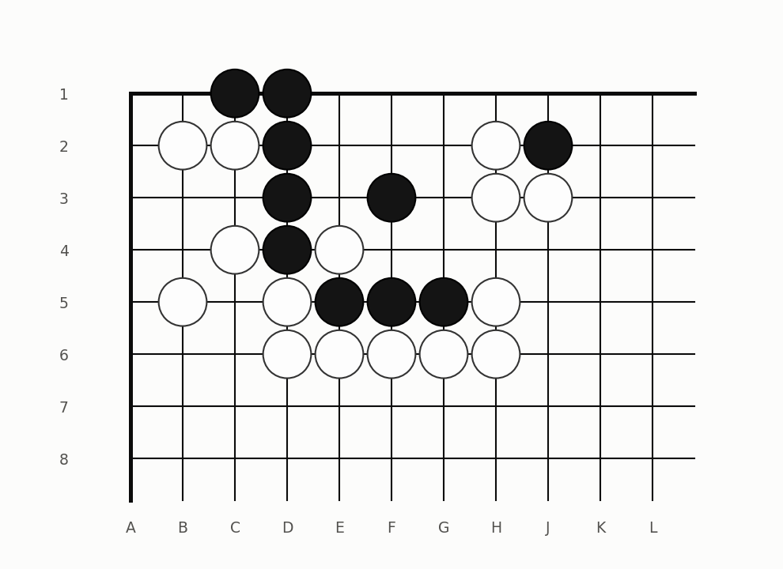</td><td style="border:1px solid #d0d7de; padding:3px 8px; text-align:center">A（F1）</td><td style="background-color:#ffebe9; border:1px solid #d0d7de; padding:3px 8px; text-align:center">D（G2）✗</td><td style="background-color:#ffebe9; border:1px solid #d0d7de; padding:3px 8px; text-align:center">B（G3）✗</td><td style="background-color:#ffebe9; border:1px solid #d0d7de; padding:3px 8px; text-align:center">C（F2）✗</td></tr>
<tr><td style="border:1px solid #d0d7de; padding:3px 8px; text-align:left"><b>35</b> 黑先做活，要求净活，不允许劫活。十九路棋盘，从左到右A~T（不含I），从上到下1~19。</td><td style="border:1px solid #d0d7de; padding:3px 8px; text-align:center">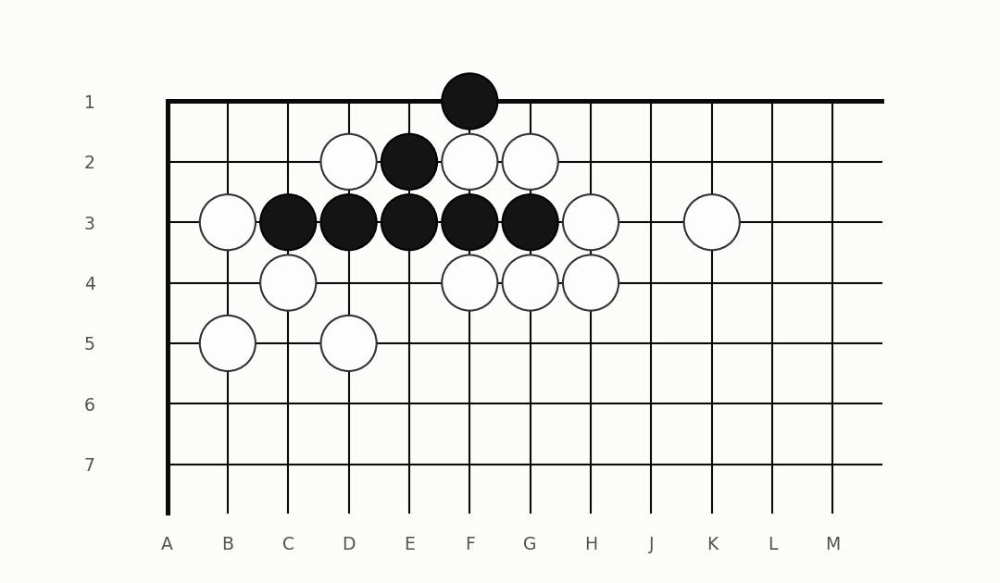</td><td style="border:1px solid #d0d7de; padding:3px 8px; text-align:center">A（B2）</td><td style="background-color:#ffebe9; border:1px solid #d0d7de; padding:3px 8px; text-align:center">D（H2）✗</td><td style="background-color:#ffebe9; border:1px solid #d0d7de; padding:3px 8px; text-align:center">D（H2）✗</td><td style="background-color:#e6ffec; border:1px solid #d0d7de; padding:3px 8px; text-align:center">A（B2）✓</td></tr>
<tr><td style="border:1px solid #d0d7de; padding:3px 8px; text-align:left"><b>36</b> 黑先杀白，劫杀即可。十九路棋盘，从左到右A~T（不含I），从上到下1~19。</td><td style="border:1px solid #d0d7de; padding:3px 8px; text-align:center">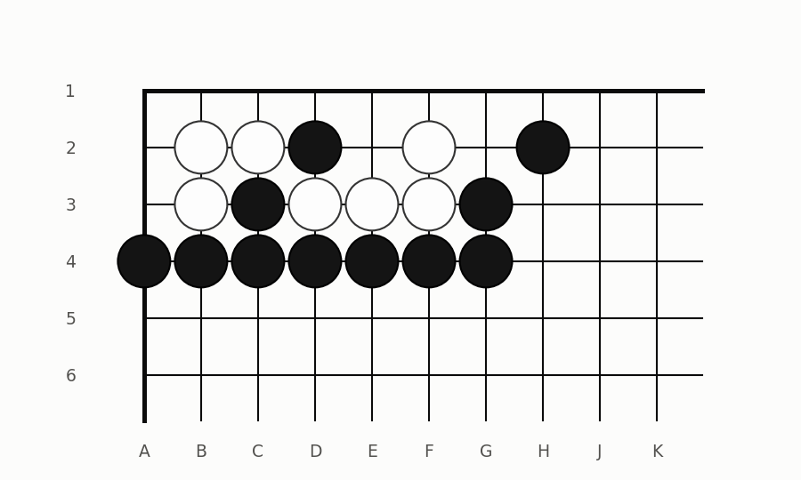</td><td style="border:1px solid #d0d7de; padding:3px 8px; text-align:center">C（D1）</td><td style="background-color:#e6ffec; border:1px solid #d0d7de; padding:3px 8px; text-align:center">C（D1）✓</td><td style="background-color:#ffebe9; border:1px solid #d0d7de; padding:3px 8px; text-align:center">B（E1）✗</td><td style="background-color:#e6ffec; border:1px solid #d0d7de; padding:3px 8px; text-align:center">C（D1）✓</td></tr>
<tr><td style="border:1px solid #d0d7de; padding:3px 8px; text-align:left"><b>37</b> 黑先杀白，要求净杀，不允许劫杀。十九路棋盘，从左到右A~T（不含I），从上到下1~19。</td><td style="border:1px solid #d0d7de; padding:3px 8px; text-align:center">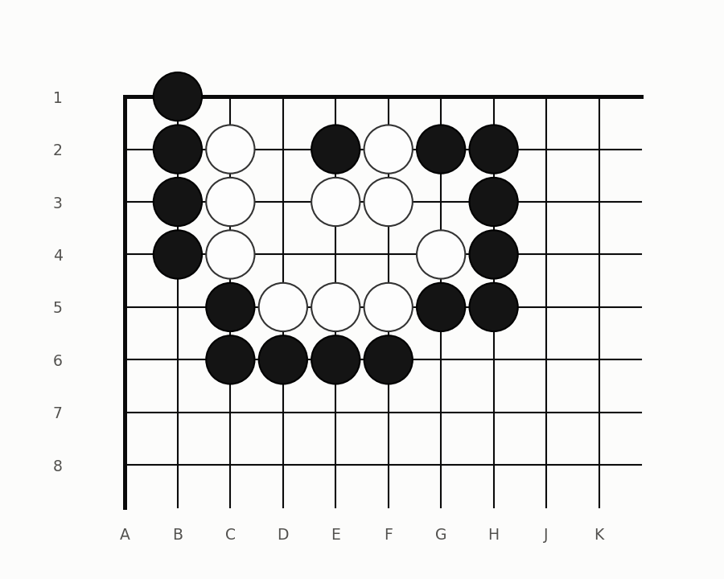</td><td style="border:1px solid #d0d7de; padding:3px 8px; text-align:center">B（D2）</td><td style="background-color:#e6ffec; border:1px solid #d0d7de; padding:3px 8px; text-align:center">B（D2）✓</td><td style="background-color:#ffebe9; border:1px solid #d0d7de; padding:3px 8px; text-align:center">A（F1）✗</td><td style="background-color:#ffebe9; border:1px solid #d0d7de; padding:3px 8px; text-align:center">A（F1）✗</td></tr>
<tr><td style="border:1px solid #d0d7de; padding:3px 8px; text-align:left"><b>38</b> 黑先杀白，劫杀即可。十九路棋盘，从左到右A~T（不含I），从上到下1~19。</td><td style="border:1px solid #d0d7de; padding:3px 8px; text-align:center">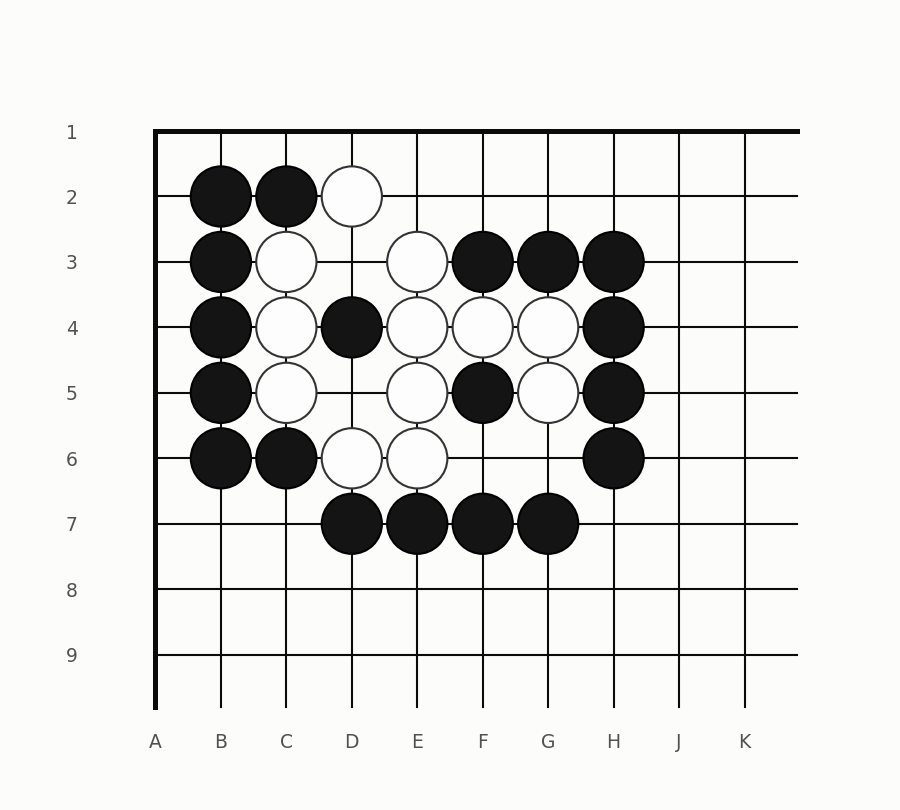</td><td style="border:1px solid #d0d7de; padding:3px 8px; text-align:center">C（D3）</td><td style="background-color:#ffebe9; border:1px solid #d0d7de; padding:3px 8px; text-align:center">A（F6）✗</td><td style="background-color:#e6ffec; border:1px solid #d0d7de; padding:3px 8px; text-align:center">C（D3）✓</td><td style="background-color:#ffebe9; border:1px solid #d0d7de; padding:3px 8px; text-align:center">A（F6）✗</td></tr>
<tr><td style="border:1px solid #d0d7de; padding:3px 8px; text-align:left"><b>39</b> 黑先杀白，要求净杀，不允许劫杀。十九路棋盘，从左到右A~T（不含I），从上到下1~19。</td><td style="border:1px solid #d0d7de; padding:3px 8px; text-align:center">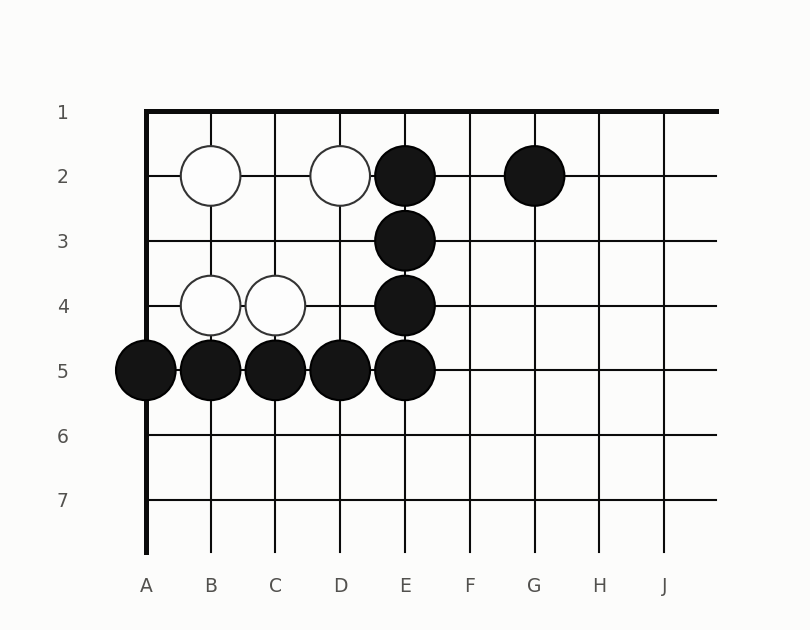</td><td style="border:1px solid #d0d7de; padding:3px 8px; text-align:center">D（D1）</td><td style="background-color:#ffebe9; border:1px solid #d0d7de; padding:3px 8px; text-align:center">A（D3）✗</td><td style="background-color:#ffebe9; border:1px solid #d0d7de; padding:3px 8px; text-align:center">A（D3）✗</td><td style="background-color:#ffebe9; border:1px solid #d0d7de; padding:3px 8px; text-align:center">A（D3）✗</td></tr>
<tr><td style="border:1px solid #d0d7de; padding:3px 8px; text-align:left"><b>40</b> 黑先杀白，要求净杀，不允许劫杀。十九路棋盘，从左到右A~T（不含I），从上到下1~19。</td><td style="border:1px solid #d0d7de; padding:3px 8px; text-align:center">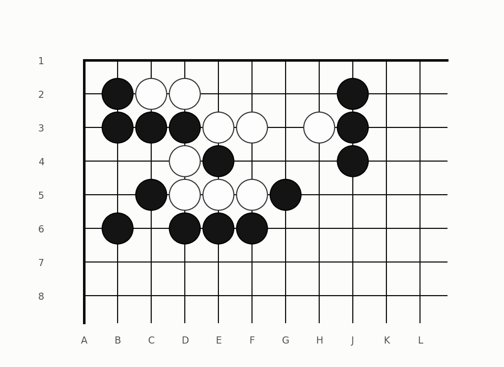</td><td style="border:1px solid #d0d7de; padding:3px 8px; text-align:center">A（G4）</td><td style="background-color:#e6ffec; border:1px solid #d0d7de; padding:3px 8px; text-align:center">A（G4）✓</td><td style="background-color:#e6ffec; border:1px solid #d0d7de; padding:3px 8px; text-align:center">A（G4）✓</td><td style="background-color:#e6ffec; border:1px solid #d0d7de; padding:3px 8px; text-align:center">A（G4）✓</td></tr>
<tr><td style="border:1px solid #d0d7de; padding:3px 8px; text-align:left"><b>41</b> 黑先做活，要求净活，不允许劫活。十九路棋盘，从左到右A~T（不含I），从上到下1~19。</td><td style="border:1px solid #d0d7de; padding:3px 8px; text-align:center">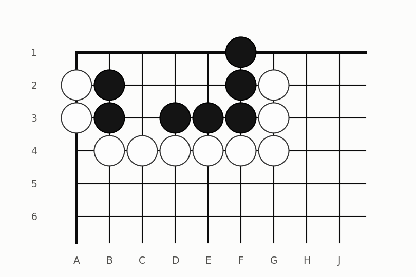</td><td style="border:1px solid #d0d7de; padding:3px 8px; text-align:center">C（D1）</td><td style="background-color:#ffebe9; border:1px solid #d0d7de; padding:3px 8px; text-align:center">D（D2）✗</td><td style="background-color:#ffebe9; border:1px solid #d0d7de; padding:3px 8px; text-align:center">A（C3）✗</td><td style="background-color:#ffebe9; border:1px solid #d0d7de; padding:3px 8px; text-align:center">D（D2）✗</td></tr>
<tr><td style="border:1px solid #d0d7de; padding:3px 8px; text-align:left"><b>42</b> 黑先杀白，要求净杀，不允许劫杀。十九路棋盘，从左到右A~T（不含I），从上到下1~19。</td><td style="border:1px solid #d0d7de; padding:3px 8px; text-align:center">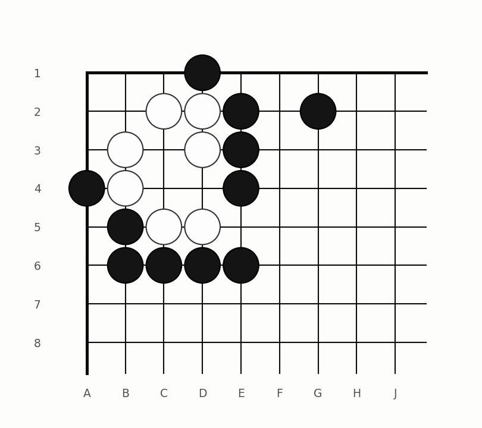</td><td style="border:1px solid #d0d7de; padding:3px 8px; text-align:center">D（B2）</td><td style="background-color:#ffebe9; border:1px solid #d0d7de; padding:3px 8px; text-align:center">A（D4）✗</td><td style="background-color:#ffebe9; border:1px solid #d0d7de; padding:3px 8px; text-align:center">A（D4）✗</td><td style="background-color:#ffebe9; border:1px solid #d0d7de; padding:3px 8px; text-align:center">A（D4）✗</td></tr>
<tr><td style="border:1px solid #d0d7de; padding:3px 8px; text-align:left"><b>43</b> 黑先杀白，要求净杀，不允许劫杀。十九路棋盘，从左到右A~T（不含I），从上到下1~19。</td><td style="border:1px solid #d0d7de; padding:3px 8px; text-align:center">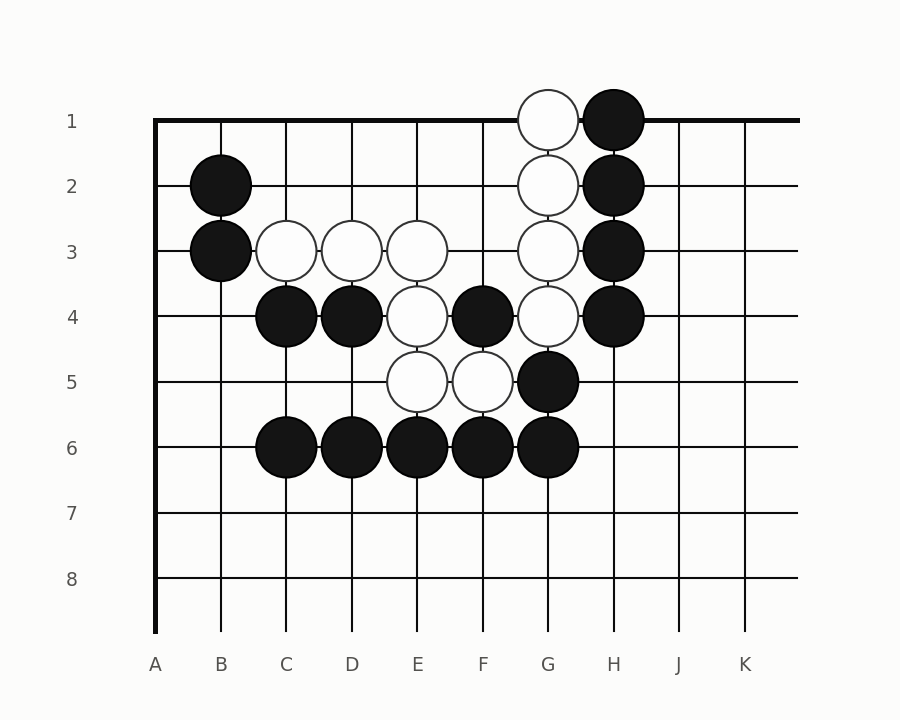</td><td style="border:1px solid #d0d7de; padding:3px 8px; text-align:center">E（都不对）</td><td style="background-color:#ffebe9; border:1px solid #d0d7de; padding:3px 8px; text-align:center">B（D1）✗</td><td style="background-color:#ffebe9; border:1px solid #d0d7de; padding:3px 8px; text-align:center">B（D1）✗</td><td style="background-color:#f6f8fa; border:1px solid #d0d7de; padding:3px 8px; text-align:center">空</td></tr>
<tr><td style="border:1px solid #d0d7de; padding:3px 8px; text-align:left"><b>44</b> 黑先做活，要求净活，不允许劫活。十九路棋盘，从左到右A~T（不含I），从上到下1~19。</td><td style="border:1px solid #d0d7de; padding:3px 8px; text-align:center">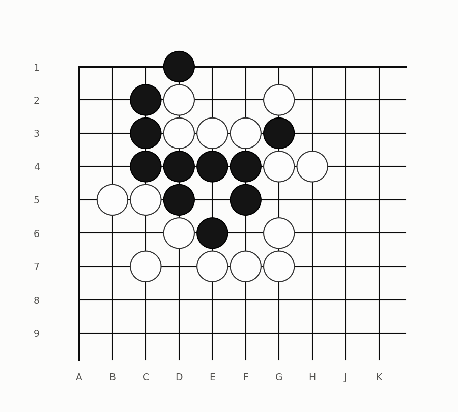</td><td style="border:1px solid #d0d7de; padding:3px 8px; text-align:center">B（A2）</td><td style="background-color:#ffebe9; border:1px solid #d0d7de; padding:3px 8px; text-align:center">A（B4）✗</td><td style="background-color:#ffebe9; border:1px solid #d0d7de; padding:3px 8px; text-align:center">A（B4）✗</td><td style="background-color:#ffebe9; border:1px solid #d0d7de; padding:3px 8px; text-align:center">C（A3）✗</td></tr>
<tr><td style="border:1px solid #d0d7de; padding:3px 8px; text-align:left"><b>45</b> 黑先做活，要求净活，不允许劫活。十九路棋盘，从左到右A~T（不含I），从上到下1~19。</td><td style="border:1px solid #d0d7de; padding:3px 8px; text-align:center">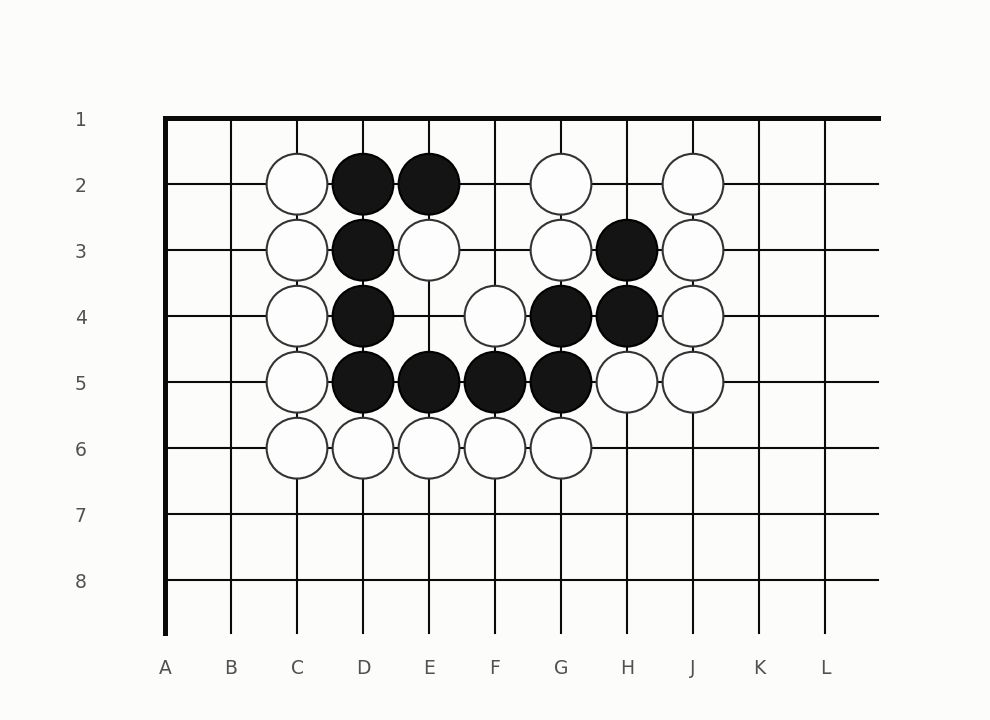</td><td style="border:1px solid #d0d7de; padding:3px 8px; text-align:center">D（H2）</td><td style="background-color:#ffebe9; border:1px solid #d0d7de; padding:3px 8px; text-align:center">A（E4）✗</td><td style="background-color:#e6ffec; border:1px solid #d0d7de; padding:3px 8px; text-align:center">D（H2）✓</td><td style="background-color:#e6ffec; border:1px solid #d0d7de; padding:3px 8px; text-align:center">D（H2）✓</td></tr>
<tr><td style="border:1px solid #d0d7de; padding:3px 8px; text-align:left"><b>46</b> 黑先杀白，要求净杀，不允许劫杀。十九路棋盘，从左到右A~T（不含I），从上到下1~19。</td><td style="border:1px solid #d0d7de; padding:3px 8px; text-align:center">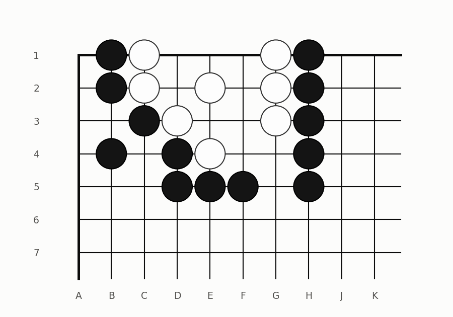</td><td style="border:1px solid #d0d7de; padding:3px 8px; text-align:center">C（E1）</td><td style="background-color:#ffebe9; border:1px solid #d0d7de; padding:3px 8px; text-align:center">A（F4）✗</td><td style="background-color:#ffebe9; border:1px solid #d0d7de; padding:3px 8px; text-align:center">D（D1）✗</td><td style="background-color:#ffebe9; border:1px solid #d0d7de; padding:3px 8px; text-align:center">A（F4）✗</td></tr>
<tr><td style="border:1px solid #d0d7de; padding:3px 8px; text-align:left"><b>47</b> 黑先，要求杀掉白▲子。要求净杀，不允许劫杀。十九路棋盘，从左到右A~T（不含I），从上到下1~19。</td><td style="border:1px solid #d0d7de; padding:3px 8px; text-align:center">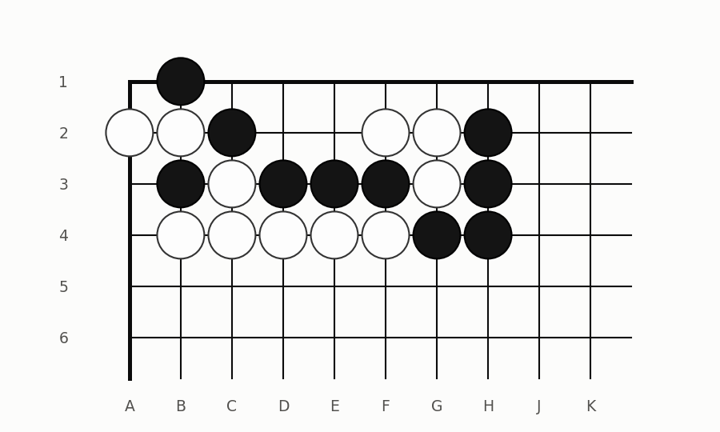</td><td style="border:1px solid #d0d7de; padding:3px 8px; text-align:center">D（E1）</td><td style="background-color:#ffebe9; border:1px solid #d0d7de; padding:3px 8px; text-align:center">C（D1）✗</td><td style="background-color:#ffebe9; border:1px solid #d0d7de; padding:3px 8px; text-align:center">A（E2）✗</td><td style="background-color:#ffebe9; border:1px solid #d0d7de; padding:3px 8px; text-align:center">B（D2）✗</td></tr>
<tr><td style="border:1px solid #d0d7de; padding:3px 8px; text-align:left"><b>48</b> 黑先杀白，要求净杀，不允许劫杀。十九路棋盘，从左到右A~T（不含I），从上到下1~19。</td><td style="border:1px solid #d0d7de; padding:3px 8px; text-align:center">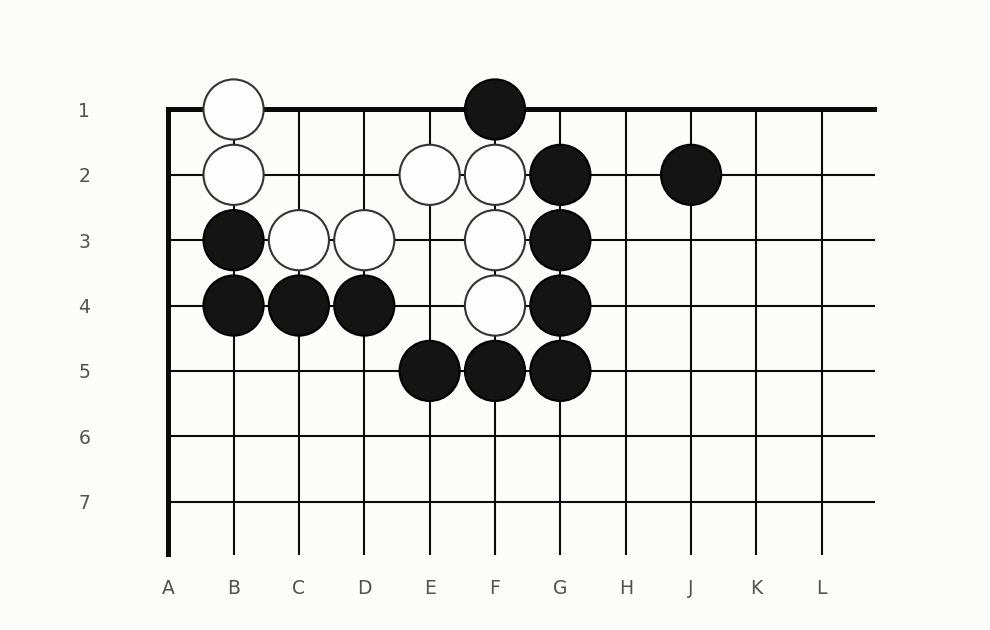</td><td style="border:1px solid #d0d7de; padding:3px 8px; text-align:center">A（D1）</td><td style="background-color:#ffebe9; border:1px solid #d0d7de; padding:3px 8px; text-align:center">C（E4）✗</td><td style="background-color:#ffebe9; border:1px solid #d0d7de; padding:3px 8px; text-align:center">B（E1）✗</td><td style="background-color:#e6ffec; border:1px solid #d0d7de; padding:3px 8px; text-align:center">A（D1）✓</td></tr>
<tr><td style="border:1px solid #d0d7de; padding:3px 8px; text-align:left"><b>49</b> 黑先做活，劫活即可。尽管劫活很容易，但此题要求黑棋的最优处理，做到先手缓气劫。十九路棋盘，从左到右A~T（不含I），从上到下1~19。</td><td style="border:1px solid #d0d7de; padding:3px 8px; text-align:center"></td><td style="border:1px solid #d0d7de; padding:3px 8px; text-align:center">C（B1）</td><td style="background-color:#ffebe9; border:1px solid #d0d7de; padding:3px 8px; text-align:center">B（C1）✗</td><td style="background-color:#ffebe9; border:1px solid #d0d7de; padding:3px 8px; text-align:center">B（C1）✗</td><td style="background-color:#e6ffec; border:1px solid #d0d7de; padding:3px 8px; text-align:center">C（B1）✓</td></tr>
<tr><td style="border:1px solid #d0d7de; padding:3px 8px; text-align:left"><b>50</b> 黑先做活，要求净活，不允许劫活。十九路棋盘，从左到右A~T（不含I），从上到下1~19。</td><td style="border:1px solid #d0d7de; padding:3px 8px; text-align:center"></td><td style="border:1px solid #d0d7de; padding:3px 8px; text-align:center">B（B2）</td><td style="background-color:#ffebe9; border:1px solid #d0d7de; padding:3px 8px; text-align:center">A（B3）✗</td><td style="background-color:#ffebe9; border:1px solid #d0d7de; padding:3px 8px; text-align:center">A（B3）✗</td><td style="background-color:#ffebe9; border:1px solid #d0d7de; padding:3px 8px; text-align:center">A（B3）✗</td></tr>
<tr><td style="border:1px solid #d0d7de; padding:3px 8px; text-align:left"><b>51</b> 黑先杀白，要求净杀，不允许劫杀。十九路棋盘，从左到右A~T（不含I），从上到下1~19。</td><td style="border:1px solid #d0d7de; padding:3px 8px; text-align:center"></td><td style="border:1px solid #d0d7de; padding:3px 8px; text-align:center">B（B1）</td><td style="background-color:#ffebe9; border:1px solid #d0d7de; padding:3px 8px; text-align:center">C（A2）✗</td><td style="background-color:#ffebe9; border:1px solid #d0d7de; padding:3px 8px; text-align:center">C（A2）✗</td><td style="background-color:#ffebe9; border:1px solid #d0d7de; padding:3px 8px; text-align:center">D（D2）✗</td></tr>
<tr><td style="border:1px solid #d0d7de; padding:3px 8px; text-align:left"><b>52</b> 黑先杀白，劫杀即可。十九路棋盘，从左到右A~T（不含I），从上到下1~19。</td><td style="border:1px solid #d0d7de; padding:3px 8px; text-align:center"></td><td style="border:1px solid #d0d7de; padding:3px 8px; text-align:center">B（F1）</td><td style="background-color:#ffebe9; border:1px solid #d0d7de; padding:3px 8px; text-align:center">A（G1）✗</td><td style="background-color:#ffebe9; border:1px solid #d0d7de; padding:3px 8px; text-align:center">C（F2）✗</td><td style="background-color:#ffebe9; border:1px solid #d0d7de; padding:3px 8px; text-align:center">A（G1）✗</td></tr>
<tr><td style="border:1px solid #d0d7de; padding:3px 8px; text-align:left"><b>53</b> 黑先做活，要求净活，不允许劫活。十九路棋盘，从左到右A~T（不含I），从上到下1~19。</td><td style="border:1px solid #d0d7de; padding:3px 8px; text-align:center"></td><td style="border:1px solid #d0d7de; padding:3px 8px; text-align:center">E（都不对）</td><td style="background-color:#ffebe9; border:1px solid #d0d7de; padding:3px 8px; text-align:center">A（E4）✗</td><td style="background-color:#ffebe9; border:1px solid #d0d7de; padding:3px 8px; text-align:center">A（E4）✗</td><td style="background-color:#e6ffec; border:1px solid #d0d7de; padding:3px 8px; text-align:center">E（都不对）✓</td></tr>
<tr><td style="border:1px solid #d0d7de; padding:3px 8px; text-align:left"><b>54</b> 黑先做活，要求净活，不允许劫活。十九路棋盘，从左到右A~T（不含I），从上到下1~19。</td><td style="border:1px solid #d0d7de; padding:3px 8px; text-align:center"></td><td style="border:1px solid #d0d7de; padding:3px 8px; text-align:center">A（E1）</td><td style="background-color:#ffebe9; border:1px solid #d0d7de; padding:3px 8px; text-align:center">B（F3）✗</td><td style="background-color:#ffebe9; border:1px solid #d0d7de; padding:3px 8px; text-align:center">D（A4）✗</td><td style="background-color:#ffebe9; border:1px solid #d0d7de; padding:3px 8px; text-align:center">E（都不对）✗</td></tr>
<tr><td style="border:1px solid #d0d7de; padding:3px 8px; text-align:left"><b>55</b> 黑先杀白，要求净杀，不允许劫杀。注意白棋外围有J3接应。十九路棋盘，从左到右A~T（不含I），从上到下1~19。</td><td style="border:1px solid #d0d7de; padding:3px 8px; text-align:center"></td><td style="border:1px solid #d0d7de; padding:3px 8px; text-align:center">D（F1）</td><td style="background-color:#ffebe9; border:1px solid #d0d7de; padding:3px 8px; text-align:center">A（G2）✗</td><td style="background-color:#e6ffec; border:1px solid #d0d7de; padding:3px 8px; text-align:center">D（F1）✓</td><td style="background-color:#ffebe9; border:1px solid #d0d7de; padding:3px 8px; text-align:center">E（都不对）✗</td></tr>
<tr><td style="border:1px solid #d0d7de; padding:3px 8px; text-align:left"><b>56</b> 黑先，要求杀掉白棋▲子，救回黑棋●子。十九路棋盘，从左到右A~T（不含I），从上到下1~19。</td><td style="border:1px solid #d0d7de; padding:3px 8px; text-align:center"></td><td style="border:1px solid #d0d7de; padding:3px 8px; text-align:center">C（G1）</td><td style="background-color:#ffebe9; border:1px solid #d0d7de; padding:3px 8px; text-align:center">A（C1）✗</td><td style="background-color:#ffebe9; border:1px solid #d0d7de; padding:3px 8px; text-align:center">A（C1）✗</td><td style="background-color:#ffebe9; border:1px solid #d0d7de; padding:3px 8px; text-align:center">A（C1）✗</td></tr>
<tr><td style="border:1px solid #d0d7de; padding:3px 8px; text-align:left"><b>57</b> 黑先杀白，要求净杀，不允许劫杀。十九路棋盘，从左到右A~T（不含I），从上到下1~19。</td><td style="border:1px solid #d0d7de; padding:3px 8px; text-align:center"></td><td style="border:1px solid #d0d7de; padding:3px 8px; text-align:center">E（都不对）</td><td style="background-color:#ffebe9; border:1px solid #d0d7de; padding:3px 8px; text-align:center">A（G2）✗</td><td style="background-color:#ffebe9; border:1px solid #d0d7de; padding:3px 8px; text-align:center">A（G2）✗</td><td style="background-color:#ffebe9; border:1px solid #d0d7de; padding:3px 8px; text-align:center">A（G2）✗</td></tr>
<tr><td style="border:1px solid #d0d7de; padding:3px 8px; text-align:left"><b>58</b> 黑先，如何救回被困的▲黑子，杀掉白棋●子？十九路棋盘，从左到右A~T（不含I），从上到下1~19。</td><td style="border:1px solid #d0d7de; padding:3px 8px; text-align:center"></td><td style="border:1px solid #d0d7de; padding:3px 8px; text-align:center">A（G1）</td><td style="background-color:#ffebe9; border:1px solid #d0d7de; padding:3px 8px; text-align:center">B（J2）✗</td><td style="background-color:#ffebe9; border:1px solid #d0d7de; padding:3px 8px; text-align:center">B（J2）✗</td><td style="background-color:#e6ffec; border:1px solid #d0d7de; padding:3px 8px; text-align:center">A（G1）✓</td></tr>
<tr><td style="border:1px solid #d0d7de; padding:3px 8px; text-align:left"><b>59</b> 黑先杀白，要求净杀，不允许劫杀。注意外围白棋有C6子接应。十九路棋盘，从左到右A~T（不含I），从上到下1~19。</td><td style="border:1px solid #d0d7de; padding:3px 8px; text-align:center"></td><td style="border:1px solid #d0d7de; padding:3px 8px; text-align:center">B（C1）</td><td style="background-color:#ffebe9; border:1px solid #d0d7de; padding:3px 8px; text-align:center">A（A3）✗</td><td style="background-color:#ffebe9; border:1px solid #d0d7de; padding:3px 8px; text-align:center">A（A3）✗</td><td style="background-color:#ffebe9; border:1px solid #d0d7de; padding:3px 8px; text-align:center">E（都不对）✗</td></tr>
<tr><td style="border:1px solid #d0d7de; padding:3px 8px; text-align:left"><b>60</b> 黑先杀白，要求净杀，不允许劫杀。十九路棋盘，从左到右A~T（不含I），从上到下1~19。</td><td style="border:1px solid #d0d7de; padding:3px 8px; text-align:center"></td><td style="border:1px solid #d0d7de; padding:3px 8px; text-align:center">B（E1）</td><td style="background-color:#e6ffec; border:1px solid #d0d7de; padding:3px 8px; text-align:center">B（E1）✓</td><td style="background-color:#ffebe9; border:1px solid #d0d7de; padding:3px 8px; text-align:center">D（G1）✗</td><td style="background-color:#ffebe9; border:1px solid #d0d7de; padding:3px 8px; text-align:center">E（都不对）✗</td></tr>
<tr><td style="border:1px solid #d0d7de; padding:3px 8px; text-align:left"><b>61</b> 黑先杀白，要求净杀，不允许劫杀。十九路棋盘，从左到右T~A（不含I），从上到下19~1。</td><td style="border:1px solid #d0d7de; padding:3px 8px; text-align:center"></td><td style="border:1px solid #d0d7de; padding:3px 8px; text-align:center">D（Q19）</td><td style="background-color:#ffebe9; border:1px solid #d0d7de; padding:3px 8px; text-align:center">A（P18）✗</td><td style="background-color:#e6ffec; border:1px solid #d0d7de; padding:3px 8px; text-align:center">D（Q19）✓</td><td style="background-color:#ffebe9; border:1px solid #d0d7de; padding:3px 8px; text-align:center">A（P18）✗</td></tr>
<tr><td style="border:1px solid #d0d7de; padding:3px 8px; text-align:left"><b>62</b> 原题为黑先杀白，然而此题前田陈尔出题有误，实际上无法杀白，白棋可以净活。本题因此改为黑棋收官，在此处谋取最大利益。十九路棋盘，从左到右A~T（不含I），从上到下1~19。</td><td style="border:1px solid #d0d7de; padding:3px 8px; text-align:center"></td><td style="border:1px solid #d0d7de; padding:3px 8px; text-align:center">D（E1）</td><td style="background-color:#ffebe9; border:1px solid #d0d7de; padding:3px 8px; text-align:center">B（E2）✗</td><td style="background-color:#ffebe9; border:1px solid #d0d7de; padding:3px 8px; text-align:center">A（F2）✗</td><td style="background-color:#ffebe9; border:1px solid #d0d7de; padding:3px 8px; text-align:center">A（F2）✗</td></tr>
<tr><td style="border:1px solid #d0d7de; padding:3px 8px; text-align:left"><b>63</b> 黑先杀白，要求净杀，不允许劫杀。十九路棋盘，从左到右T~A（不含I），从上到下19~1。</td><td style="border:1px solid #d0d7de; padding:3px 8px; text-align:center"></td><td style="border:1px solid #d0d7de; padding:3px 8px; text-align:center">E（都不对）</td><td style="background-color:#ffebe9; border:1px solid #d0d7de; padding:3px 8px; text-align:center">A（O19）✗</td><td style="background-color:#e6ffec; border:1px solid #d0d7de; padding:3px 8px; text-align:center">E（都不对）✓</td><td style="background-color:#ffebe9; border:1px solid #d0d7de; padding:3px 8px; text-align:center">C（Q17）✗</td></tr>
<tr><td style="border:1px solid #d0d7de; padding:3px 8px; text-align:left"><b>64</b> 黑先做活，劫活即可。十九路棋盘，从左到右A~T（不含I），从上到下1~19。</td><td style="border:1px solid #d0d7de; padding:3px 8px; text-align:center"></td><td style="border:1px solid #d0d7de; padding:3px 8px; text-align:center">E（都不对）</td><td style="background-color:#ffebe9; border:1px solid #d0d7de; padding:3px 8px; text-align:center">B（G2）✗</td><td style="background-color:#ffebe9; border:1px solid #d0d7de; padding:3px 8px; text-align:center">A（E3）✗</td><td style="background-color:#ffebe9; border:1px solid #d0d7de; padding:3px 8px; text-align:center">B（G2）✗</td></tr>
<tr><td style="border:1px solid #d0d7de; padding:3px 8px; text-align:left"><b>65</b> 黑先做活，要求净活，不允许劫活。十九路棋盘，从左到右T~A（不含I），从上到下19~1。</td><td style="border:1px solid #d0d7de; padding:3px 8px; text-align:center"></td><td style="border:1px solid #d0d7de; padding:3px 8px; text-align:center">E（都不对）</td><td style="background-color:#ffebe9; border:1px solid #d0d7de; padding:3px 8px; text-align:center">C（S17）✗</td><td style="background-color:#ffebe9; border:1px solid #d0d7de; padding:3px 8px; text-align:center">B（S19）✗</td><td style="background-color:#ffebe9; border:1px solid #d0d7de; padding:3px 8px; text-align:center">B（S19）✗</td></tr>
<tr><td style="border:1px solid #d0d7de; padding:3px 8px; text-align:left"><b>66</b> 黑先做活，要求净活，不允许劫活。十九路棋盘，从左到右A~T（不含I），从上到下1~19。</td><td style="border:1px solid #d0d7de; padding:3px 8px; text-align:center"></td><td style="border:1px solid #d0d7de; padding:3px 8px; text-align:center">C（A2）</td><td style="background-color:#ffebe9; border:1px solid #d0d7de; padding:3px 8px; text-align:center">B（E1）✗</td><td style="background-color:#ffebe9; border:1px solid #d0d7de; padding:3px 8px; text-align:center">E（都不对）✗</td><td style="background-color:#ffebe9; border:1px solid #d0d7de; padding:3px 8px; text-align:center">A（A3）✗</td></tr>
<tr><td style="border:1px solid #d0d7de; padding:3px 8px; text-align:left"><b>67</b> 黑先杀白，要求净杀，不允许劫杀。十九路棋盘，从左到右T~A（不含I），从上到下19~1。</td><td style="border:1px solid #d0d7de; padding:3px 8px; text-align:center"></td><td style="border:1px solid #d0d7de; padding:3px 8px; text-align:center">A（T18）</td><td style="background-color:#ffebe9; border:1px solid #d0d7de; padding:3px 8px; text-align:center">D（Q18）✗</td><td style="background-color:#ffebe9; border:1px solid #d0d7de; padding:3px 8px; text-align:center">D（Q18）✗</td><td style="background-color:#ffebe9; border:1px solid #d0d7de; padding:3px 8px; text-align:center">B（S18）✗</td></tr>
<tr><td style="border:1px solid #d0d7de; padding:3px 8px; text-align:left"><b>68</b> 黑先做活，劫活即可。十九路棋盘，从左到右T~A（不含I），从上到下19~1。</td><td style="border:1px solid #d0d7de; padding:3px 8px; text-align:center"></td><td style="border:1px solid #d0d7de; padding:3px 8px; text-align:center">B（R18）</td><td style="background-color:#ffebe9; border:1px solid #d0d7de; padding:3px 8px; text-align:center">A（P19）✗</td><td style="background-color:#ffebe9; border:1px solid #d0d7de; padding:3px 8px; text-align:center">A（P19）✗</td><td style="background-color:#ffebe9; border:1px solid #d0d7de; padding:3px 8px; text-align:center">C（S18）✗</td></tr>
<tr><td style="border:1px solid #d0d7de; padding:3px 8px; text-align:left"><b>69</b> 黑先杀白，要求净杀，不允许劫杀。十九路棋盘，从左到右T~A（不含I），从上到下19~1。</td><td style="border:1px solid #d0d7de; padding:3px 8px; text-align:center"></td><td style="border:1px solid #d0d7de; padding:3px 8px; text-align:center">A（P19）</td><td style="background-color:#e6ffec; border:1px solid #d0d7de; padding:3px 8px; text-align:center">A（P19）✓</td><td style="background-color:#ffebe9; border:1px solid #d0d7de; padding:3px 8px; text-align:center">B（P18）✗</td><td style="background-color:#ffebe9; border:1px solid #d0d7de; padding:3px 8px; text-align:center">D（Q19）✗</td></tr>
<tr><td style="border:1px solid #d0d7de; padding:3px 8px; text-align:left"><b>70</b> 黑先杀白，要求净杀，不允许劫杀。十九路棋盘，从左到右T~A（不含I），从上到下19~1。</td><td style="border:1px solid #d0d7de; padding:3px 8px; text-align:center"></td><td style="border:1px solid #d0d7de; padding:3px 8px; text-align:center">E（都不对）</td><td style="background-color:#ffebe9; border:1px solid #d0d7de; padding:3px 8px; text-align:center">C（P19）✗</td><td style="background-color:#ffebe9; border:1px solid #d0d7de; padding:3px 8px; text-align:center">D（P18）✗</td><td style="background-color:#ffebe9; border:1px solid #d0d7de; padding:3px 8px; text-align:center">B（Q18）✗</td></tr>
<tr><td style="border:1px solid #d0d7de; padding:3px 8px; text-align:left"><b>71</b> 黑先做活，劫活即可。十九路棋盘，从左到右A~T（不含I），从上到下1~19。</td><td style="border:1px solid #d0d7de; padding:3px 8px; text-align:center"></td><td style="border:1px solid #d0d7de; padding:3px 8px; text-align:center">C（G1）</td><td style="background-color:#ffebe9; border:1px solid #d0d7de; padding:3px 8px; text-align:center">B（D2）✗</td><td style="background-color:#ffebe9; border:1px solid #d0d7de; padding:3px 8px; text-align:center">B（D2）✗</td><td style="background-color:#ffebe9; border:1px solid #d0d7de; padding:3px 8px; text-align:center">D（D1）✗</td></tr>
<tr><td style="border:1px solid #d0d7de; padding:3px 8px; text-align:left"><b>72</b> 黑先杀白，要求净杀，不允许劫杀。注意外围有白▲子接应。十九路棋盘，从左到右A~T（不含I），从上到下1~19。</td><td style="border:1px solid #d0d7de; padding:3px 8px; text-align:center"></td><td style="border:1px solid #d0d7de; padding:3px 8px; text-align:center">D（F2）</td><td style="background-color:#ffebe9; border:1px solid #d0d7de; padding:3px 8px; text-align:center">C（E1）✗</td><td style="background-color:#ffebe9; border:1px solid #d0d7de; padding:3px 8px; text-align:center">C（E1）✗</td><td style="background-color:#e6ffec; border:1px solid #d0d7de; padding:3px 8px; text-align:center">D（F2）✓</td></tr>
<tr><td style="border:1px solid #d0d7de; padding:3px 8px; text-align:left"><b>73</b> 黑先杀白，要求净杀，不允许劫杀。十九路棋盘，从左到右A~T（不含I），从上到下1~19。</td><td style="border:1px solid #d0d7de; padding:3px 8px; text-align:center"></td><td style="border:1px solid #d0d7de; padding:3px 8px; text-align:center">E（都不对）</td><td style="background-color:#ffebe9; border:1px solid #d0d7de; padding:3px 8px; text-align:center">D（E1）✗</td><td style="background-color:#e6ffec; border:1px solid #d0d7de; padding:3px 8px; text-align:center">E（都不对）✓</td><td style="background-color:#ffebe9; border:1px solid #d0d7de; padding:3px 8px; text-align:center">D（E1）✗</td></tr>
<tr><td style="border:1px solid #d0d7de; padding:3px 8px; text-align:left"><b>74</b> 黑先做活，要求净活，不允许劫活。十九路棋盘，从左到右A~T（不含I），从上到下1~19。</td><td style="border:1px solid #d0d7de; padding:3px 8px; text-align:center"></td><td style="border:1px solid #d0d7de; padding:3px 8px; text-align:center">C（A2）</td><td style="background-color:#e6ffec; border:1px solid #d0d7de; padding:3px 8px; text-align:center">C（A2）✓</td><td style="background-color:#ffebe9; border:1px solid #d0d7de; padding:3px 8px; text-align:center">B（D1）✗</td><td style="background-color:#ffebe9; border:1px solid #d0d7de; padding:3px 8px; text-align:center">A（C1）✗</td></tr>
<tr><td style="border:1px solid #d0d7de; padding:3px 8px; text-align:left"><b>75</b> 黑先做活，要求净活，不允许劫活。十九路棋盘，从左到右T~A（不含I），从上到下19~1。</td><td style="border:1px solid #d0d7de; padding:3px 8px; text-align:center"></td><td style="border:1px solid #d0d7de; padding:3px 8px; text-align:center">A（O19）</td><td style="background-color:#ffebe9; border:1px solid #d0d7de; padding:3px 8px; text-align:center">D（Q18）✗</td><td style="background-color:#ffebe9; border:1px solid #d0d7de; padding:3px 8px; text-align:center">D（Q18）✗</td><td style="background-color:#ffebe9; border:1px solid #d0d7de; padding:3px 8px; text-align:center">D（Q18）✗</td></tr>
<tr><td style="border:1px solid #d0d7de; padding:3px 8px; text-align:left"><b>76</b> 黑先杀白，要求净杀，不允许劫杀。十九路棋盘，从左到右T~A（不含I），从上到下19~1。</td><td style="border:1px solid #d0d7de; padding:3px 8px; text-align:center"></td><td style="border:1px solid #d0d7de; padding:3px 8px; text-align:center">B（P19）</td><td style="background-color:#ffebe9; border:1px solid #d0d7de; padding:3px 8px; text-align:center">A（R16）✗</td><td style="background-color:#ffebe9; border:1px solid #d0d7de; padding:3px 8px; text-align:center">D（O17）✗</td><td style="background-color:#ffebe9; border:1px solid #d0d7de; padding:3px 8px; text-align:center">D（O17）✗</td></tr>
<tr><td style="border:1px solid #d0d7de; padding:3px 8px; text-align:left"><b>77</b> 黑先做活，劫活即可。十九路棋盘，从左到右A~T（不含I），从上到下1~19。</td><td style="border:1px solid #d0d7de; padding:3px 8px; text-align:center"></td><td style="border:1px solid #d0d7de; padding:3px 8px; text-align:center">D（B2）</td><td style="background-color:#e6ffec; border:1px solid #d0d7de; padding:3px 8px; text-align:center">D（B2）✓</td><td style="background-color:#e6ffec; border:1px solid #d0d7de; padding:3px 8px; text-align:center">D（B2）✓</td><td style="background-color:#ffebe9; border:1px solid #d0d7de; padding:3px 8px; text-align:center">B（A3）✗</td></tr>
<tr><td style="border:1px solid #d0d7de; padding:3px 8px; text-align:left"><b>78</b> 黑先杀白，要求净杀，不允许劫杀。十九路棋盘，从左到右T~A（不含I），从上到下19~1。</td><td style="border:1px solid #d0d7de; padding:3px 8px; text-align:center"></td><td style="border:1px solid #d0d7de; padding:3px 8px; text-align:center">C（R19）</td><td style="background-color:#ffebe9; border:1px solid #d0d7de; padding:3px 8px; text-align:center">B（N19）✗</td><td style="background-color:#ffebe9; border:1px solid #d0d7de; padding:3px 8px; text-align:center">B（N19）✗</td><td style="background-color:#ffebe9; border:1px solid #d0d7de; padding:3px 8px; text-align:center">B（N19）✗</td></tr>
<tr><td style="border:1px solid #d0d7de; padding:3px 8px; text-align:left"><b>79</b> 黑先杀白，要求净杀，不允许劫杀。注意外围白棋有▲子接应。十九路棋盘，从左到右1~19，从上到下A~T（不含I）。</td><td style="border:1px solid #d0d7de; padding:3px 8px; text-align:center"></td><td style="border:1px solid #d0d7de; padding:3px 8px; text-align:center">D（A2）</td><td style="background-color:#e6ffec; border:1px solid #d0d7de; padding:3px 8px; text-align:center">D（A2）✓</td><td style="background-color:#e6ffec; border:1px solid #d0d7de; padding:3px 8px; text-align:center">D（A2）✓</td><td style="background-color:#ffebe9; border:1px solid #d0d7de; padding:3px 8px; text-align:center">A（C3）✗</td></tr>
<tr><td style="border:1px solid #d0d7de; padding:3px 8px; text-align:left"><b>80</b> 黑先杀白，劫杀即可。十九路棋盘，从左到右A~T（不含I），从上到下1~19。</td><td style="border:1px solid #d0d7de; padding:3px 8px; text-align:center"></td><td style="border:1px solid #d0d7de; padding:3px 8px; text-align:center">E（都不对）</td><td style="background-color:#ffebe9; border:1px solid #d0d7de; padding:3px 8px; text-align:center">A（F1）✗</td><td style="background-color:#ffebe9; border:1px solid #d0d7de; padding:3px 8px; text-align:center">D（E3）✗</td><td style="background-color:#ffebe9; border:1px solid #d0d7de; padding:3px 8px; text-align:center">B（F2）✗</td></tr>
</tbody>
</table>

表格说明：每行含题目描述（第 1 行为完整题面；自第 2 行起「这是前田陈尔九段的《痛快》一书中的题目，」一句在表格中省略，完整题面见 `死活题.json`）、棋盘图片（boards/ 目录）、正解（含坐标），以及 Flash / Pro / Vision 三个模型的回答选项（字母与坐标）与是否正确（格底色：<span style="background-color:#e6ffec; padding:2px 8px; border:1px solid #d0d7de">对</span> <span style="background-color:#ffebe9; padding:2px 8px; border:1px solid #d0d7de">错</span> <span style="background-color:#f6f8fa; padding:2px 8px; border:1px solid #d0d7de">空 = 无答案</span>）。选项 E 即「以上选项都不对」。
